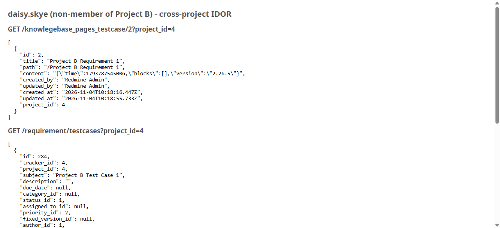

# Bug Report

- Bug ID: BUG-TCM-135
- Production Redmine Issue ID: #127713
- Title: Any authenticated user of ANY project can read another project's Requirement content, full testcase list, and member list via `knowlegebase_pages_testcase`, `requirement/testcases`, and `user_project`
- Redmine version: 6.0.11 (Docker, localhost:3000)
- Plugin name: Redmineflux Testcase Management
- Plugin version: branch `release/7.3.0`, commit `a67d393`
- Environment: Local Docker (Postgres)
- Browser: Chromium (Playwright) + `curl`
- User role: Developer on Project A (`rftc-016-ci-qa`) only, and separately Manager on Project A only — both with zero membership on Project B (`rftc-121640-project-b`)

## Steps to reproduce

1. Log in as any authenticated user who is a member of some OTHER project but has zero membership on Project B
   (`rftc-121640-project-b`, id=4) — reproduced independently with both `daisy.skye` (Developer on Project A only)
   and `luna.blossom` (Manager on Project A only, who additionally holds `edit_requirement`).
2. Request each of the following, substituting Project B's numeric id (`4`) and a real page/requirement id from
   it (`2`):
   - `GET /knowlegebase_pages_testcase/2?project_id=4`
   - `GET /requirement/testcases?project_id=4&limit=100`
   - `GET /user_project/4`

## Expected result

- Per ticket #121640 / finding TCM-09 ("Requirement read endpoints are scoped to the requirement's own (enabled +
  visible) project"): each should be refused for a non-member of Project B (the requirement's own project not
  being enabled/visible to this caller).

## Actual result

- All three return **HTTP 200** with real Project B data, to a caller with zero membership on Project B:
  - `GET /knowlegebase_pages_testcase/2?project_id=4` → full requirement record: `title: "Project B Requirement
    1"`, its full `content` JSON, `created_by`/`updated_by`, timestamps, `project_id`.
  - `GET /requirement/testcases?project_id=4&limit=100` → the full testcase/feature-tracker issue list of
    Project B, e.g. `{"id":284,...,"subject":"Project B Test Case 1","project_id":4,...}` with every field
    (status, priority, assignee, dates, done_ratio, etc.).
  - `GET /user_project/4` → Project B's member list (`[{"id":1,"name":"Redmine Admin"}]`).
- Confirmed this is NOT simply "any login bypasses auth" — a fully anonymous (no-session) request to all three of
  these exact URLs correctly returns `403` ("You are not authorized to perform this action."), consistent with
  the TCM-01/02/03/34 login-required fixes. The gap is specifically the per-project **membership/enabled-module**
  scoping check described by TCM-09 — it is missing for these 3 endpoints.
- The other 4 endpoints the same finding (TCM-09) names — `content_search_knowledgebase_testcase` (422, missing
  required `q` param in this probe, not independently re-tested with a valid query this round),
  `version_change_knowledgebase`, `version_data_knowledgebase`, `page_attachments` — all correctly returned `404`
  for the same non-member caller, so this fix is only partially applied, not entirely missing.
- Reproduced identically with two different non-member users holding different roles/permission sets (`daisy.skye`
  Developer, `luna.blossom` Manager), ruling out a role-specific quirk.
- Found while executing **TC-TCM-352** (`TESTCASE_MANAGEMENT_SECURITY_REVIEW_121640.md`, finding TCM-09).

## Evidence

### Screenshot

### Console / log

- `curl` (session cookie only, no special headers) against all three URLs as `daisy.skye`: all `200`, bodies
  contain real Project B records (see Actual result above for exact JSON).
- Anonymous `curl` (no cookie) against the same three URLs: all `403 {"error":"You are not authorized to perform
  this action."}` — confirms the gap is project-scoping, not missing login enforcement.

## Duplicate check

- Duplicate found: No
- Existing bug reference (if duplicate): N/A — checked `bugs/_duplicates.md` and `bugs/_index.md`; distinct from
  **BUG-TCM-134** (that one is `GET /runs/:id/edit` returning the wrong HTTP status while NOT leaking the run's
  own field data; this one is 3 different endpoints returning HTTP 200 WITH real cross-project data).

## Retest (2026-11-11, after `master` pull to commit `9785d2c`)

**CONFIRMED FIXED for the original data-leak scope.** Pulled latest `master` (`911b8fe` → `9785d2c`), restarted
`redmine6-redmine-1`, retested live as `daisy.skye` (Developer, Project A only) via a real logged-in Playwright
session:

- `GET /knowlegebase_pages_testcase/2?project_id=4` → **404 Not Found**. No requirement content, no title/content
  JSON, nothing of Project B's requirement leaked.
- `GET /requirement/testcases?project_id=4&limit=100` → **404 Not Found**, clean generic Redmine chrome (no
  Project B name anywhere, no testcase list).
- `GET /user_project/4` → **404 Not Found**, clean generic Redmine chrome, no member list.

All three endpoints now correctly refuse the non-member — the original data leak (requirement content, testcase
list, member list) is gone.

**New residual finding (minor, narrower than the original bug — not reopening this ticket for it):**
`GET /knowlegebase_pages_testcase/2?project_id=4` still leaks Project B's **project name and a working navigation
menu** into its own 404 page — page `<title>` reads `"404 - RFTC-121640 Security Project B - Redmine"`, and the
page's `<h1>` + project nav (Overview/Activity/Roadmap/Issues/.../Wiki/Files, all pointing at
`/projects/rftc-121640-project-b/...`) render fully, exactly the same information-disclosure pattern BUG-TCM-134
fixed for `/runs/:id/edit`. The other two endpoints (`requirement/testcases`, `user_project`) do **not** have this
leak — their 404 pages show generic, unscoped Redmine chrome. Likely cause: the controller sets `@project` (for
the layout) before the visibility check fails, same root shape as BUG-TCM-134's original bug, just not yet applied
to this one specific action. Tracked as a new, separate, minor finding — see **BUG-TCM-139**.
