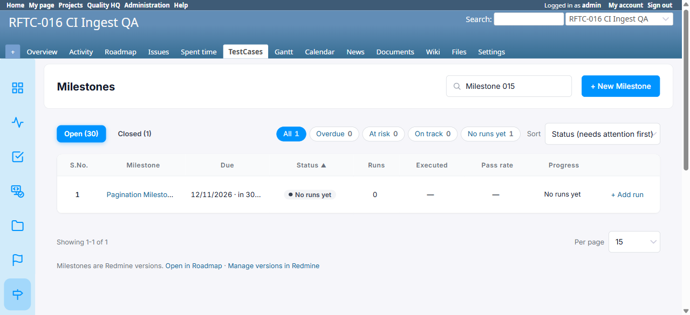
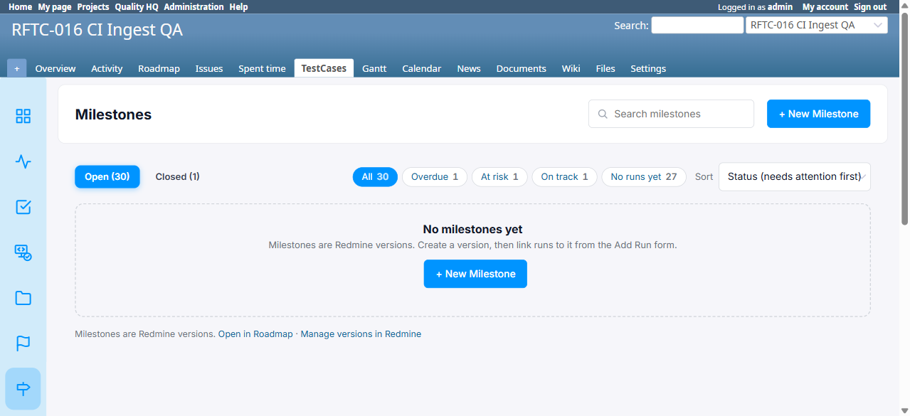
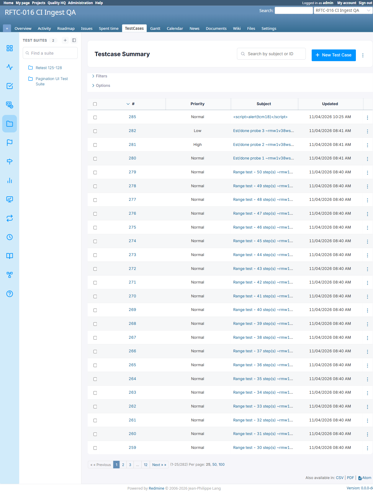
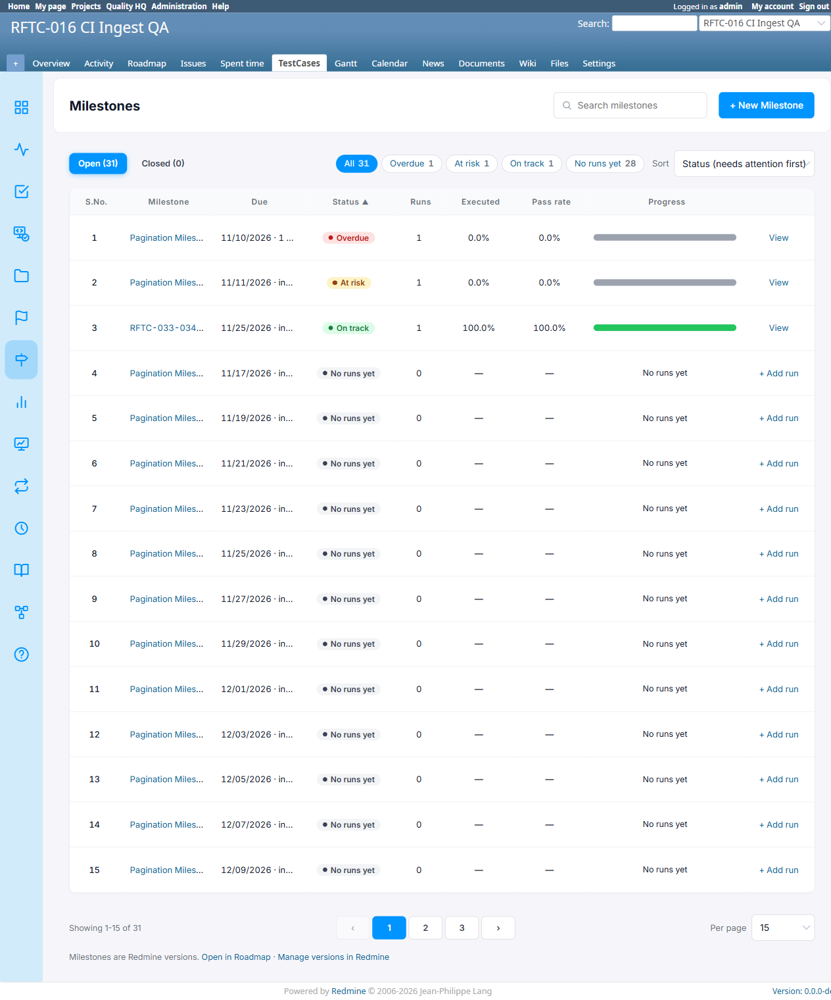
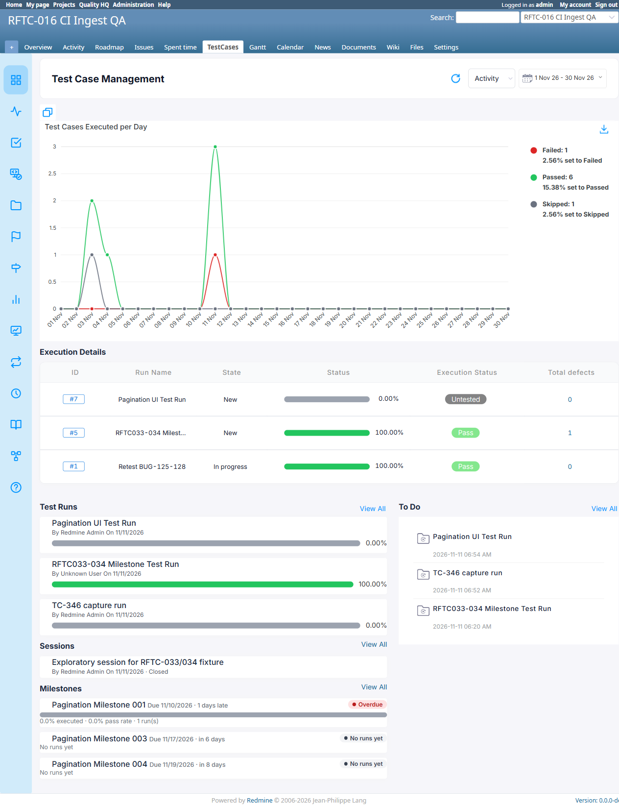
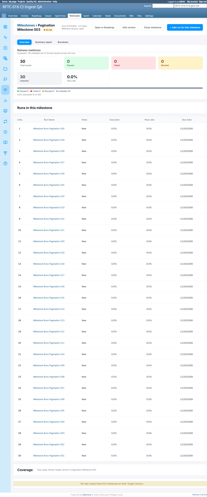
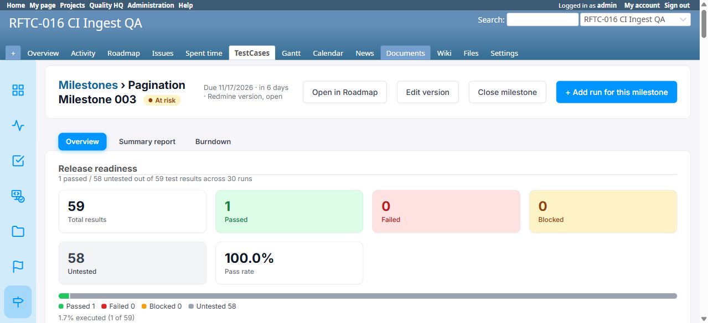
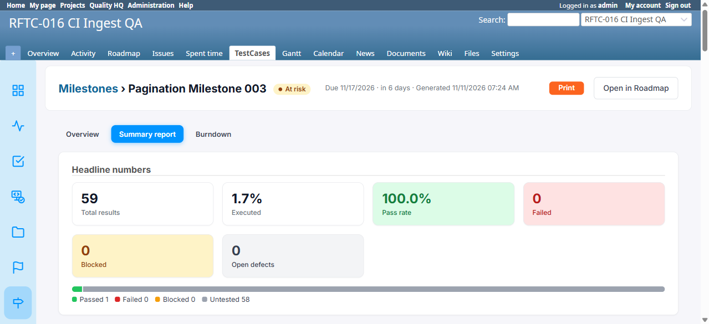

# Bug Report Template

- Bug ID: BUG-TCM-137
- Production Redmine Issue ID: #128023 (filed against RFTC033-12 / testcase #127987 in production Run #659, since item 7 Print-button directly fails that case's "clean, consistent" expectation; items 1-6 reported together in the same defect)
- Title: Milestones feature (Release 7.3.0) — 7 UI/UX consistency and correctness issues across list, overview and report pages
- Redmine version: 6.x (Docker, localhost:3000, Postgres)
- Plugin name: Redmineflux Testcase Management
- Plugin version: branch `release/7.3.0`/`master`, commit `60fa4ae` (Milestones feature, rftc-033/034, Release 7.3.0)
- Environment: Local QA Docker instance (redmine6-redmine-1), Project `rftc-016-ci-qa`
- Browser: Chromium (Playwright MCP)
- User role: Admin
- Date: 2026-11-11

## Steps to reproduce

Fixture: project with 30+ Milestones (Redmine Versions) and a milestone with 30 linked Runs (`Pagination Milestone
003` / version #16 used throughout). 7 independent issues found while testing the Milestones list, its Overview
widget, and the per-milestone detail pages:

**1. Open/Closed tab badge counts ignore the active search filter — Milestones list**
1. Go to a project's Milestones list (`/projects/:id/testcase_milestones`) with 30+ milestones.
2. Search for a term matching only 1 milestone (e.g. "Milestone 015") and submit.
3. Observe the "Open (N)" / "Closed (N)" tab badges vs. the "All N" status chip just below them.

**2. Out-of-range `page` param shows the wrong empty state — Milestones list**
1. On the same list (31 milestones, default 15/page → 3 pages), open `?page=4` directly (no page 4 exists).
2. Observe the main content area and the status chips above it.

**3. Milestones list pagination doesn't match the rest of the plugin's UI**
1. Compare the pagination control at the bottom of the Milestones list to the one at the bottom of the Test Cases
   list (`/test_suites?project_id=...`) or any other paginated list in this plugin.

**4. Milestones widget on the project Overview page uses a different card style than its sibling widgets**
1. Open `/test_suites/releases?project_id=...` (Test Case Management overview/dashboard page).
2. Compare the "Test Runs" / "Sessions" widget cards to the "Milestones" widget cards directly below them, on the
   same page.

**5. "Runs in this milestone" table has no pagination**
1. Open a milestone with 30 (or more) linked Runs — `/projects/:id/testcase_milestones/:id` (Overview tab).
2. Scroll to the "Runs in this milestone" table.

**6. Overview tab content has no spacing/margin below the tab bar (sibling tabs do)**
1. Open a milestone's detail page, stay on the default "Overview" tab.
2. Compare the gap between the tab row and the content below it, vs. the same gap on the "Summary report" tab.

**7. "Print" button doesn't match the plugin's standard button style**
1. Open a milestone's "Summary report" tab (`/projects/:id/testcase_milestones/:id/report`).
2. Compare the "Print" button to "Open in Roadmap" / "Edit version" / "Close milestone" buttons elsewhere on the
   same page and feature.

## Expected result

1. Tab badge counts should reflect the active search filter, or at least agree with the status chips on the same
   page.
2. An out-of-range page should clamp to the last valid page, or show a distinct "no results on this page" message
   — never the same "No milestones yet" (zero-ever-created) empty state used for a genuinely empty project, since
   the status chips above still correctly show the real non-zero total.
3. The Milestones list's pagination (page numbers, per-page selector, "showing" text) should visually match the
   classic Redmine-style pagination already used everywhere else in this plugin (Test Cases, Runs, etc.) — not a
   separate custom-built component.
4. The Milestones widget's cards should follow the same minimal pattern (title + byline + bar/percent) as the
   Test Runs and Sessions widgets directly above it on the same page, not add an extra status badge + stats line
   not present on its siblings.
5. The "Runs in this milestone" table should paginate (or at least cap + "View all" link) once a milestone has
   many linked runs, consistent with every other run-listing table in this plugin.
6. The Overview tab's content should have the same spacing/margin below the tab bar as the Summary report and
   Burndown tabs.
7. The Print button should use the plugin's standard button style (white background + border), like every other
   secondary action button on the same page, not a standalone solid-color style.

## Actual result

1. **Confirmed.** Searching to 1 result still shows "Open (31)" on the tab badge while the "All 1" status chip
   directly below correctly shows 1. Root cause: `TestcaseMilestonesController#index` computes
   `@open_count`/`@closed_count` from `all_versions` (before the `@search` filter), while `@status_counts` (status
   chips) is computed from `base` (after search + tab filtering) — two different scopes on the same page.
2. **Confirmed.** `?page=4` (when only 3 pages exist) renders 0 rows with **no** "Showing X-Y of Z" text and
   **no** "No milestones match" text — instead it shows "No milestones yet. Milestones are Redmine versions.
   Create a version, then link runs to it from the Add Run form." (the message meant for a project with zero
   milestones ever created), even though the status chips above still correctly show "All 31". Not reachable via
   normal clicking (filters/sort/search links never carry a stale `page` param), but directly reachable via a
   bookmarked/shared link if milestones are later closed or deleted, reducing the total page count.
3. **Confirmed.** Test Cases list: `« Previous | 1 2 3 ... 12 | Next » » | (1-25/282) | Per page: 25, 50, 100`
   (plain text links) + "Also available in: CSV | PDF | Atom". Milestones list: rounded pill-style number buttons,
   `‹`/`›` icon arrows, a `<select>` dropdown for per-page (10/15/25/50), "Showing X-Y of Z" wording, no export
   links — a completely separate, custom-built component.
4. **Confirmed.** "Test Runs"/"Sessions" cards: title + "By X On date" + a plain progress bar/percentage (or
   nothing, for a closed session) — minimal. "Milestones" cards: title + due-date text + a colored status
   **badge/pill** ("Overdue", "No runs yet") + bar + an **extra stats line** ("0.0% executed · 0.0% pass rate ·
   N run(s)") not present on either sibling widget on the same page.
5. **Confirmed.** With 30 runs linked to one milestone, "Runs in this milestone" renders all 30 rows on a single
   page with no "per page" control, no "Showing X of Y", and no cap — will grow unboundedly long for a milestone
   with hundreds of runs.
6. **Confirmed.** On the Overview tab, "Release readiness" starts immediately below the tab row inside the same
   white box (no visible gap). On Summary report / Burndown, there is a clear gray background gap between the tab
   row and the content card below it, which is a visually distinct, separated card.
7. **Confirmed.** The Print button renders as a solid orange/filled button, while every other button on the same
   page/feature ("Open in Roadmap", "Edit version", "Close milestone") uses a white background with a border.

## Evidence

### Screenshot

**1. Tab badge counts ignore the search filter** — searching "Milestone 015" (1 real match): "Open (30)" /
"Closed (1)" tab badges still show the full unfiltered totals, while "All 1" below correctly shows the filtered
count.

**2. Out-of-range page shows the wrong empty state** — `?page=4` (only 3 pages exist for 31 milestones): status
chips correctly show "All 30"/"Overdue 1"/"At risk 1"/"On track 1"/"No runs yet 27", but the content area wrongly
shows "No milestones yet... Create a version..." as if the project had zero milestones.

**3. Pagination style inconsistency** — Test Cases list (classic Redmine style, plain text links + CSV/PDF/Atom
export):

Milestones list (custom pill/dropdown component, bottom of page) — see the pagination row under "Showing 1-15 of
31" in the same screenshot used for item 4 below, and the dedicated capture:

**4. Overview-page widget inconsistency** — "Test Runs"/"Sessions" cards (minimal: title + byline + bar) vs.
"Milestones" cards (status badge pill + extra stats line), same page:

**5. "Runs in this milestone" table unpaginated** — all 30 linked runs rendered on one page, no pagination
control, no "Showing X of Y":

**6. Overview tab spacing** — Overview tab (content starts right at the tab-row boundary, no gap):

**6 & 7. Summary report tab** — for comparison, showing the correct spacing gap below the tab row AND the
inconsistent orange "Print" button style (vs. the white/bordered "Open in Roadmap" button next to it):

Reproducible directly against the `rftc-016-ci-qa` project using the steps above; the 30-run/30-milestone fixture
used for items 2, 3, 5 is this project's "Pagination Milestone 00X" versions and "Milestone Runs Pagination 0XX"
runs.

### Retest screenshot (fill after fix is verified)

N/A

### Console / log

- `app/controllers/testcase_milestones_controller.rb#index` — `@open_count`/`@closed_count` vs. `@status_counts`
  scope mismatch (item 1); pagination/empty-state branch for an out-of-range page (item 2).
- `app/views/testcase_milestones/index.html.erb` (or equivalent partial) — custom pagination component (item 3).
- `app/views/test_suites/releases.html.erb` (or equivalent overview/dashboard partial) — Milestones widget card
  markup vs. Test Runs/Sessions widget card markup (item 4).
- `app/views/testcase_milestones/show.html.erb` — "Runs in this milestone" table, no pagination (item 5).
- `app/views/testcase_milestones/show.html.erb` + shared tab-bar partial — Overview tab spacing (item 6).
- `app/views/testcase_milestones/report.html.erb` — Print button markup/class (item 7).

## Duplicate check

- Duplicate found: No
- Existing bug reference (if duplicate): N/A

## Retest (2026-11-11, after `master` pull to commit `9785d2c`)

**CONFIRMED FIXED — all 7 items**, re-verified live as admin on `rftc-016-ci-qa` (31+ milestones, milestone #16
"Pagination Milestone 003" with 30 linked runs):

1. **Tab badge counts follow the search filter**: `?q=Pagination+Milestone+015` → `Open (1)` / `Closed (0)`,
   matching the `All 1` status chip below. Unfiltered: `Open (33)` matches `All 33`.
2. **Out-of-range page clamps to the last valid page**: `?page=99` (only 2 pages exist for 33 milestones) →
   correctly shows page 2's real rows (`26-33/33`), not the "No milestones yet" empty state. Status chips above
   stayed correct throughout.
3. **Pagination now matches the plugin's classic style**: bottom of the list now shows `« « Previous | 1 | 2 |
   Next » »` + `(26-33/33)` + `Per page: 25, 50` — the same component used on Test Cases/Runs, not the old
   pill/dropdown widget.
4. **Milestones overview-page widget now matches its siblings**: screenshot confirms "Milestones" cards under
   Quality HQ / `test_suites/releases` now show the same minimal pattern as "Test Runs" (title + one grey due-
   date/status line, e.g. "Pagination Milestone 001 — Due 11/10/2026 · 1 days late · Overdue") — no more separate
   status-badge-pill + extra-stats-line style.
5. **"Runs in this milestone" table now paginates**: milestone #16 (30 linked runs) shows exactly 25 rows + a
   pager (`« « Previous 1 2 Next » »`, `(1-25/30)`, `Per page: 25, 50`) instead of all 30 unpaginated.
6. **Overview tab spacing now matches Summary report/Burndown**: screenshot confirms a clear visible gap between
   the tab row and the "Release readiness" content card, matching the other two tabs.
7. **Print button now uses the standard style**: computed styles confirm the Print button and "Open in Roadmap"
   button share the identical class (`rf-ms-btn rf-ms-btn-secondary`), background (`rgb(255,255,255)`), text color,
   and border — no longer the solid orange/filled button.

Developer's production comment (#128023) states all 7 are fixed on `master` (commit `9785d2c`) with new automated
tests — matches this session's independent live re-verification exactly, item for item.
