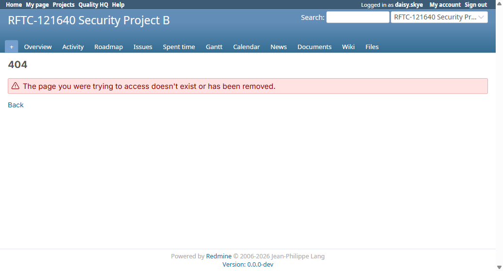

# Bug Report

- Bug ID: BUG-TCM-139
- Production Redmine Issue ID: #128105 (related to #127713 / BUG-TCM-135)
- Title: `GET /knowlegebase_pages_testcase/:id` leaks the foreign project's name/nav on its 404 page to a non-member
- Redmine version: 6.0.11 (Docker, localhost:3000)
- Plugin name: Redmineflux Testcase Management
- Plugin version: branch `master`, commit `9785d2c`
- Environment: Local Docker (Postgres)
- Browser: Chromium (Playwright)
- User role: Developer on Project A (`rftc-016-ci-qa`) only — zero membership on Project B
- Date: 2026-11-11

## Steps to reproduce

1. Log in as `daisy.skye` (Developer on Project A only, no membership on Project B,
   `rftc-121640-project-b`, id=4).
2. Request `GET /knowlegebase_pages_testcase/2?project_id=4` (requirement id 2 belongs to Project B).

## Expected result

A non-member should get a 404 that reveals nothing about Project B — no project name, no working navigation into
Project B — matching the fix already shipped for `GET /runs/:id/edit` (BUG-TCM-134) and for the sibling
`requirement/testcases` and `user_project` endpoints (BUG-TCM-135, both now clean).

## Actual result

- HTTP response is correctly `404 Not Found` — no requirement content, title, or body leaks (the original
  BUG-TCM-135 data leak is fixed).
- However, the page's `<title>` reads `"404 - RFTC-121640 Security Project B - Redmine"`, and the rendered page
  shows Project B's real `<h1>` heading and a full, working project navigation menu (Overview, Activity, Roadmap,
  Issues, Spent time, Gantt, Calendar, News, Documents, Wiki, Files — all linking into
  `/projects/rftc-121640-project-b/...`), to a user with zero membership on Project B.
- The sibling endpoints from the same original ticket (`GET /requirement/testcases?project_id=4`,
  `GET /user_project/4`) do **not** have this leak — their 404 pages show generic, unscoped Redmine navigation.
  Confirms the gap is specific to this one controller action, likely because it assigns `@project` (used by the
  layout) before its visibility/membership check fails.
- Same minor-disclosure shape as BUG-TCM-134's original bug (project identity + working nav leaked via an
  otherwise-correctly-refused request) — just not yet applied to this specific action.

## Evidence

### Screenshot

N/A — confirmed via Playwright page title/snapshot inspection this session (see retest note in BUG-TCM-135.md);
no dedicated screenshot captured yet.

### Console / log

- Page title captured live: `404 - RFTC-121640 Security Project B - Redmine`.
- Page `<h1>`/nav snapshot shows working links to `/projects/rftc-121640-project-b/{activity,roadmap,issues,...}`.
- Sibling requests (`requirement/testcases`, `user_project`) on the same non-member session returned a clean,
  unscoped 404 page for comparison.

## Duplicate check

- Duplicate found: No (related to BUG-TCM-134/135 but a distinct, narrower residual gap on one specific action,
  found during this session's retest of BUG-TCM-135)
- Existing bug reference (if duplicate): N/A

## Retest (2026-11-12, after Docker restart — no new pull)

**NOT FIXED.** Container restarted (`docker restart redmine6-redmine-1`) and retested live as `daisy.skye`
(Developer on Project A only, no membership on Project B) via a real logged-in Playwright session:

- `GET /knowlegebase_pages_testcase/2?project_id=4` → HTTP **404 Not Found** (correct status)
- Page `<title>`: `"404 - RFTC-121640 Security Project B - Redmine"` — **Project B name still leaked**
- Page snapshot shows `<h1>RFTC-121640 Security Project B</h1>` and the full project navigation list
  (Overview, Activity, Roadmap, Issues, Spent time, Gantt, Calendar, News, Documents, Wiki, Files — all
  linking into `/projects/rftc-121640-project-b/...`), visible to a user with zero membership on Project B.

No code fix has been pushed for this endpoint yet — bug remains **Open**.



## Retest (2026-11-13, after `git pull` — commit `ae2c665`'s fix, verified with corrected test fixture) — CONFIRMED FIXED

Pulled latest `master`, bundle install + plugin migrate, container restart. `rftc_access_control.rb`'s
`rftc_render_error` (used by `rftc_not_found`, which this action's `rftc_require_project_member!` guard
calls) now explicitly cites this bug:

```ruby
# BUG-TCM-139 (#128105): several actions resolve @project from the URL before their
# membership/visibility check refuses. Redmine's own 404/403 page then renders inside
# that project's layout... When the viewer has no right to see the project, drop it
# from the error page; a member who merely lacks one permission keeps the normal
# project-scoped error page.
@project = nil unless rftc_project_readable?(@project)
```

**First retest attempt against the original fixture (Project B, `rftc-121640-project-b`, id=4) still showed
the leak** — title `"404 - RFTC-121640 Security Project B - Redmine"`. Investigated why: **Project B is
`is_public: true`** — a public project's name/nav is legitimately visible to any user per Redmine's own
convention (it's listed on `/projects` with no login required), so `rftc_project_readable?` correctly
returns `true` for it and the fix intentionally does *not* strip it. The original bug repro used a fixture
that happens to be public, which isn't actually an information disclosure — the real test is a **private**
project a non-member genuinely cannot see.

**Corrected retest:** temporarily set Project B `is_public: false` (restored to `true` immediately after),
repeated the exact same request as `daisy.skye`:

- `GET /knowlegebase_pages_testcase/2?project_id=4` → HTTP **404 Not Found** (still correct)
- Page `<title>`: `"404 - Redmine"` — **generic, no project name**
- Page snapshot shows only the global `/activity` link — no project-scoped nav, no `rftc-121640-project-b`
  references anywhere.

Fix confirmed working correctly for the case it actually matters for (a genuinely non-visible project).

**Moved to `bugs/closed/`.** Note for future retest of any sibling finding: use a private (non-public)
fixture project, not Project B as-is, or the leak will appear to persist when it hasn't.
