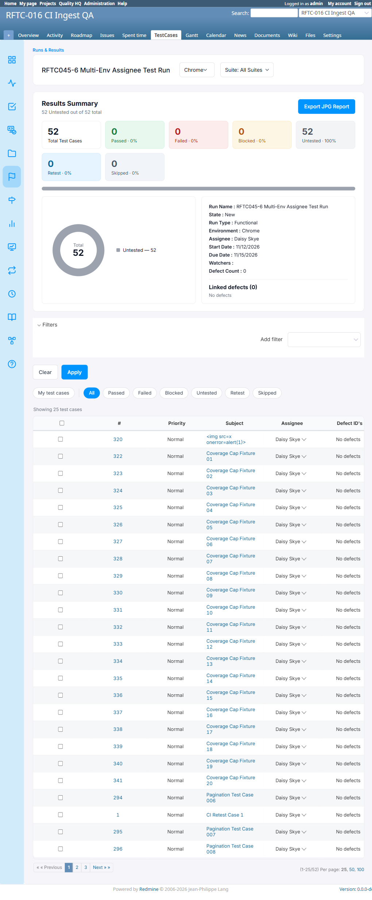
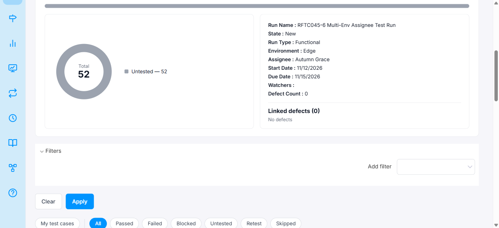
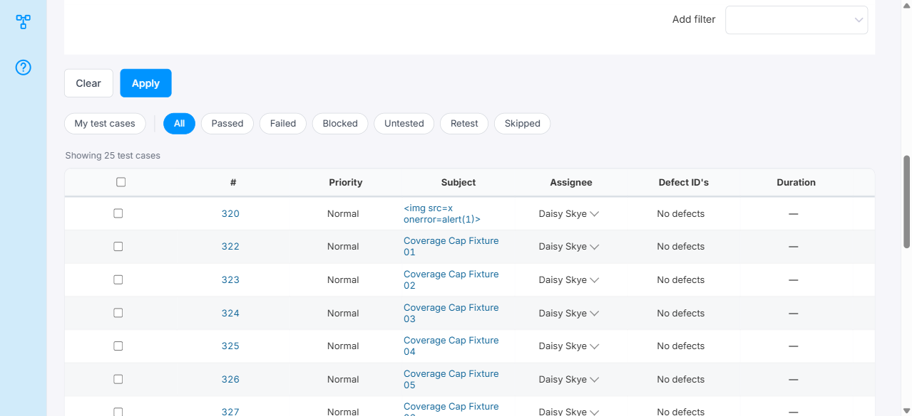

# Bug Report

- Bug ID: BUG-TCM-140
- Production Redmine Issue ID: #128233
- Title: Add Run form allows per-environment assignee selection but per-TC assignee column ignores it — same assignee shown on all environment tabs
- Redmine version: 6.0.11 (Docker)
- Plugin name: redmineflux_testcase_management
- Plugin version: master (Release 7.4.0)
- Environment: localhost:3000
- Browser: Chrome (admin)
- User role: Admin
- Date: 2026-11-12

## Steps to reproduce

1. Navigate to TestCases → Runs & Results → New Run for a project.
2. Add two environments (e.g. Chrome and Edge) using the "Add Assignment" button.
3. Set a **different** env-level assignee for each environment — e.g. Chrome → Daisy Skye, Edge → Autumn Grace.
4. Set the global `assignee_id` field (Release 7.4.0 per-TC default) to any user (e.g. Daisy Skye).
5. Create the run.
6. Open the run. Observe the TC table under the Chrome tab — note the "Assignee" column value.
7. Switch to the Edge tab using the environment dropdown.

## Expected result

- Under the Chrome tab, all TCs should show the Chrome env-level assignee (Daisy Skye) in the per-TC Assignee column.
- Under the Edge tab, all TCs should show the Edge env-level assignee (Autumn Grace) in the per-TC Assignee column.
- The Add Run form's per-environment assignee fields imply that each environment's TCs will carry that environment's assignee, which is what the client specifically requested ("har environment har testcase alag assignee").

## Actual result

- Under both Chrome and Edge tabs, all TCs show **Daisy Skye** in the per-TC Assignee column — only the first environment's assignee is used.
- The Edge env-level assignee (Autumn Grace) appears correctly in the **run summary** ("Assignee: Autumn Grace") when the Edge tab is active, but does **not** flow through to individual TC rows.
- The env-level assignee settings in the Add Run form have no per-environment effect on the per-TC Assignee column.

## Root cause (source-verified)

`run.rb` line 115–120 (`before_create :apply_default_case_assignee`):

```ruby
def apply_default_case_assignee
    default = run_assignments.map(&:assignee_id).compact.first  # ← only FIRST env's assignee
    return if default.blank?
    run_issues.each { |ri| ri.assignee_id = default if ri.assignee_id.blank? }
end
```

- On run creation, **only the first environment's assignee** is used as the per-TC default for all `RunIssue` records — regardless of how many environments are configured or which env's tab is currently viewed.
- Chrome → Daisy Skye is env index 0 (first) → all 52 TCs get Daisy Skye's ID written to `run_issues.assignee_id`.
- Edge → Autumn Grace is env index 1 — its assignee is **never read** by this method, so it has zero effect on TC-level assignment.
- The per-TC assignee is a **single shared value per (Run, TC)** stored in `run_issues.assignee_id`. There is no `run_issues.assignee_id_per_environment` or similar column — the data model itself does not support per-env TC assignment.

## Impact

- **UI is misleading in two ways:**
  1. The Add Run form allows setting different assignees per environment, implying per-environment TC assignment — but only the first env's assignee actually populates TC rows.
  2. Switching between Chrome and Edge tabs shows the same TC assignees, even though each env's summary header correctly shows its own env-level assignee.
- **Client's requirement unmet:** "har environment har testcase alag assignee" requires per-(Run, TC, Environment) assignment. The current data model and business logic only support per-(Run, TC) assignment shared across all environments.
- **Confirmed in scope (2026-11-12):** Per-environment TC assignment is a confirmed in-scope requirement. This is a real functional bug, not a design gap or enhancement request.
- **Fix scope:** Requires both a data model change (`run_issues` or `issue_status_results` needs an env-scoped assignee column) and UI/logic changes to `apply_default_case_assignee`, the reassign endpoint, and the TC table rendering per active environment tab.
- Found during RFTC045-6 (multi-env design check), Run #44, project `rftc-016-ci-qa`.

## Evidence

### Chrome tab — per-TC assignee = Daisy Skye


### Edge tab — run summary shows Autumn Grace (env-level correct) but TC column still shows Daisy Skye



### Retest screenshot (fill after fix is verified)


### Console / log

- No console errors — this is a data/logic issue, not a JS crash.

## Duplicate check

- Duplicate found: No
- Checked `bugs/_duplicates.md` — no existing bug for per-env assignee not flowing to TC column.

## Retest (2026-11-13, after `git pull` — commit `1699da6`) — STILL NOT FIXED

Pulled latest `master` (`1699da6`). Checked for the data model change this fix requires:

```ruby
ActiveRecord::Base.connection.table_exists?(:run_issue_assignments)  # => false
```

The `run_issue_assignments` table (per-(Run, Test Case, Environment) assignee) does not exist in this pull.
This bug has been converted into production enhancement ticket **[#128320](http://flux.zehntech.com/issues/128320)**
("Per-environment test case assignee inside a run"), currently **In QA, 90% done**, Target: Release 7.4.0
[13-11-2026] — but that feature's code has not landed on `master` yet. Test design for #128320 is already
written (`RFTC-045_EXTERNAL_SPEC_PER_RUN_TESTCASE_ASSIGNEE.md`, RFTC045-35 through RFTC045-52), pending a
build to execute against.

**Stays Open** until #128320 merges to `master` and RFTC045-35 (its direct regression check) passes.

## Retest #2 (2026-11-13, same day, after confirming #128320's actual code landed on `master` at commit `4e0170a`) — CONFIRMED FIXED

The earlier retest above checked commit `1699da6`, which turned out to still be one commit behind — #128320's code ("Each environment of a run can now have its own test case assignees") was on the `development` branch at that point, not yet on `master`. Re-verified with a real `git fetch origin master`: `master` is now at `4e0170a`, which includes it. Bundle install, plugin migrate (`CreateRunIssueAssignments`), container restart.

**Live retest on Run #44** (the original bug's own fixture — Chrome → Daisy Skye, Edge → Autumn Grace):
- Set Chrome tab's TC #323 assignee to Aurora Wren via inline reassignment — Edge tab for the same TC stayed "Daisy Skye" (unaffected).
- Set Edge tab's TC #323 assignee to Autumn Grace — Chrome tab for the same TC stayed "Aurora Wren" (unaffected).
- Created a brand-new Run (#48) via Add Run with Chrome → Daisy Skye, Edge → Autumn Grace: Chrome tab seeded all 54 TCs with Daisy Skye, Edge tab seeded all 54 TCs with Autumn Grace — **the exact scenario this bug originally reported (Edge showing Chrome's assignee) is now correct.**

**The core capability this bug reported missing — a test case carrying a genuinely different assignee per environment — now works.** Client's original requirement ("har environment har testcase alag assignee") is met.

**One important nuance, not a reason to keep this bug open:** test cases on *pre-existing* Runs (created before #128320, like Run #44's own untouched test cases) have no backfilled per-environment rows — per the feature's own documented design ("no backfill needed... existing Runs simply have no environment-specific rows yet, so they fall through to the existing per-TC value unchanged"), so they still show one shared value across every environment tab until someone explicitly reassigns them. That is expected, by-design behavior for legacy data, not a defect.

**A separate, newly-introduced regression was found while retesting Edit Run's per-environment assignee carry-over on this same Run #44 fixture — filed separately as BUG-TCM-145** (editing one environment's assignee via Edit Run can leak into every environment's untouched test cases, specifically on Runs — like this bug's own original fixture — whose test cases don't yet have explicit per-environment rows).

**Moved to `bugs/closed/`.**
