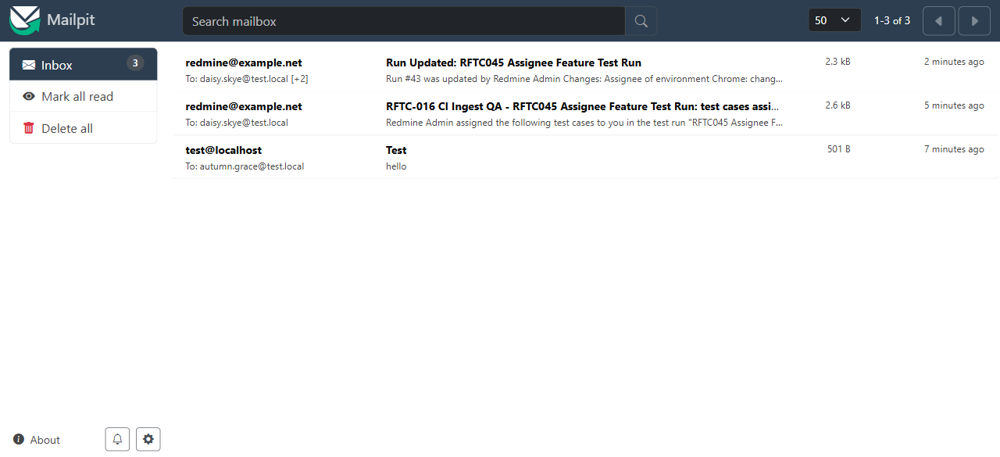

# Bug Report

- Bug ID: BUG-TCM-141
- Production Redmine Issue ID: #128234
- Title: Inline and bulk TC reassignment sends no email notification to the new assignee
- Redmine version: 6.0.11 (Docker)
- Plugin name: redmineflux_testcase_management
- Plugin version: master (Release 7.4.0)
- Environment: localhost:3000
- Browser: Chrome (admin)
- User role: Admin
- Date: 2026-11-12

## Steps to reproduce

1. Open any Run with at least one TC assigned to User A.
2. Reassign one or more TCs to User B — either via inline click (TC Assignee dropdown) or via bulk Reassign modal.
3. Check whether User B receives any email notification about the new assignment.

## Expected result

- User B (new assignee) should receive an email notification that test cases have been assigned to them in the run, so they know what testing work they are responsible for.
- This is consistent with how env-level assignee changes on Edit Run work: `RunMailer.run_updated` is called with `assignee_changes` data and an email is sent.

## Actual result

- **No email is sent** when TCs are reassigned via inline or bulk reassignment.
- The `reassign_testcases` controller action (runs_controller.rb line 876–895) updates `RunIssue.assignee_id` records and returns a JSON success response — but contains **no `RunMailer` call or any other notification mechanism**.
- The new assignee has no way to know they have been assigned testing responsibility unless they manually check the run.

## Root cause (source-verified)

`runs_controller.rb` line 876–895 (`reassign_testcases` action):

```ruby
def reassign_testcases
  ...
  count = RunIssue.reassign!(run: @run, issue_ids: in_run, assignee_id: assignee&.id)
  name = assignee ? assignee.name : l(:label_unassigned)
  render json: { count: count, assignee_id: assignee&.id, assignee_name: name,
                 message: l(:notice_testcases_reassigned, count: count, name: name) }, status: :ok
end
```

No `RunMailer` call. Compare with `update` action (line 591–596) which DOES send email on env-level assignee changes:

```ruby
RunMailer.run_updated(@run, User.current, environment_changes, assignee_changes, new_environments).deliver_later
```

## Comparison — email behavior by action

| Action | Email sent? |
|--------|------------|
| Run created (new assignees) | YES — `send_notification_on_create` after_commit |
| Edit Run — env-level assignee changed | YES — `RunMailer.run_updated` with `assignee_changes` |
| Inline TC reassign (`reassign_testcases`) | **NO** |
| Bulk TC reassign (`reassign_testcases`) | **NO** |

## Impact

- Assignees are silently given testing responsibilities with no notification.
- In a team environment with multiple environments and assignees (the exact use case Release 7.4.0 was built for), this means testers may miss their assigned work entirely.
- Severity: Medium — feature works correctly otherwise, but the notification gap makes it unreliable in production team workflows.

## Evidence

- Source read: `runs_controller.rb` lines 876–895 (no `RunMailer` call in `reassign_testcases`).
- Source read: `run.rb` lines 15 (`after_commit :send_notification_on_create`) and `runs_controller.rb` line 593 (`RunMailer.run_updated` on Edit Run).

### Retest screenshot (fill after fix is verified)


### Console / log

- No console errors — notification gap is a missing feature call, not a crash.

## Duplicate check

- Duplicate found: No
- Checked `bugs/_duplicates.md` — no existing bug for missing reassignment notification.

## Retest (2026-11-13, after `git pull` — commit `1699da6`) — CONFIRMED FIXED

Pulled latest `master` (`1699da6` "Email the new assignee on reassignment, and make Edit Run's assignee
reach the test cases"), bundle install + plugin migrate (no new migrations pending), container restart.

**Source confirms the fix:** `run_mailer.rb` now defines `testcases_reassigned(run, assignee, issues, actor)`,
and `reassign_testcases` in `runs_controller.rb` calls it after the reassignment. The method is guarded by
`return unless Setting.notified_events.include?('run_updated')` — this instance's notification settings
only had `issue_added`/`issue_updated` checked, so the first live attempt (inline-reassigned TC #323 to
Autumn Grace) sent no mail, matching the bug's original symptom. Enabled "Run updated" under
Administration → Settings → Notifications (a genuine pre-existing instance config gap, not a code defect),
retried: inline-reassigned TC #325 to Daisy Skye.

**Result: email delivered.** Mailpit captured `daisy.skye@test.local` — subject *"RFTC-016 CI Ingest QA -
RFTC045 Assignee Feature Test Run: test cases assigned to you"*, body *"Redmine Admin assigned the following
test cases to you in the test run... #325 — Coverage Cap Fixture 04. Open the run to see your test
cases..."* — confirming `testcases_reassigned` fires correctly on inline reassignment with the admin's
notification settings enabled.



**Moved to `bugs/closed/`.**
