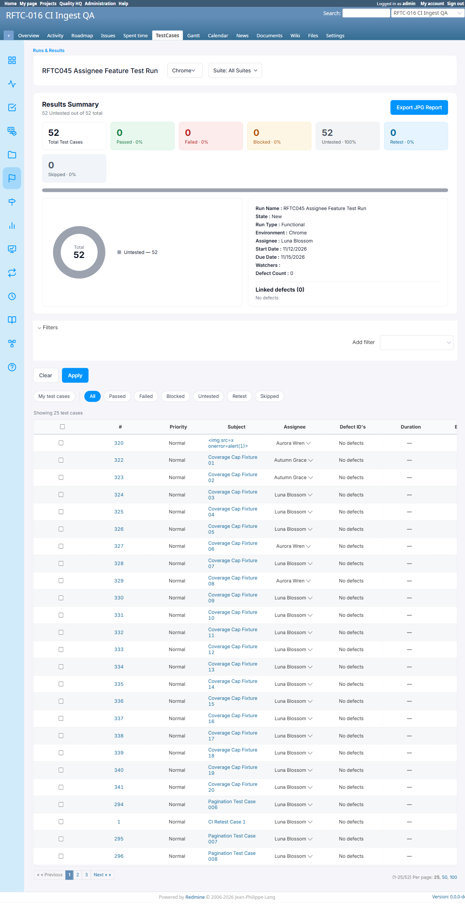

# Bug Report

- Bug ID: BUG-TCM-142
- Production Redmine Issue ID: #128235
- Title: Edit Run form assignee_id field updates Run record but does not cascade to per-TC assignees — misleading UX
- Redmine version: 6.0.11 (Docker)
- Plugin name: redmineflux_testcase_management
- Plugin version: master (Release 7.4.0)
- Environment: localhost:3000
- Browser: Chrome (admin)
- User role: Admin
- Date: 2026-11-12

## Steps to reproduce

1. Create a run with TCs auto-populated with Assignee A (via Add Run → env-level assignee → first env gets applied to all TCs via `apply_default_case_assignee`).
2. Navigate to Edit Run for that run.
3. In the Edit Run form, change the `assignee_id` field (the top-level run-level assignee selector) to Assignee B.
4. Submit the Edit Run form.
5. Return to the run's TC table and observe the per-TC Assignee column.

## Expected result

- After editing the run-level assignee to Assignee B, all TCs that previously had no explicit per-TC assignee, or all TCs if the form implies a default cascade, should update their per-TC Assignee to Assignee B.
- If the Edit Run form's assignee field controls the env-level default (not TC-level), that should be clearly communicated — the form currently presents the field identically to the Add Run form, which DOES populate TC rows at creation.

## Actual result

- The Edit Run form accepts and saves the `assignee_id` value to `Run.assignee_id` (the Run model record), but **per-TC assignees (RunIssue records) are NOT updated**.
- The TC table still shows Assignee A for all TCs — the Edit Run submit has zero effect on the per-TC Assignee column.
- The user expects parity with Add Run behavior (where setting an env-level assignee populates all TC rows), but Edit Run intentionally does not invoke `apply_default_case_assignee` (it is `before_create` only).

## Root cause (source-verified)

**run.rb:**
```ruby
before_create :apply_default_case_assignee  # ← before_create ONLY, never before_update
```

**runs_controller.rb line 571:**
```ruby
@run.assignee_id = params[:assignee_id] if params[:assignee_id].present?
```
This sets the Run model's `assignee_id` column but does NOT trigger `apply_default_case_assignee` (create-only), so RunIssue records are untouched.

**runs_controller.rb line 2066 (`update_params`):**
```ruby
# Top-level assignee_id is NOT in update_params permitted list —
# only run_assignments_attributes: [:id, :environment, :assignee_id, :_destroy]
```
So `params[:assignee_id]` on Edit Run goes through line 571 (a direct model assignment), not through the standard strong-params update path that would cascade.

**Net result:** Editing the run-level assignee on Edit Run form is a no-op for per-TC rows — it only updates `runs.assignee_id` column (the run record itself), which is not what the user intends.

## Impact

- **Misleading UX:** The Edit Run form's assignee field looks like it will update TC-level defaults (consistent with Add Run), but it has no effect on the per-TC Assignee column.
- **No feedback to user:** The form submits successfully with no error or warning that TC-level assignees were not changed.
- **Silent overwrite risk:** If a user opens Edit Run and accidentally changes the assignee field, they expect all TC assignees to update — but nothing happens. Conversely, if the field were made to work (cascade to RunIssue records), it would silently overwrite any manual inline/bulk reassignments already done inside the run.
- **Recommended fix:** Remove the `assignee_id` field from the Edit Run form entirely.
  - Reason: Bulk reassignment (available inside the run) is the correct and already-implemented tool for TC-level assignment. The Edit Run form has no safe behavior for this field — either it does nothing (current, misleading) or it mass-overwrites existing TC assignments (destructive).
  - Add Run can keep the field as a creation-time default, but only if it correctly cascades per-environment (see BUG-TCM-140).
- Severity: Medium — data integrity is not at risk, but users will be confused when Edit Run appears to have no effect on TC assignments.

## Evidence

- Source read: `run.rb` line 20 — `before_create :apply_default_case_assignee` (not `before_save`).
- Source read: `runs_controller.rb` line 571 — direct `@run.assignee_id = params[:assignee_id]` with no RunIssue cascade.
- Source read: `runs_controller.rb` line 2066 — `update_params` does not include top-level `assignee_id`.

### Retest screenshot (fill after fix is verified)


### Console / log

- No console errors — this is a logic gap, not a crash.

## Duplicate check

- Duplicate found: No
- Checked `bugs/_duplicates.md` — no existing bug for Edit Run assignee field not cascading to TC rows.
- Related to BUG-TCM-140 (Add Run per-env assignee not reflected in TC column) and BUG-TCM-141 (no email on TC reassignment) — all three are gaps in the Release 7.4.0 per-run TC assignee feature.

## Retest (2026-11-13, after `git pull` — commit `1699da6`) — CONFIRMED FIXED

Pulled latest `master` (`1699da6`, same commit as BUG-TCM-141's fix). `runs_controller.rb`'s `update` action
now carries the new default assignee over to test cases (comment cites this bug/#128235 directly):

```ruby
new_default_case_assignee = RunAssignment.where(run_id: @run.id).order(:id).pluck(:assignee_id).compact.first
if new_default_case_assignee.present? && new_default_case_assignee != previous_default_case_assignee
  RunIssue.where(run_id: @run.id, assignee_id: previous_default_case_assignee)
          .update_all(assignee_id: new_default_case_assignee)
end
# restore hand-set values the rebuild step may have wiped
previous_case_assignees.reject { |_iid, aid| aid == previous_default_case_assignee }
                       .group_by { |_iid, aid| aid }.each do |aid, pairs|
  RunIssue.where(run_id: @run.id, issue_id: pairs.map(&:first)).update_all(assignee_id: aid)
end
```

**Live retest on Run #43** (project `rftc-016-ci-qa`): before the edit, TC assignees were a mix — some
still at the run's original default (Daisy Skye), some hand-reassigned to Aurora Wren/Autumn Grace. Used
Edit Run (via the run list's Action → Edit Run popup — the edit form is a JS-injected fragment, not reachable
by navigating `/runs/:id/edit` directly) to change the Chrome environment's assignee from Daisy Skye to Luna
Blossom.

**Result:**
- Run summary header: `Assignee : Luna Blossom` — correct, as before.
- TCs that were still at the old default (Daisy Skye) — e.g. #324, #326, #328, #330–341, #294, #295, #296,
  #1 — **all cascaded to Luna Blossom.**
- TCs that were hand-set to a genuinely different value (#320, #322, #323, #327, #329 → Aurora
  Wren/Autumn Grace) — **kept their own hand-set value, not overwritten.**
- A bonus confirmation email ("Run Updated... Assignee of environment Chrome: changed from Daisy Skye to
  Luna Blossom") was sent to the run's watcher, via `RunMailer.run_updated` — same mailer BUG-TCM-141
  verified.

One inherent, documented limitation (not a defect): a TC manually reassigned to the *same* value the
default already held is indistinguishable from "never touched" — it will cascade on the next Edit Run save
like a default-following row would. The code comment says this plainly; no fix is possible without storing
an explicit "manually set" flag per TC, which isn't part of this feature's scope.



**Moved to `bugs/closed/`.**
