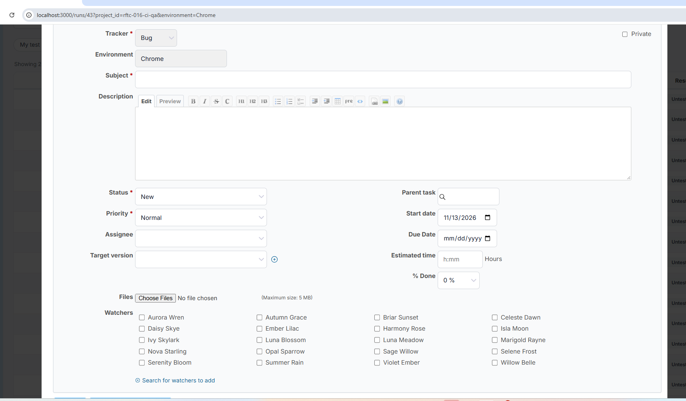
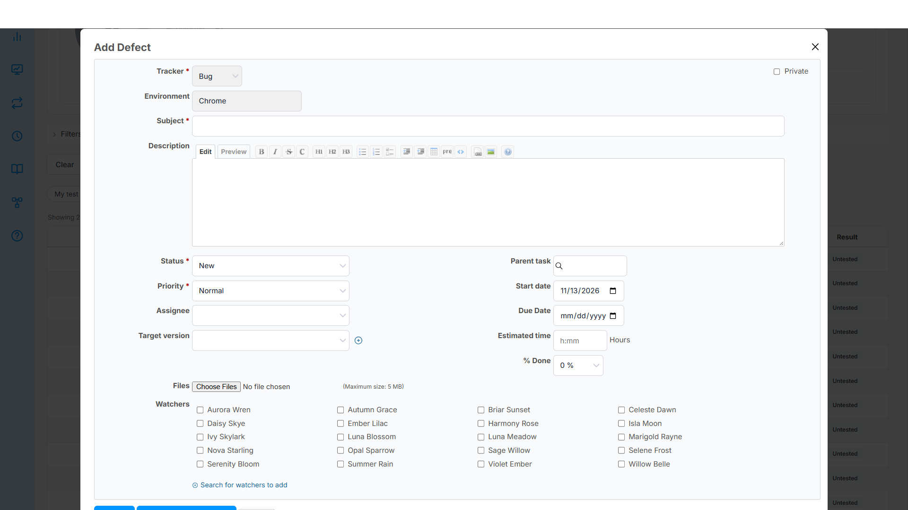
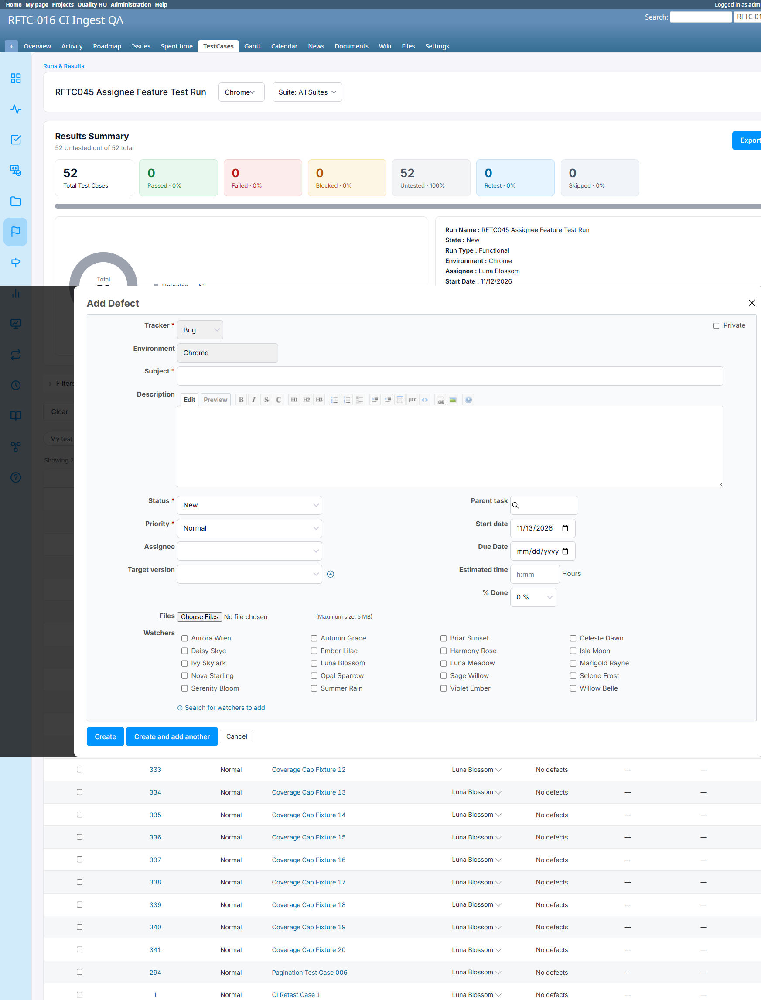
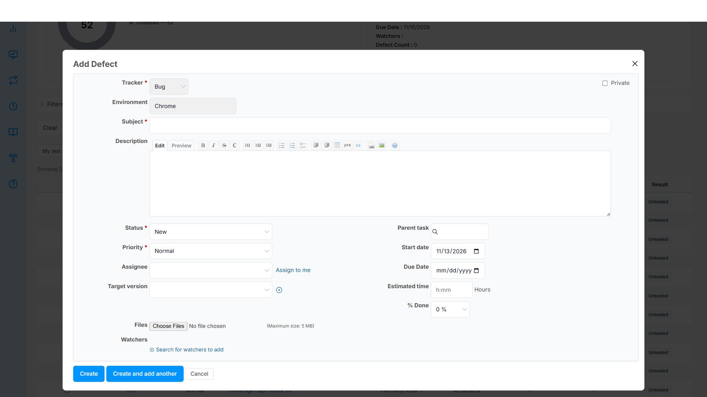

# Bug Report

- Bug ID: BUG-TCM-144
- Production Redmine Issue ID: #128386
- Title: "Add Defect" popup (from the Add Result modal's "Report Defect" link) has no working scroll — its Create/Cancel buttons become inaccessible on a normal 1920x1080 window
- Redmine version: 6.0.11 (Docker, localhost:3000)
- Plugin name: redmineflux_testcase_management
- Plugin version: master (commit `4e0170a`)
- Environment: localhost:3000
- Browser: Chrome (admin)
- User role: Admin

## Steps to reproduce

1. Set browser viewport to 1920x1080 (a standard desktop resolution).
2. Open any Run's Test Case table; click "Untested" (or any result link) on a TC to open the "Add Result" modal.
3. Set Status to "Failed" (or "Blocked").
4. Click the "Report Defect" link to open the "Add Defect" form (Tracker, Subject, Description, Status, Priority, Watchers, etc.).
5. Try to reach the "Create" / "Create and add another" / "Cancel" buttons at the bottom of the form, either by scrolling the page/modal with the mouse wheel, or simply by looking at what's visible without scrolling.

## Expected result

- The "Add Defect" form should fit inside a scrollable modal (or the page itself should scroll normally) so the Create/Cancel buttons are always reachable, regardless of window height.

## Actual result

- At 1920x1080, the bottom of the form (Create / Create and add another / Cancel buttons) sits right at or past the visible edge of the browser's actual content area — confirmed cut off / not visible in a real browser window (user-reported screenshot, address bar + tabs eating into the 1080px budget).
- **The background page cannot be scrolled with the mouse wheel while this form is open** — a real wheel event (`page.mouse.wheel`) was dispatched over the page and `window.scrollY` stayed at `0`. `document.documentElement` has `overflow: auto hidden` (vertical scroll blocked), which is the usual "lock background scroll while a modal is open" pattern.
- **The modal's own container never engages its scrollbar either**, even though it's supposed to: `.testcase-result-modal` has `max-height: 90%; overflow-y: auto`, but its `scrollHeight` (771px) equals its `clientHeight` (771px) — it does not think it has any overflow to scroll.
- The actual form content (`.div_testcase_area`, `overflow: visible`) renders **taller** than `.testcase-result-modal`'s own box (content bottom ~965px vs. modal's own bottom ~799px in this session) — the content visually spills out past the container that was supposed to scroll it, so neither the page nor the modal has any mechanism to bring the spilled-over buttons back into view.
- Net effect: on a window short enough that the full Add Defect form doesn't fit (any real browser at 1920x1080, not just a bare 1920x1080 Playwright viewport with zero browser chrome), the user has no reliable way to reach Create/Cancel with the mouse. (Keyboard Tab-navigation to the buttons, followed by Enter/Space, may still work as an unintended workaround — not verified as part of this report.)

## Root cause (source-verified via live DOM inspection)

- `html { overflow-y: hidden }` is applied while this modal is open (standard body-scroll-lock pattern) — confirmed via `getComputedStyle(document.documentElement).overflow` = `"auto hidden"`.
- The intended scroll container, `.testcase-result-modal` (`max-height: 90%; overflow-y: auto`), does not actually size itself to its own content — `scrollHeight === clientHeight` even though a descendant (`.div_testcase_area`) extends well past its bottom edge.
- `.div_testcase_area` (the element that actually holds the Add Result / Add Defect form content) has `overflow: visible` with no `max-height`, so it overflows its intended scrollable ancestor instead of being contained by it.
- This combination (background scroll locked + modal's own scroll never triggers + inner content escapes its container) is what leaves the bottom action buttons stranded outside any reachable scroll region.

## Impact

- A tester cannot complete the single most common action in this flow — filing a defect against a failed/blocked test result — without resizing the browser window, zooming out, or stumbling onto a keyboard-based workaround. This blocks a core QA workflow on a standard desktop resolution.
- Severity: High — not a cosmetic nit; it can make a primary action genuinely unreachable for a meaningful share of real-world window sizes (anything with less usable height than roughly 1000px after browser chrome, which includes most non-maximized windows and many laptop screens).

## Evidence

### Screenshot

### Retest screenshot (fill after fix is verified)

### Retest (2026-11-13) — FIXED

Developer fix commit `6b48030` pulled to `localhost:3000` and container restarted. `#modal-container` now has
`overflow-y:auto; align-items:flex-start` and `#modal-content` has `margin:auto`. At 1920x1080 the Add Defect
dialog fits fully, Create/Cancel both visible. At a constrained 1920x700 viewport (simulating real browser-chrome
overhead), the overlay's `scrollHeight` (843) genuinely exceeds `clientHeight` (636) and scrolling reveals the
Create button fully within the viewport (`top: 575, bottom: 615`, both inside `innerHeight: 636`).

Production issue #128386 updated: status In QA → Done, % done → 100.

### Console / log

- No console error — this is a layout/CSS defect, not a script crash.
- Verified via live DOM inspection (not just visual screenshot): `document.documentElement` overflow, `.testcase-result-modal` scrollHeight/clientHeight equality, and a dispatched real `mouse.wheel` event producing `window.scrollY === 0` both before and after.

## Duplicate check

- Duplicate found: No
- Checked `bugs/_duplicates.md` — no existing bug for the Add Defect / Add Result modal's scroll containment.
- Related to BUG-TCM-143 (same modal family, different symptom — Select2 search field width vs. this one's overall modal scroll containment) but a distinct root cause; not a duplicate.
