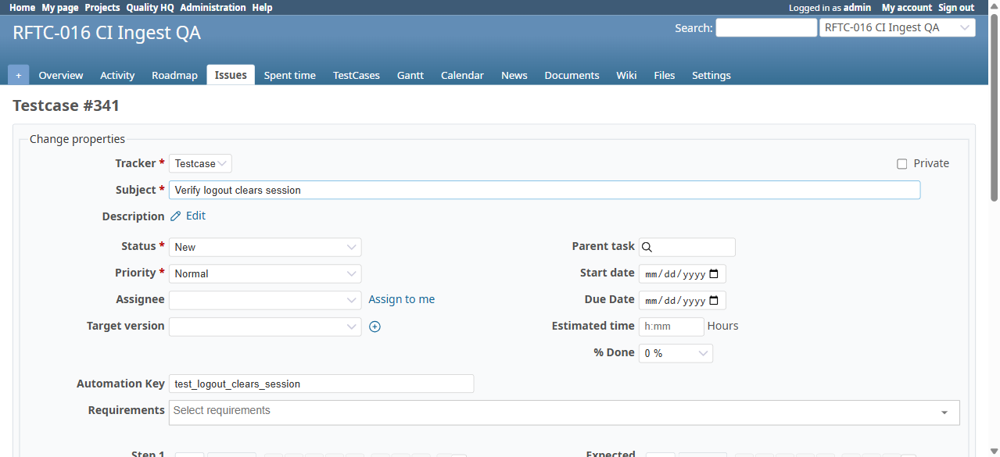
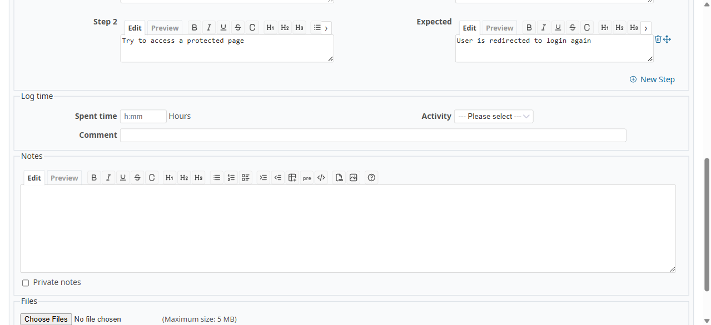
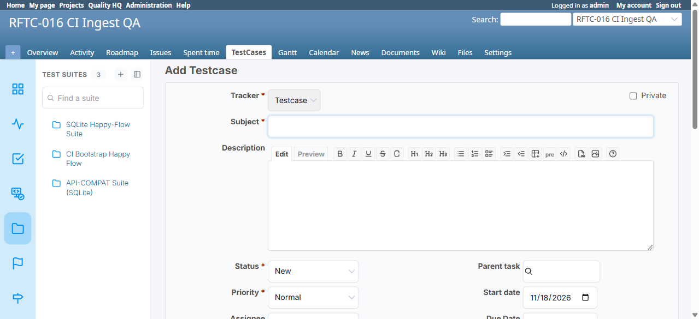
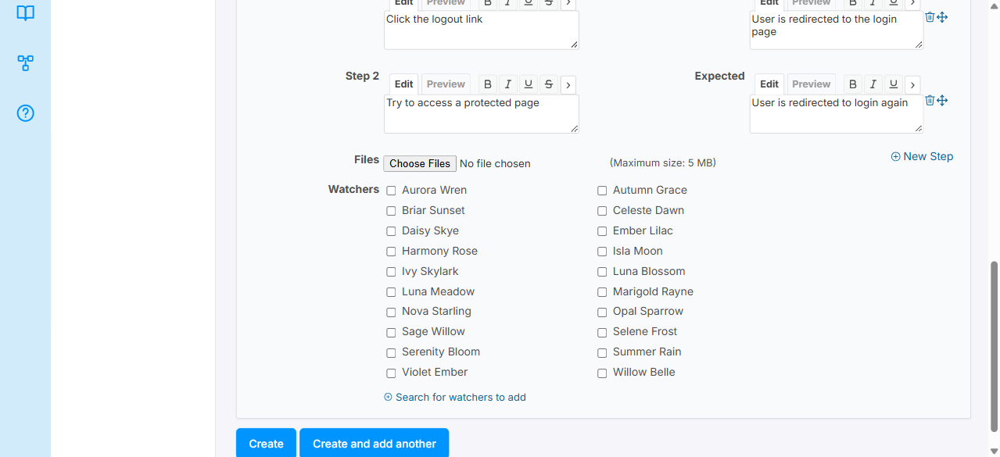

# Bug Report Template

- Bug ID: BUG-TCM-152
- Production Redmine Issue ID: #128944 (assigned to Vaishnavi Bhawsar, Priority: High)
- Title: New Testcase form's Steps editor restores stale content from a single global `localStorage['savedSteps']` key, silently persisting unrelated steps on a brand-new, unrelated test case
- Redmine version: 6.0 (official `redmine:6.0-bookworm` Docker image)
- Plugin name: redmineflux_testcase_management
- Plugin version: master, commit `92e446f`
- Environment: Docker `redmine6-happyflow-sqlite`, `localhost:3021`, SQLite3, project `rftc-016-ci-qa`
- Browser: Chromium (Playwright)
- User role: Admin
- Date: 2026-11-18

## Steps to reproduce

1. Open any test case's **Edit** page and interact with its Steps/Expected Result fields (e.g. open an
   existing test case that has real steps, like issue #341 "Verify logout clears session" with Step 1
   "Click the logout link" → "User is redirected to the login page").
2. Without submitting anything further, navigate to **New Test Case** (`/projects/<id>/issue_testcase/new`)
   for an entirely unrelated, brand-new test case — do not type anything into Subject or Steps.
3. Observe the Steps section on this fresh "Add Testcase" form before typing anything at all.
4. (Optional, confirms persistence) Fill only Subject + Automation Key, leave Steps untouched, click Create.
   Inspect the created issue's steps via `GET /get_testcase/<id>.json`.

## Expected result

- A brand-new "Add Testcase" form should start with an empty Steps section (one blank Step/Expected pair, or
  none) — it has no relationship to any other test case's content.

## Actual result

- The fresh "Add Testcase" form's Step 1 is **already pre-filled** with "Click the logout link" / "User is
  redirected to the login page" — content that belongs to a completely different, unrelated test case (#341)
  — before any typing or interaction on this new form at all.
- **Root cause confirmed via `localStorage`:** the Steps editor persists its entire working state to a single,
  globally-shared key, `localStorage['savedSteps']`, with no scoping by issue id, project, or form session:
  ```
  localStorage.getItem('savedSteps')
  => "[{\"step\":\"Click the logout link\",\"expected\":\"User is redirected to the login page\"},
       {\"step\":\"Try to access a protected page\",\"expected\":\"User is redirected to login again\"},
       {\"step\":\"\",\"expected\":\"\"}]"
  ```
  Every "Add Testcase" page load reads from this same global key and pre-fills the Steps section from
  whatever was last edited anywhere on the site, by anyone in that browser.
- **Confirmed this silently persists to the database, not just a visual artifact:** test case #344 (created
  with only a Subject and an Automation Key — no steps were ever manually typed for it) ended up with 2 real,
  DB-persisted step rows (`id: 4305`, `4306`) whose `step`/`expected` text is byte-for-byte identical to
  issue #341's own steps:
  ```
  GET /get_testcase/344.json → steps: [
    {"id":4305,"step":"Click the logout link","expected":"User is redirected to the login page"},
    {"id":4306,"step":"Try to access a protected page","expected":"User is redirected to login again"}
  ]
  GET /get_testcase/341.json → steps: [
    {"id":4303,"step":"Click the logout link","expected":"User is redirected to the login page"},
    {"id":4304,"step":"Try to access a protected page","expected":"User is redirected to login again"}
  ]
  ```
  (Different row ids — these are genuinely separate DB rows, not a shared reference — but with silently
  duplicated, wrong content.)
- **Ruled out as an automation_key-driven feature**: reproduced the exact same symptom via the raw
  `POST /create_testcase.json` REST API with a duplicate `Automation Key` value and explicitly NO
  `steps_and_results` in the payload — the API-created issue correctly has zero steps (`steps: []`). The
  leak is isolated entirely to the browser-side "Add Testcase" UI form's Steps editor component, not any
  server-side duplicate-key logic.

## Impact

- **Severity: High.** A QA engineer creating a new test case who doesn't happen to notice the Steps section
  is already filled in (easy to miss — it looks like legitimate content, not an empty placeholder) will
  silently ship a test case with **someone else's steps**, with no indication anything is wrong. This can
  happen to any new test case created after any other test case's Steps editor was touched anywhere in the
  same browser, by any user sharing that browser profile/session.
- Not specific to SQLite — this is a client-side JavaScript/localStorage bug, independent of the DB engine.
  Found incidentally during the SQLite leg of the happy-flow cross-DB pass while creating TC-TCM-367's own
  test fixture; very likely reproducible identically on PostgreSQL/MySQL since it's unrelated to persistence
  layer, but not independently re-confirmed on those two legs this session.

## Live Reproduction (2026-11-18, same session as discovery)

Re-reproduced end-to-end, cleanly, as a deliberate repro rather than an incidental discovery:

1. Opened #341's **Edit** page, scrolled to confirm its real Step 1/2 content, then navigated away via a
   plain "view issue" link — no form submitted, nothing saved, no deliberate interaction with the Steps
   editor beyond viewing it.
2. Navigated to a brand-new `/projects/rftc-016-ci-qa/issue_testcase/new` (no `testsuite_id`, no prior
   context) — confirmed Subject is empty.
3. **Scrolled to the Steps section before typing anything at all** — Step 1/2 were already filled with
   #341's exact content ("Click the logout link" → "User is redirected to the login page"; "Try to access a
   protected page" → "User is redirected to login again"). Screenshots below.
4. Typed **only** a Subject ("BUG-TCM-152 live repro: brand-new testcase, Steps never touched by me") —
   deliberately left the Steps section completely untouched — and clicked **Create**.
5. New issue **#355** created. `GET /get_testcase/355.json` confirms the DB genuinely persisted 2 step rows
   (`id: 4309, 4310`) with content byte-identical to #341's own steps, despite never being typed for #355.

```
GET /get_testcase/355.json →
"steps":[{"id":4309,"step":"Click the logout link","expected":"User is redirected to the login page"},
         {"id":4310,"step":"Try to access a protected page","expected":"User is redirected to login again"}]
```

## Evidence

### Screenshots






### Console / log

```
localStorage.getItem('savedSteps')
=> "[{\"step\":\"Click the logout link\",\"expected\":\"User is redirected to the login page\"},{\"step\":\"Try to access a protected page\",\"expected\":\"User is redirected to login again\"},{\"step\":\"\",\"expected\":\"\"}]"
```

## Retest — FIXED (2026-11-19)

Developer fix: commit `a6cb342` ("Stop a new test case from getting another test case's steps (BUG-TCM-152)"),
replacing the global `localStorage['savedSteps']` key with an in-memory `window.rftcStepsDraft` object scoped
to `{scope: 'new' | issue.id, steps: [...]}` — survives Redmine's own in-page form refresh but never persists
across page loads or different issues. The old `localStorage` key is actively removed on every page load so
stale data left by earlier plugin versions is never read again.

Pulled the fix into the shared plugin checkout (`C:\redmine v6\plugins\redmineflux_testcase_management`) and
restarted all three cross-DB happy-flow containers (SQLite/PostgreSQL/MySQL legs share this same mount).
Retested live on the SQLite leg (`localhost:3021`), repeating the exact original repro:

1. Opened #341's Edit page, confirmed its own Step 1 ("Click the logout link"), navigated away without saving.
2. Opened a brand-new `/projects/rftc-016-ci-qa/issue_testcase/new` form — Steps section genuinely empty, no
   pre-filled content. Confirmed via `localStorage.getItem('savedSteps')` → `null` (old key cleared).
3. Typed only a Subject and, after the server's own "Steps and expected result cannot be blank" validation
   forced at least one real step, typed a step with content clearly distinct from #341's own ("Retest step
   for BUG-TCM-152 fix verification"). Created issue **#396**.
4. `GET /get_testcase/396.json` → exactly 1 step, byte-for-byte what was typed — zero trace of #341's content.
5. Re-checked #341 itself (`GET /get_testcase/341.json`) — unaffected, still shows its own original 2 steps.

**Confirmed fixed, both directions, no regression.** Production issue **#128944** updated: In QA → **Done**,
% done → **100%** (approved by user, 2026-11-19).

## Duplicate check

- Duplicate found: No (checked `bugs/_duplicates.md` and `bugs/_index.md` — no prior entry about a
  `savedSteps`/localStorage/stale-step-content issue on the New Testcase form)
- Existing bug reference (if duplicate): —
