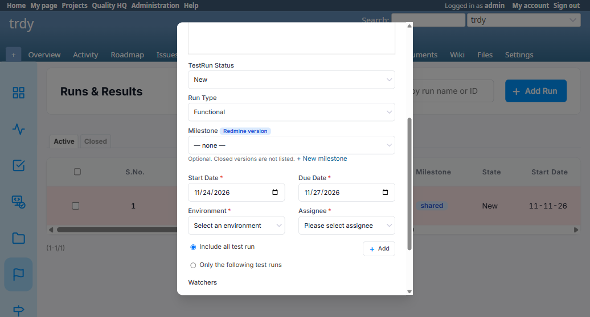
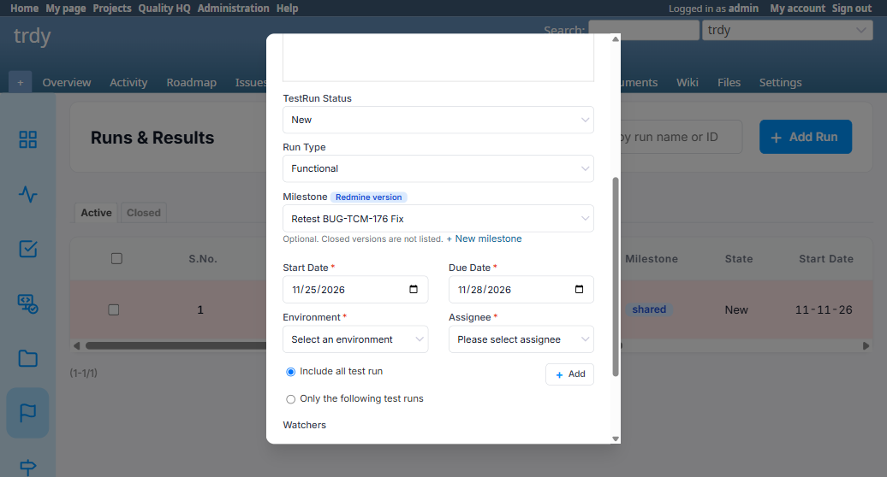
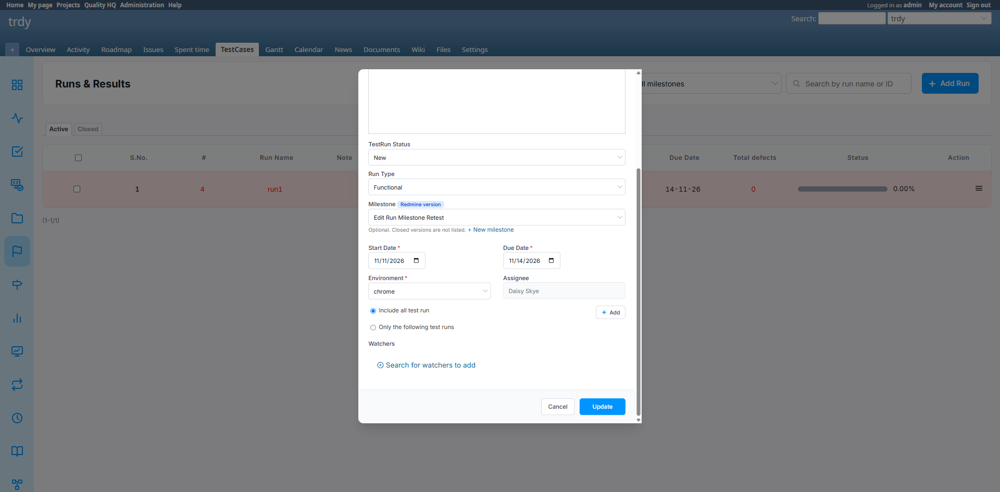

# BUG-TCM-176

- Bug ID: BUG-TCM-176
- Production Redmine Issue ID: #129335 (assigned: Vaishnavi Bhawsar)
- Severity: Medium — not a crash or data-integrity issue, but a required Version custom field permanently
  disables the plugin's own "quick create" milestone flow, with no way for the user to recover from the
  popup itself
- Title: Inline "+ New milestone" quick-create popup (inside the Add Run modal) has no way to satisfy a
  required Version custom field, so milestone creation from the popup is permanently blocked once one exists
- Redmine version: 6.0-bookworm
- Plugin name: Redmineflux Testcase Management
- Plugin version: dev build (`Version: 0.0.0-dev`)
- Environment: Docker `redmine6` (`localhost:3000`), project `trdy`
- Browser: Chromium (Playwright)
- User role: Administrator
- Date: 2026-11-24

## Steps to reproduce

1. As an admin, go to Administration → Custom fields → Versions → New custom field. Create any field (e.g.
   "QA Required Field", Text format) and check **Required**. Save.
2. Go to a project → Runs & Results → **Add Run**.
3. In the Add Run popup, next to the **Milestone** dropdown, click **"+ New milestone"**.
4. In the inline quick-create fields that appear (**Milestone name**, **Due date** only), enter a name and
   click **Create and select**.

## Expected result

- Either the quick-create popup should include the required custom field (consistent with the full
  `/projects/<id>/versions/new` page, which correctly renders it), or the Milestone dropdown's "+ New
  milestone" link should be hidden/disabled when the project has a required Version custom field, directing
  the user to the full version-creation page instead.

## Actual result

- The popup only ever offers **Milestone name** and **Due date** — no field for the required custom field.
- Submitting fails server-side (`POST /projects/trdy/testcase_milestones/quick_create` → 422), and the
  popup does render the validation message inline ("Qa required field cannot be blank") rather than failing
  silently — so this is not a silent-failure/crash bug.
- However, since the popup provides no way to actually enter the required field's value, the user is stuck:
  every submission from this popup will keep failing with the same message, for any input. The only way to
  create a milestone at all becomes the full `/projects/<id>/versions/new` page (reached via the main
  Milestones tab's "+ New Milestone" link), which correctly shows and accepts the required field. The
  Add-Run-modal quick-create path effectively becomes permanently dead once any plugin/project sets a
  required Version custom field.

## Evidence

### Screenshot



### Retest screenshot (2026-11-25 — FIXED)



### Retest screenshot — Edit Run follow-up (2026-11-25 — FIXED)



**Retest result: PASS.** Pulled fix commit `9434037` (`master`) into the `redmine6` plugin source
(`app/views/runs/_milestone_field.html.erb`, `app/controllers/testcase_milestones_controller.rb`,
`app/helpers/testcase_milestones_helper.rb`), restarted the `redmine6-redmine-1` container, and re-ran the
exact repro steps on `localhost:3000`, project `trdy`. The "+ New milestone" quick-create popup now shows
the "QA Required Field *" input alongside Milestone name/Due date. Submitted with the required field filled
("Retest BUG-TCM-176 Fix" / "retest-value") → milestone created successfully and auto-selected in the
Milestone dropdown, no console errors, no 422. Confirmed fixed per developer's commit `9434037`
("Let people create a milestone from the Add Run form when a Version field is required (BUG-TCM-176)").

**Follow-up finding (same day):** the Edit Run popup has its own separate instance of this same "+ New
milestone" link, and it initially did nothing at all when clicked (no quick-create box appeared) —
reported back to the developer rather than filed as a new bug, since it was clearly adjacent to this same
area. Developer fixed same day with commit `7d09303` ("Make the New milestone button work on the Edit Run
form", `app/views/runs/edit.js.erb`). Retested after pulling that commit and restarting the container:
**PASS** — the quick-create box (including the required custom field) now appears correctly from Edit Run
too, and a test milestone ("Edit Run Milestone Retest") was created and auto-selected successfully, no
console errors.

### Console / log

```
Failed to load resource: the server responded with a status of 422 (Unprocessable Content)
@ http://localhost:3000/projects/trdy/testcase_milestones/quick_create:1
```

## Duplicate check

- Duplicate found: No
- Existing bug reference (if duplicate): N/A — checked `bugs/_duplicates.md` and `bugs/_index.md`; no prior
  entry about the quick-create milestone popup or Version custom fields.
