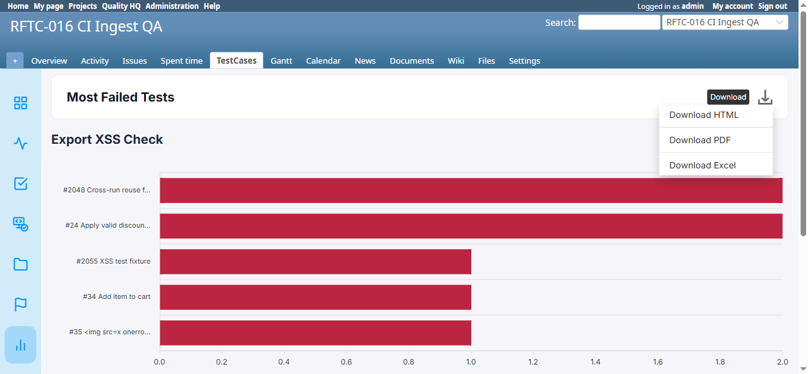

# BUG-TCM-071

- Bug ID: BUG-TCM-071
- Production Redmine Issue ID: #123986 (https://flux.zehntech.com/issues/123986) — assigned to Vaishnavi Bhawsar, priority High, Defect Type Functional / Defect Severity High-severity / Defect priority High. Linked to production Testcase #123984 ("Most Failed Tests report export formats: HTML, PDF and Excel") in Run #612, environment Win + Chrome + Ver6.
- Title: Most Failed Tests report's Excel export doesn't recognize the report type at all — produces a 5-row error sheet ("Unknown Report Type" / "The report type 'most_failed' is not recognized") instead of the ranked data, unlike the working HTML and PDF exports
- Redmine version: 6.x (Docker `localhost:3000`, Postgres)
- Plugin name: redmineflux_testcase_management
- Plugin version: master (post-7.1.0, pre-7.2.0 — rftc-016/017/020/021/038/042/043/044 merged)
- Environment: Docker `redmine6-redmine-1`, project `RFTC-016 CI Ingest QA` (id=2), report #13 "Export XSS Check" (type: Most Failed Tests)
- Browser: Chrome (via Playwright)
- User role: Admin
- Date: 2026-10-19

## Steps to reproduce

1. Create a report of type **Most Failed Tests** (e.g. "Include all test run"), confirm the on-screen page shows
   real ranked data (bar chart + table with Rank/Test Case/Failures/Executed/Failure Rate/Failing Runs columns).
2. Click the report's **Download** menu → **Download Excel** (`/testcase_reports/<id>/export_excel?project_id=<id>`).
3. Open the downloaded `.xlsx` file.
4. For comparison, also click **Download HTML** and **Download PDF** on the same report and open both.

## Expected result

The Excel file should contain the same ranked data as the on-screen report and the HTML/PDF exports: a header row
with the 6 columns (Rank, Test Case, Failures, Executed, Failure Rate, Failing Runs) and one data row per ranked
test case — the same export contract the Most Failed Tests feature's own "Download" menu advertises (this is not
an unannounced feature; the Download dropdown unconditionally offers HTML/PDF/Excel for every report type,
including Most Failed Tests).

## Actual result

**FAIL.** The downloaded `.xlsx` contains no ranked data at all — not even empty/wrong data, but an explicit
unsupported-type message. The entire worksheet is 5 cells:

```
A1: Testcase Summary
A2: Export XSS Check
A3: (empty)
A4: Unknown Report Type
A5: The report type 'most_failed' is not recognized.
```

(`Export XSS Check` is this report's name; `A1`'s "Testcase Summary" header is itself wrong — it's the generic
fallback sheet title, not anything related to Most Failed Tests.)

By contrast, **both Download HTML and Download PDF for the same report #13 work correctly** and contain the full
ranked data, including the test case whose subject is ` Remove item from
cart` (#35) — confirmed present and correctly HTML-escaped as inert text in the HTML export (`&lt;img
src=x onerror=alert('export-xss'...`, zero `<script>` tags in that file, the live page's `data-mostfailed`/
`JSON.parse`/ApexCharts re-render path that causes the separate chart-XSS bug (BUG-TCM-070) is entirely absent
from the HTML export — it is a static DOM snapshot, not a live re-render, so that specific vulnerability does not
propagate into the HTML export) and as plain, inert text in the PDF export (PDF viewers do not interpret HTML, so
the tag-shaped text is not a risk there either).

So specifically for **Excel**: the export path has evidently never been wired up for the `most_failed` report
type — this is a different and more severe failure mode than BUG-TCM-068 (Slow Tests' Excel export silently
produces empty/wrong data for a *recognized* type). Here the type isn't recognized at all.

## Root cause (inferred)

The report-type dispatch inside the Excel export code path (likely `app/controllers/testcase_reports_controller.rb#export_excel`
or a `report_type`-keyed builder it delegates to) has no case for `most_failed` (and, going by BUG-TCM-068, an
incomplete one for `slow_test`) — only the original report types (`testcase`, `summary`, `activity`,
`tester_scorecard`, `requirement`, `overdue_run`) were ever wired into the Excel exporter. The two rftc-020/021
report types were added to the on-screen `show` view and to the HTML/PDF export paths, but not to the Excel
exporter's type dispatch.

## Suggested fix

Add `most_failed` (and verify `slow_test`, per BUG-TCM-068) to whatever `case`/dispatch table the Excel exporter
uses to pick a data-builder method, using the same ranking query the `show` action and the HTML/PDF exports
already use, so all three export formats stay in sync for every report type the New Report form offers. Since
this plugin's Download menu offers HTML/PDF/Excel unconditionally for every report type, the exporter's type
coverage should be asserted against the full report-type list in one test, not per-type ad hoc — this exact gap
(a new report type shipping to 2 of 3 export formats and not the third) has now recurred once already in this
release (BUG-TCM-068).

## Evidence

### Exported Excel worksheet XML (`xl/worksheets/sheet1.xml`), full and unmodified

```xml
<row r="1"><c r="A1" t="inlineStr"><is><t>Testcase Summary</t></is></c></row>
<row r="2"><c r="A2" t="inlineStr"><is><t>Export XSS Check</t></is></c></row>
<row r="3"><c r="A3" t="inlineStr"><is><t></t></is></c></row>
<row r="4"><c r="A4" t="inlineStr"><is><t>Unknown Report Type</t></is></c></row>
<row r="5"><c r="A5" t="inlineStr"><is><t>The report type &#39;most_failed&#39; is not recognized.</t></is></c></row>
```

### Screenshot



## Duplicate check

- Duplicate found: No
- Checked `bugs/_index.md` and `bugs/_duplicates.md` — BUG-TCM-068 covers Excel export for the **Slow Tests**
  report type producing *wrong/empty* data for a recognized type; this bug covers the **Most Failed Tests** report
  type's Excel export not recognizing the type at all. Different report type, different failure mode (silent
  wrong data vs. explicit non-recognition) — not a duplicate, but likely the same class of gap (new rftc-020/021
  report types never wired into the Excel exporter), worth fixing together.
