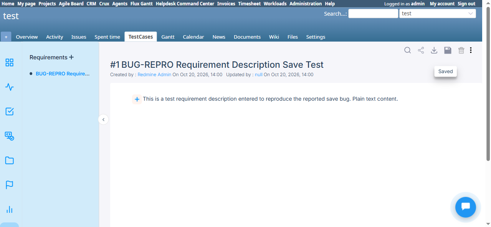
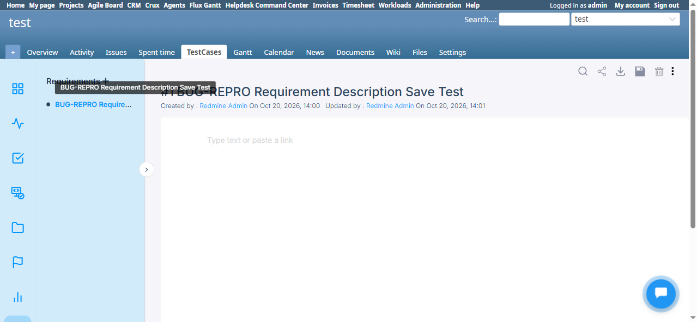
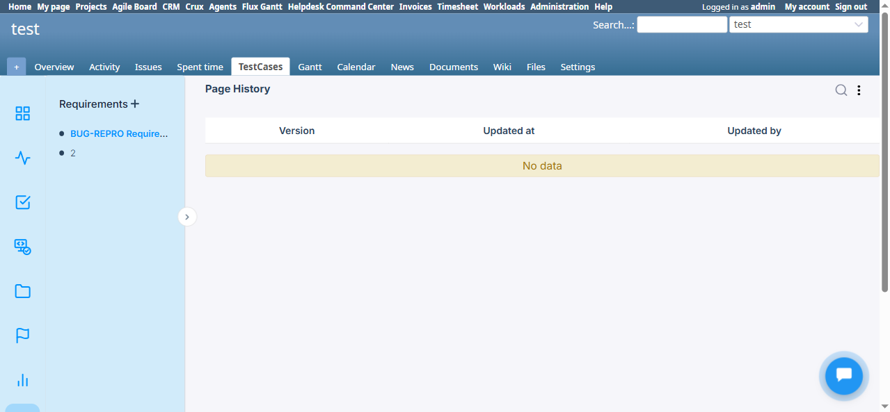

# BUG-TCM-074

- Bug ID: BUG-TCM-074
- Production Redmine Issue ID: #124053 (https://flux.zehntech.com/issues/124053) — created 2026-10-20, assigned to Vaishnavi Bhawsar, Priority Blocker, Defect Severity Critical, Defect priority Urgent, Defect Type Functional, standalone bug (no production Run/Testcase link)
- Title: Requirement content (description) is silently discarded on save — reload shows an empty editor even though "Updated by/at" changes and no Page History version is ever recorded
- Severity: Critical
- Redmine version: 6.x (Docker)
- Plugin name: Redmineflux Testcase Management
- Plugin version: 7.1.0
- Environment: Docker `localhost:3015` (`C:\crux-redmine`), project `test`
- Browser: Chromium (Playwright)
- User role: Administrator
- Date: 2026-10-20

## Summary

Customer-reported issue (via Tina, client environment) re-verified on a fresh 7.1.0 install: any content typed
into a Requirement's rich-text/EditorJS content area (`#page-content .ce-paragraph`) triggers the autosave ("Saved"
toast appears, and the requirement's "Updated by / Updated at" fields genuinely update), but the content is never
actually persisted. Reloading the Requirement page shows the editor back at its empty placeholder state
("Type text or paste a link"), as if nothing was ever typed.

This is not just a render/cache issue — `Page History` for the requirement shows **"No data"**, i.e. zero versions
were ever recorded for this page, even after a save that visibly updated the `updated_by`/`updated_at` metadata.
So the save request is firing and touching the requirement record, but the actual content payload is being
dropped before (or instead of) being written to whatever field/version the viewer reads back from.

Matches the customer's report exactly: "the requirement description is not being saved properly. Any description
content, including text, tables, or links, disappears after saving. The only information that is preserved
correctly is the reference to an attached file, if one is included. The requirement titles themselves are saved
correctly."

## Steps to reproduce

1. Log in as Administrator, open a project with the Redmineflux Testcase Management module + Testcase tracker
   enabled.
2. Go to **Requirement** (`/requirements?project_id=<id>`), create a new requirement (Title only — the creation
   modal has no description field).
3. Open the created requirement. Click into its content area and type any plain text (no formatting needed).
4. Observe the "Saved" toast appear, and `Updated by` / `Updated at` change to the current user/time.
5. Reload the page (`/requirements?project_id=<id>&page_id=<n>`).
6. Open the requirement's **Page History** (vertical-dot menu → Page History).

## Expected result

- The typed content should still be visible in the requirement's content area after reload.
- Page History should show at least one version for the save that just happened.

## Actual result

- Step 5: content area is back to the empty placeholder "Type text or paste a link" — the typed text is gone.
- Step 6: Page History table shows **"No data"** — zero versions recorded, despite the requirement's own
  `Updated by`/`Updated at` fields showing the save did happen.
- The requirement Title (set at creation) is retained correctly — only the body content is lost.

## Evidence

### Screenshot

## Test case coverage

Found while live-retesting the customer-reported issue (Tina, client environment) against the plugin zip the
customer was given for 7.1.0, mounted at `C:\crux-redmine\plugins\redmineflux_testcase_management` and run via the
`C:\crux-redmine` Docker stack. Not yet mapped to an existing automation TC — Requirement content-save round-trip
is not currently covered in `testcases/`; should be added once this is fixed (Traceability Matrix gap).

## Related customer report (second symptom — NOT reproduced here)

The same customer report also describes a server error when creating a Test Case linked to one of these
requirements. That path was retested here (global "New Test Case" form, `Requirements` multi-select, existing
requirement selected) and **completed successfully** (issue #26 created, correctly linked, visible in the
Traceability Matrix) — no server error. Viewing the created test case's issue page and the project's
Traceability Matrix also loaded cleanly. This half of the customer's report could not be reproduced via the
paths tried; it may depend on a different creation path, a requirement with attached files/mentions, or an
environment-specific state on the customer's own instance. Needs the customer's exact click-path or a server log
from their instance to pin down — flagged for the user, not filed as a separate bug yet.

## Duplicate check

- Checked `bugs/_duplicates.md` and `bugs/_index.md` — no existing bug covers Requirement content/description
  failing to persist. BUG-TCM-051 (closed) is a different, already-fixed issue (mention-link insertion not
  creating the `RequirementIssue` relation) — not a duplicate.

## Production report

Reported to production `ztflux` as #124053 on 2026-10-20, assigned to Vaishnavi Bhawsar, Priority Blocker / Defect Severity Critical / Defect priority Urgent / Defect Type Functional, category "Testcase Management Plugin". Created as a standalone bug issue (no production Run/Testcase created), same convention as BUG-TCM-072/073.
