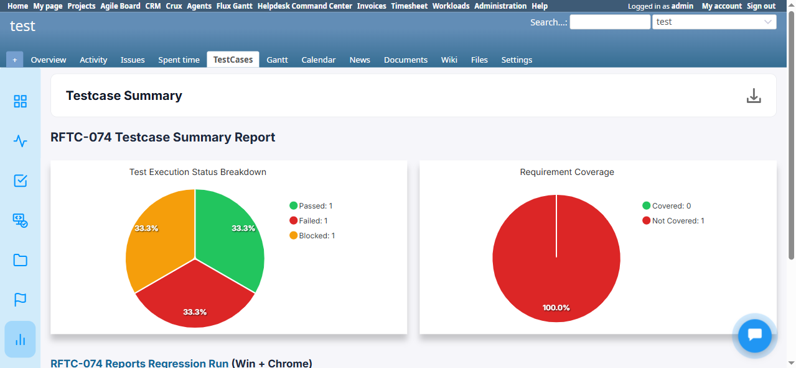

# BUG-TCM-075

- Bug ID: BUG-TCM-075
- Production Redmine Issue ID: #124054 (https://flux.zehntech.com/issues/124054) — assigned to Vaishnavi Bhawsar, priority Medium, Defect Type Functional / Defect Severity Medium-severity / Defect priority Medium, target version Testcase Management plugin Release 7.2.0.
- Title: PDF export of Testcase Reports drops the "Run Name (Environment)" heading that is correctly shown on the live page and in HTML/Excel exports
- Severity: Medium
- Redmine version: 6.x (Docker)
- Plugin name: Redmineflux Testcase Management
- Plugin version: 7.1.0
- Environment: Docker `localhost:3015` (`C:\crux-redmine`), project `test`
- Browser: Chromium (Playwright)
- User role: Administrator
- Date: 2026-10-20

## Summary

Every Testcase Report type that shows a "Run Name (Environment)" heading on its live page (`<h3 id="report_run_name">`)
renders that heading correctly in both the live page and the HTML export, but **drops it, partially or completely,
in the PDF export**. This was missed in an earlier regression pass of the Reports feature during this same session
(which only compared table data and chart rendering across formats) and was caught only after the user compared a
downloaded PDF against the live page directly and pointed out the run name/environment were missing.

Confirmed across all 6 in-scope report types, created against one real Run (`RFTC-074 Reports Regression Run`,
environment `Win + Chrome`):

| # | Report type | Live page heading | HTML export | PDF export |
|---|---|---|---|---|
| 2 | Testcase Summary | `RFTC-074 Reports Regression Run (Win + Chrome)` | Present | **Completely missing** |
| 3 | Defect Summary | `RFTC-074 Reports Regression Run (Win + Chrome)` | Present | Run name present, **"(Win + Chrome)" environment suffix missing** |
| 4 | Activity Summary | `RFTC-074 Reports Regression Run (Win + Chrome)` | Present | **Completely missing** |
| 5 | Tester Scorecard | N/A — Run Name/Environment are separate table columns, not an `<h3>` heading | Present (table) | **Not affected** — both columns render correctly |
| 6 | Requirement Coverage | N/A — this report type has no run-name heading at all | N/A | N/A — not applicable |
| 7 | Overdue Run Summary | `RFTC-074 Reports Regression Run (Win + Chrome) - Overdue by 1 day` (red) | Present | **Completely missing** (both the run name/environment and the "Overdue by N day(s)" text) |

So 3 of 6 report types lose the heading entirely, 1 loses only the environment suffix, and 2 are not applicable to
this defect (different layout / no such heading at all).

## Steps to reproduce

1. Log in as Administrator, open project `test`.
2. Create (or reuse) a Run with a non-blank Environment set (e.g. `Win + Chrome`), containing at least one executed
   test case result.
3. Go to **Reports** (`/projects/test/testcase_reports`), open an existing **Testcase Summary** report tied to that
   run (or create a new one).
4. Note the heading at the top of the live report page: `<h3 id="report_run_name">` — e.g.
   `RFTC-074 Reports Regression Run (Win + Chrome)`, linked to the run.
5. Click the download dropdown → **Download PDF**, open the downloaded PDF.
6. Compare: the same heading line is absent from the PDF.
7. Repeat steps 3–6 for Defect Summary, Activity Summary, and Overdue Run Summary reports tied to the same run.

## Expected result

- The PDF export should show the same "Run Name (Environment)" heading (and, for Overdue Run Summary, the
  "Overdue by N day(s)" line) that the live page and HTML export both show, for every report type that has one.

## Actual result

- Testcase Summary, Activity Summary, Overdue Run Summary: heading line is **completely absent** from the PDF —
  text extraction of the PDF confirms no "RFTC-074 Reports Regression Run" text anywhere in the document, though it
  appears as the very first line under the report title on the live page and in the HTML export.
- Defect Summary: the run name text is present in the PDF, but the trailing `(Win + Chrome)` environment suffix is
  dropped — PDF shows only "RFTC-074 Reports Regression Run".
- Tester Scorecard: unaffected — Run Name and Environment are rendered as ordinary table columns (different layout
  from the `<h3>` heading used by the other 3 types) and both come through correctly in the PDF.
- Requirement Coverage: not applicable — this report type has no run-name heading on its live page either.

This points to a PDF-generation-specific template/CSS issue (the PDF export pipeline, e.g.
wkhtmltopdf/Puppeteer-based conversion, appears to skip or fail to render the `#report_run_name` heading element,
or the markup feeding it) rather than a data problem — the underlying run/environment data is present and correct
in the database and in both other export formats.

## Evidence

### Live page — heading present (Testcase Summary, report #2)

```html
<h3 id="report_run_name">
  <a href="/runs/1?environment=Win+%2B+Chrome&project_id=test">RFTC-074 Reports Regression Run</a> (Win + Chrome)
</h3>
```



### PDF export — heading missing or truncated

Testcase Summary PDF (`pdftotext -layout`), first lines — no run-name/environment heading anywhere before the table:

```
Testcase Summary

RFTC-074 Testcase Summary Report

#   Subject                                               Requirement                                  Updated at               Status
```

Defect Summary PDF — run name present, `(Win + Chrome)` suffix dropped (compare to the live `<h3>` above, which
includes it):

```
Defect Summary

RFTC-074 Defect Summary Report

RFTC-074 Reports Regression Run

Defect  Subject                  Requirement  Priority Assignee  Testcase ID
```

Activity Summary PDF — heading completely missing:

```
Activity Summary

RFTC-074 Activity Summary Report [01/10/2026 - 21/10/2026]

#   Subject                                               Requirement                                  Updated by     Updated at               Status
```

Overdue Run Summary PDF — heading and "Overdue by N day(s)" line both missing:

```
Overdue Run Summary

RFTC-074 Overdue Run Summary Report

#   Subject                                               Requirement                                  Updated at               Status
```

Tester Scorecard PDF — NOT affected, Run Name and Environment both present as table columns:

```
Tester Scorecard

RFTC-074 Tester Scorecard Report

Assigne Run Name                      Environment Testcases Passed Failed Skipped Retest Blocked Defects ...
e

Luna     RFTC-074 Reports Regression  Win +   3  1  1  0  0  1  2 ...
Blossom  Run                          Chrome
```

The raw downloaded PDF files for all four affected/compared reports are attached alongside this bug file for
direct inspection:
- `screenshots/BUG-TCM-075/defect-summary-report3.pdf`
- `screenshots/BUG-TCM-075/activity-summary-report4.pdf`
- `screenshots/BUG-TCM-075/overdue-run-summary-report7.pdf`
- `.playwright-mcp/pdf_check/testcase_summary.pdf` (Testcase Summary, report #2 — kept as a working file, not
  committed; the heading-missing finding for this one is captured above via the `pdftotext` excerpt and the live
  page screenshot/HTML comparison)

## Test case coverage

Found during the full Reports-feature regression pass performed this session (create Run with Environment → create
all 6 report types → download HTML/PDF/Excel → verify data/graphs). Not yet mapped to an automation TC — Reports
PDF-export heading fidelity is not currently covered in `testcases/`; should be added as a dedicated TC once this
is fixed (Traceability Matrix gap).

## Excel export re-verified (NOT affected)

Per explicit follow-up request, re-checked all 6 Excel exports specifically for the run-name/environment heading
(not just table data/charts as in the original pass), by unzipping each `.xlsx` and reading its raw
`xl/worksheets/sheet1.xml` (these exports use inline strings, no `sharedStrings.xml`):

- Testcase Summary (`report_2.xlsx`): `Run: RFTC-074 Reports Regression Run (Win + Chrome)` — present, correct.
- Defect Summary (`report_3.xlsx`): `Run: RFTC-074 Reports Regression Run (Win + Chrome)` — present, correct
  (unlike its PDF, which drops the `(Win + Chrome)` suffix).
- Activity Summary (`report_4.xlsx`): `Run: RFTC-074 Reports Regression Run (Win + Chrome)` — present, correct.
- Tester Scorecard (`report_5.xlsx`): `Run Name` / `Environment` columns both present and populated
  (`RFTC-074 Reports Regression Run` / `Win + Chrome`).
- Requirement Coverage (`requirement_coverage.xlsx`): `Run` / `Environment` columns both present and populated for
  every row.
- Overdue Run Summary (`report_7.xlsx`): `Run: RFTC-074 Reports Regression Run (Win + Chrome) - Overdue by 1 days`
  — present, correct, including the overdue text that the PDF for this report type drops entirely.

**Conclusion: Excel export is not affected by this bug at all** — the heading/run-name/environment data is complete
and correct in every Excel export, for every report type. This bug is PDF-export-only.

## Duplicate check

- Checked `bugs/_duplicates.md` and `bugs/_index.md` — no existing bug covers a missing run-name/environment
  heading in PDF report exports. BUG-TCM-068 and BUG-TCM-071 are both Excel-export defects for different report
  types (Slow Tests, Most Failed Tests) — not duplicates, different format and different symptom. BUG-TCM-005/006
  are about PDF *delivery via email* (attachment missing/failing to generate), not a rendering gap within a
  PDF that otherwise generates successfully — not duplicates either.

## Correction to earlier session note

An earlier note in this same session (`docs/TESTCASE_MANAGEMENT_MEMORY.md`) recorded the Reports-feature regression
pass as fully passing with "no bug found" across all 6 report types/3 formats. That conclusion was **incomplete** —
it verified table data and chart rendering matched across formats, but did not specifically check for the
run-name/environment heading's presence in each format. This bug (BUG-TCM-075) corrects that record.

## Production report

Reported 2026-10-20 as issue #124054 on `ztflux`, via `redmineflux_core_create_issue`
(tracker_id=3/Bug, category_id=2085/Testcase Management Plugin, fixed_version_id=2067/Release 7.2.0,
priority_id=2/Medium, assigned_to_id=192/Vaishnavi Bhawsar, custom fields Defect Type=Functional,
Defect Severity=Medium-severity, Defect priority=Medium), per explicit user approval.
