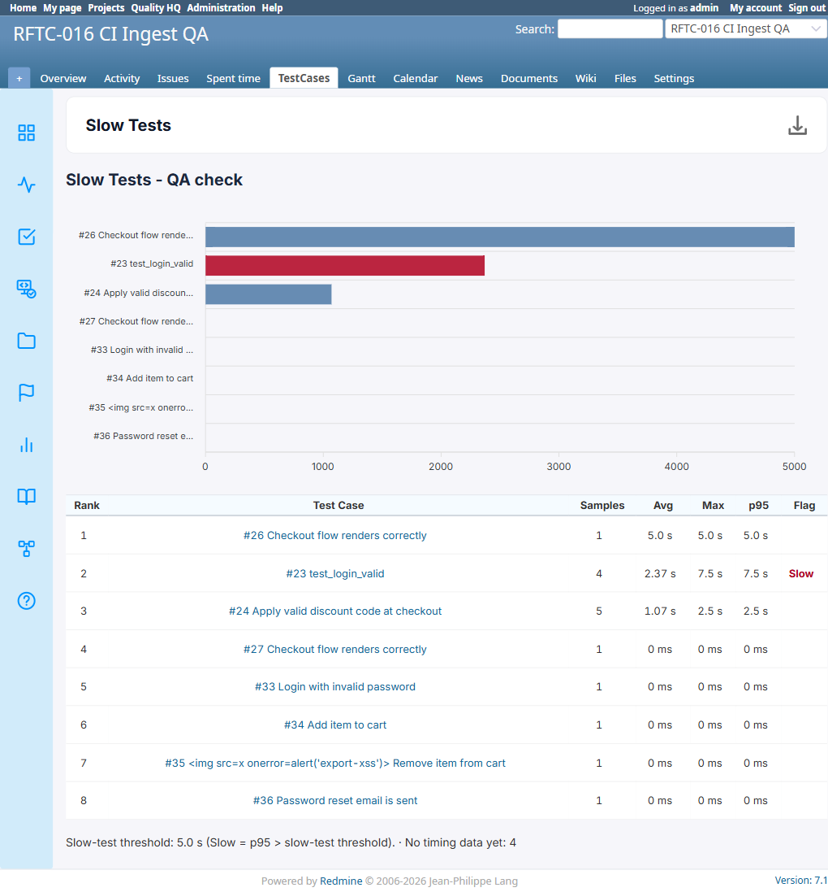
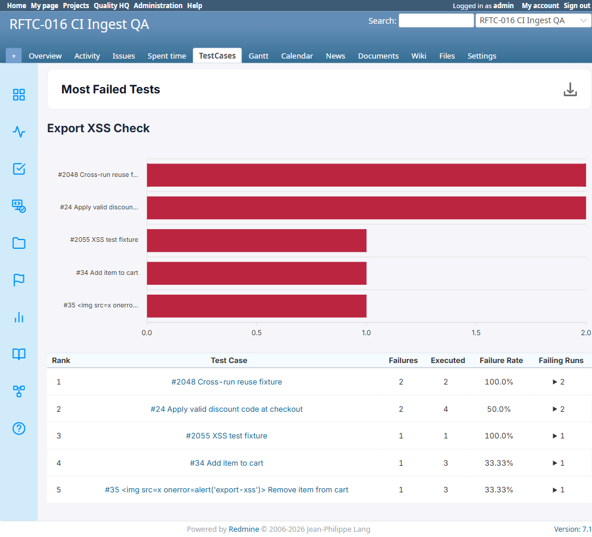

# BUG-TCM-076

- Bug ID: BUG-TCM-076
- Production Redmine Issue ID: (not yet reported — awaiting approval)
- Title: PDF export of Slow Tests and Most Failed Tests reports completely omits the bar chart that is correctly shown on the live page and in the HTML export
- Severity: Medium
- Redmine version: 6.x (Docker)
- Plugin name: Redmineflux Testcase Management
- Plugin version: 7.1.0
- Environment: Docker `localhost:3000` (`redmine6-redmine-1`), project `RFTC-016 CI Ingest QA` (id=2)
- Browser: Chromium (Playwright)
- User role: Administrator
- Date: 2026-10-20

## Summary

Both the **Slow Tests** report (ApexCharts bar chart: Avg timing per test case) and the **Most Failed Tests**
report (ApexCharts bar chart: Failures per test case) render their bar chart correctly on the live page and in
the HTML export, but the chart is **completely absent from the PDF export** — the PDF contains only the table
data, with blank space where the chart should be. Table data itself is accurate and complete in all three export
formats (this is purely a chart-rendering gap in the PDF pipeline, not a data gap).

Checked against two real reports in project `RFTC-016 CI Ingest QA` (id=2):

| Report | Live page chart | HTML export chart | PDF export chart | Table data (all 3 formats) |
|---|---|---|---|---|
| #3 "Slow Tests - QA check" (Slow Tests) | Present (bar chart, Avg) | Present (apexcharts/svg) | **Completely missing** | Correct, all 8 rows |
| #13 "Export XSS Check" (Most Failed Tests) | Present (bar chart, Failures) | Present (apexcharts/svg) | **Completely missing** | Correct, all 5 rows |

This is a distinct defect from BUG-TCM-075 (which covers the missing "Run Name (Environment)" heading in PDF
exports of Testcase Summary/Defect Summary/Activity Summary/Overdue Run Summary) — Slow Tests and Most Failed
Tests are standalone aggregate reports with no Run Name heading at all, so BUG-TCM-075 does not apply to them;
this is specifically about the bar **chart** being dropped, not a heading.

It is also distinct from BUG-TCM-068 (Slow Tests' **Excel** export is empty/wrong) and BUG-TCM-071 (Most Failed
Tests' **Excel** export doesn't recognize the report type) — those are Excel-only defects already filed; this bug
is PDF-only, and both reports' Excel exports were not re-checked here (already covered by the existing bugs).

## Steps to reproduce

1. Log in as Administrator, open project `RFTC-016 CI Ingest QA`.
2. Open the existing **Slow Tests** report `/testcase_reports/3?project_id=rftc-016-ci-qa` — confirm the live page
   shows a bar chart (Avg timing per ranked test case) above the data table.
3. Click the report's download dropdown → **Download HTML**, open the downloaded file, confirm the same bar
   chart renders (ApexCharts/SVG present).
4. Click the download dropdown → **Download PDF**, open the downloaded PDF.
5. Compare: the chart is absent from the PDF — only the title and table are present, no chart image/graphic
   anywhere on the page.
6. Repeat steps 2–5 for the **Most Failed Tests** report `/testcase_reports/13?project_id=rftc-016-ci-qa`
   (bar chart: Failures per ranked test case).

## Expected result

- The PDF export should include the same bar chart that the live page and HTML export both show, for both
  Slow Tests and Most Failed Tests report types.

## Actual result

- **Slow Tests (report #3):** PDF contains only the title ("Slow Tests" / "Slow Tests - QA check") and the full,
  correct 8-row data table (Rank/Test Case/Samples/Avg/Max/p95/Flag) — no chart anywhere in the document. The
  footer line ("Slow-test threshold: 5.0 s... · No timing data yet: 4") is also missing from the PDF, a separate
  minor gap already noted as out-of-scope-for-BUG-TCM-075 evidence, reconfirmed here.
- **Most Failed Tests (report #13):** PDF contains only the title ("Most Failed Tests" / "Export XSS Check") and
  the full, correct 5-row data table (Rank/Test Case/Failures/Executed/Failure Rate/Failing Runs, including the
  XSS-fixture test case's subject rendered as safe inert text) — no chart anywhere in the document.
- By contrast, both reports' **HTML exports are fully correct** — `apexcharts`/`svg` markup present and the chart
  renders identically to the live page.

## Evidence

### Live page — chart present

### HTML export — chart present (confirmed via markup inspection)

Slow Tests HTML export: 154 occurrences of `apexcharts`, 104 of `svg`, 9 `<tr>` (header + 8 data rows), footer
text `No timing data yet: 4` present — matches live page exactly.

Most Failed Tests HTML export: 139 occurrences of `apexcharts`, 104 of `svg`, 6 `<tr>` (header + 5 data rows),
XSS test case subject correctly HTML-escaped (`&lt;img` ×4, zero raw `<img src=x` tags) — matches live page
exactly.

### PDF export — chart missing, table data correct

Raw downloaded PDF files attached alongside this bug file for direct inspection:
- `screenshots/BUG-TCM-076/slow-tests-report3-pdf-no-chart.pdf`
- `screenshots/BUG-TCM-076/most-failed-tests-report13-pdf-no-chart.pdf`

Text extraction of both PDFs confirms the full, correct table data is present in each (all rows, all columns,
correct values) with no chart image, canvas, or SVG content anywhere in the document — the chart area is simply
absent, not blank/broken space.

## Root cause (inferred)

Consistent with the pattern already identified for BUG-TCM-075's missing run-name heading: the PDF export
pipeline (likely a server-side re-render of a subset of the report page's DOM, distinct from the live
ApexCharts/SVG chart which is rendered client-side via JavaScript after page load) does not capture or include
JS-rendered chart elements — only the server-rendered table markup makes it into the PDF. The HTML export, by
contrast, is a full DOM snapshot (including the client-rendered chart), which is why it stays correct while the
PDF consistently drops anything that depends on client-side JS rendering (chart in this bug, heading element in
BUG-TCM-075).

## Test case coverage

Found while re-verifying the Slow Tests and Most Failed Tests reports' PDF/HTML/Excel exports (the user
specifically asked to double-check these two report types' exports for completeness, following the BUG-TCM-075
finding that PDF exports have format-specific rendering gaps). Not yet mapped to an automation TC — Reports
PDF-export chart fidelity is not currently covered in `testcases/`; should be added as a dedicated TC once this
is fixed (Traceability Matrix gap, same as BUG-TCM-075).

## Duplicate check

- Checked `bugs/_duplicates.md` and `bugs/_index.md` — no existing bug covers a missing chart in PDF report
  exports. BUG-TCM-075 is heading-only (different report types, different symptom). BUG-TCM-068/071 are
  Excel-export defects for these same two report types — not duplicates, different format and different symptom.

## Production report

Not yet reported. Will prepare the exact issue payload (title, description, severity) and ask for explicit
approval before calling `redmineflux_core_create_issue` against `ztflux`, per `REDMINEFLUX-MCP-SETUP.md` §4.
