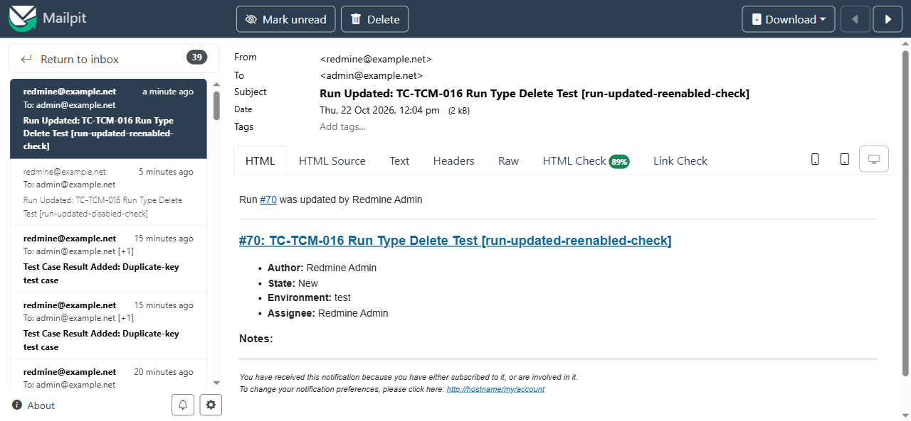
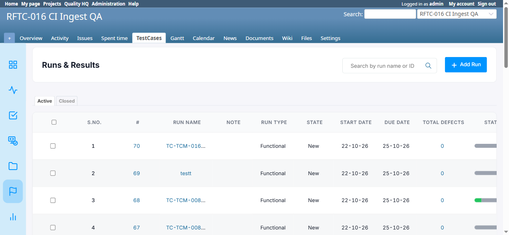
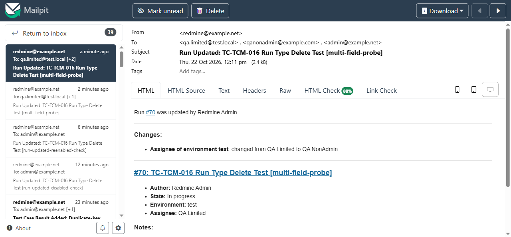

# Bug Report

- Bug ID: BUG-TCM-088
- Production Redmine Issue ID: #124273
- Title: "Run Updated" notification email shows stale (one-edit-behind) values for every Run-derived field — name, State, Environment, Assignee — when the same run is edited again in quick succession; only the separately-computed "Changes:" diff line stays current
- Redmine version: master (post-pull, pre-7.2.0)
- Plugin name: redmineflux_testcase_management
- Plugin version: 7.2.0
- Environment: Docker `localhost:3000`, project `rftc-016-ci-qa`, Mailpit
- Browser: Playwright (Chromium)
- User role: Admin
- Date: 2026-10-22

## Steps to reproduce

1. Ensure "Run updated" is enabled in Administration → Settings → Notifications.
2. Edit run #70 via the real **Edit Run** UI action (action-menu → Edit Run), rename it to
   `[run-updated-reenabled-check]`, click **Update**. A "Run Updated" email arrives correctly naming
   `[run-updated-reenabled-check]` (this part is correct — confirms the mechanism isn't dead).
3. Immediately edit the same run again via the same real Edit Run UI flow, rename it to
   `[staleness-probe-3]`, click **Update**.
4. Check Mailpit for the new "Run Updated" email generated by step 3's edit.
5. Separately confirm the run's actual current name via `Run.find(70).name` (`rails runner`).

## Expected result

- The email generated by step 3 should reflect the run's state **after** step 3's save — i.e. the subject/body
  should read `[staleness-probe-3]`, matching what `Run.find(70).name` now returns.

## Actual result

- The email generated by step 3 instead reads **`Run Updated: TC-TCM-016 Run Type Delete Test
  [run-updated-reenabled-check]`** — the name from the *previous* edit (step 2), not the name just saved in step 3.
- Confirmed via `rails runner` that the database's actual current name at this moment is already
  `TC-TCM-016 Run Type Delete Test [staleness-probe-3]` — the save itself is correct; only the notification
  email's content is one edit behind.
- This pattern reproduced **consistently across 3 separate edits in a row** in the same session (each edit's
  email showed the *previous* edit's name, never the current one), ruling out a one-off fluke.
- Confirmed via `docker logs` on `redmine6-redmine-1` that each edit enqueues and performs its own distinct
  `ActionMailer::MailDeliveryJob` within milliseconds of the request (not a queued/delayed job from an earlier
  edit) — so this is not simply a backlog of old stale jobs catching up; each fresh job itself renders with a
  stale name.
- `runs_controller.rb`'s update action calls `RunMailer.run_updated(@run, ...).deliver_later` *after*
  `@run.update(update_params)` succeeds, and `run_mailer.rb#run_updated` reads `run.name` directly (no obvious
  explicit caching in the mailer method itself) — the staleness most likely comes from how the `@run` ActiveRecord
  object is captured/re-resolved between being passed to the mailer call and the job actually rendering the
  email (e.g. a stale GlobalID-driven re-fetch, in-memory object retained from before the update, or an
  ActiveRecord query-cache artifact within the same request) rather than from any explicit stale-data bug in the
  mailer's own placeholder logic. Root cause not fully pinned to an exact line; evidence above establishes the
  symptom is real and consistently reproducible.
- Distinct from BUG-TCM-013 (duplicate delivery) and BUG-TCM-012 (fixed — body previously showed the run's old
  name in a different, already-fixed way) — this is specifically about the *version* of the data used, not
  duplicate sends or hardcoded labels.

**Extended investigation — scope is every Run-derived field, not just name, and the staleness is
timing-sensitive:**

- Edited run #70 changing Name, Status, Run Type, Due Date and Assignee all at once, ~6 minutes after the
  previous edit: this email was **entirely correct** — correct name, correct State ("In progress"), correct
  Environment, correct Assignee, and the "Changes:" line correctly described "Assignee of environment test:
  changed from Redmine Admin to QA Limited". This shows the bug is not permanent/always-on.
- Immediately after (within ~15 seconds), edited run #70 again — renamed to `[rapid-followup-probe]` and
  changed Assignee from QA Limited to QA NonAdmin. `rails runner` confirmed the DB was correct instantly
  (`name` = `[rapid-followup-probe]`, assignee = QA NonAdmin). But the resulting email:
  - **Subject/heading**: `TC-TCM-016 Run Type Delete Test [multi-field-probe]` — the *previous* edit's name,
    not `[rapid-followup-probe]`.
  - **Summary box "Assignee:"**: `QA Limited` — the *previous* edit's assignee, not the just-saved `QA
    NonAdmin`.
  - **"Changes:" diff line**: `Assignee of environment test: changed from QA Limited to QA NonAdmin` — this
    one is CORRECT, reflecting the real change just made.
  - This proves the staleness is isolated to whatever reads directly off the `run`/`@run` object at render
    time (name, state, environment/assignee via `run.run_assignments`) — the separately-computed
    `assignee_changes`/`environment_changes` hashes passed explicitly as controller-computed arguments are NOT
    stale, since those are plain Ruby hashes built fresh in the current request, not re-fetched via the run
    object.
- **This strongly suggests the staleness is timing/race-condition-sensitive** (reproduces when the same run is
  edited again within seconds of a prior edit; does not reproduce when edits are minutes apart) rather than a
  flat "always one behind" rule — consistent with a transient caching/visibility artifact (e.g. a
  connection-level or query-level cache not yet invalidated) rather than a logic bug in the mailer's own
  placeholder code.

## Evidence

### Screenshot







### Console / log

```
# redmine6-redmine-1 logs for the two consecutive edits:
I, [2026-10-22T06:30:09...] Enqueued ActionMailer::MailDeliveryJob ... "run_updated" ... Run/70 ...
I, [2026-10-22T06:30:09...] Performed ActionMailer::MailDeliveryJob ... in 55.04ms   # edit disabled by setting -> guard returns, no send
I, [2026-10-22T06:30:42...] Enqueued ActionMailer::MailDeliveryJob ... "run_updated" ... Run/70 ...
I, [2026-10-22T06:30:42...] Performed ActionMailer::MailDeliveryJob ... in 118.11ms  # this is the email that arrived with the STALE "[run-updated-disabled-check]" name,
                                                                                     # even though this edit's own save was renaming the run to "[run-updated-reenabled-check]"

# rails runner readback immediately after:
Run.find(70).name => "TC-TCM-016 Run Type Delete Test [run-updated-reenabled-check]"   # DB is correct; only the email was stale
```

## Production report

Reported to production `ztflux` on 2026-10-22 as **#124273**, assigned to Vaishnavi Bhawsar, Priority Medium /
Defect Severity Medium-severity / Defect priority Medium / Defect Type Functional, category Testcase Management
Plugin. Standalone bug issue (no production Test Run/Test Case link), per explicit user instruction.

## Duplicate check

- Duplicate found: No
- Existing bug reference (if duplicate): n/a — checked against `bugs/_duplicates.md` and `bugs/_index.md`,
  neither BUG-TCM-012 nor BUG-TCM-013 cover this specific "stale version of the run name in the email" symptom.
