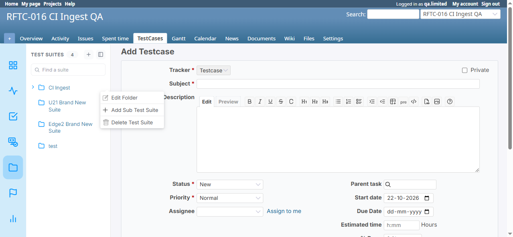

# BUG-TCM-090

- Bug ID: BUG-TCM-090
- Production Redmine Issue ID: #124317
- Title: The Add Testcase page's test-suite kebab menu shows Edit Folder/Delete Test Suite regardless of
  permission (unlike the real Test Suites page, which correctly filters it), and both actions are broken on
  this page for every user (`project_id=undefined` 404) because its copy of the shared modal omits the
  `data-project_id` attribute the other page sets
- Redmine version: 7.0.0
- Plugin name: Redmineflux Testcase Management
- Plugin version: 7.2.0
- Environment: Docker `localhost:3000`, project `rftc-016-ci-qa` (id=2)
- Browser: Chromium (Playwright MCP)
- User role: Manager (`qa.limited`) with only `create_test_suite` (+ `execute_testcase`) granted —
  `view_test_suite`/`edit_test_suite`/`delete_test_suite` all denied — and separately reproduced as Admin
- Date: 2026-10-22

## Summary

Found by the user while testing a role with only `create_test_suite` granted. Two related findings, both on
`/projects/<project>/issue_testcase/new` ("Add Testcase" — already the subject of BUG-TCM-009's missing
page-level authorization):

### Finding 1 — The test-suite tree's "⋮" kebab menu ignores permission entirely on this page

On the real Test Suites page (`/test_suites?project_id=rftc-016-ci-qa`), the same "CI Ingest" suite's kebab menu
correctly shows only **"Add Sub Test Suite"** for `qa.limited` (only `create_test_suite` granted) — Edit
Folder and Delete Test Suite are correctly hidden. Confirmed via direct test.

On the **Add Testcase page**, the identical "CI Ingest" suite's kebab menu shows **all three options — "Edit
Folder", "Add Sub Test Suite", "Delete Test Suite"** — for the exact same user, same role, same permission
state. Screenshot: `add-testcase-page-kebab-menu-all-options-no-permission.png`.

So the menu-filtering logic that correctly applies on the Test Suites page is simply never applied to this
page's copy of the same sidebar widget.

### Finding 2 — Clicking "Edit Folder" (and, by the same code path, "Delete Test Suite") is broken on this page for every user, not just denied ones

Clicking "Edit Folder" on the Add Testcase page produces:

```
Failed to load resource: the server responded with a status of 404 (Not Found)
@ http://localhost:3000/test_suites/3/edit?project_id=undefined
```

**Reproduced identically as Admin** (full permissions) — this is not a permission-gated failure, it is broken
for everyone who reaches this page's menu.

Root-caused via source:

```js
// assets/javascripts/testcase.js
$('#subfolder_edit').click(function () {
  let project_id = $('#subfolder-modal').attr('data-project_id');
  ...
  url: `${url}/test_suites/${testsuiteids}/edit?project_id=${project_id}`,
});

$("#delete_folder").click(function () {
  let project_id = $("#subfolder-modal").attr("data-project_id");
  ...
  $("#hidden_project_id").val(project_id);   // same pattern -- feeds the Delete confirm form
});
```

Both handlers read `project_id` from `#subfolder-modal`'s `data-project_id` attribute. Comparing the two views
that render this same modal:

```erb
<!-- app/views/test_suites/index.html.erb:402 (correct) -->
<div class="subfolder-modal" id="subfolder-modal" data-suits-id="" data-project_id="<%= @project.identifier %>" >

<!-- app/views/issue_testcase/new.html.erb:257 (missing the attribute) -->
<div class="subfolder-modal" id="subfolder-modal" data-suits-id="">
```

`issue_testcase/new.html.erb`'s copy of the modal **never sets `data-project_id` at all** — so on this page
`$('#subfolder-modal').attr('data-project_id')` always returns `undefined`, which gets interpolated literally
into the Edit Folder URL (`?project_id=undefined`) and into the Delete Test Suite confirmation form's hidden
field. `#subfolder_new` ("Add Sub Test Suite") is unaffected — it only needs `data-suits-id`, which both views
do set correctly, matching the earlier observation that this one option worked fine on this page.

**Not independently executed to completion**: clicking "Delete Test Suite" and confirming was correctly
blocked by the session's own irreversible-deletion safety guard (never attempted against a real suite); the
same broken `data-project_id` dependency was instead confirmed via source inspection of `#delete_folder`'s
identical code pattern, without actually executing a delete.

## Steps to reproduce

**Finding 1:**
1. Grant a role only `create_test_suite` (no `view_test_suite`/`edit_test_suite`/`delete_test_suite`).
2. As that user, open `/test_suites?project_id=<project>` and hover a suite's "⋮" menu — observe only "Add Sub
   Test Suite" shows.
3. Navigate to `/projects/<project>/issue_testcase/new` instead and hover the same suite's "⋮" menu — observe
   all three options show.

**Finding 2:**
1. On the Add Testcase page, click "Edit Folder" on any suite (as any user, any permission level).
2. Observe a 404 in the browser console: `GET /test_suites/<id>/edit?project_id=undefined`.
3. (Not executed) Clicking "Delete Test Suite" and confirming would submit with the same broken
   `project_id=undefined` via the hidden form field, per source inspection of the identical code pattern.

## Expected result

- Finding 1: the kebab menu should show the same permission-filtered options on every page it's embedded in,
  matching the Test Suites page's behavior.
- Finding 2: Edit Folder (and Delete Test Suite) should work correctly regardless of which page the modal is
  opened from.

## Actual result

- Finding 1: all three options are shown unconditionally on the Add Testcase page, regardless of permission.
- Finding 2: Edit Folder 404s for every user on this page; Delete Test Suite's confirm form is fed the same
  broken `project_id` value via the same missing attribute.

## Evidence

### Screenshot



### Retest screenshot (fill after fix is verified)


### Console / log

```
# Finding 2 -- reproduced identically as qa.limited (zero edit_test_suite) AND as Admin (full permissions)
[ERROR] Failed to load resource: the server responded with a status of 404 (Not Found)
  @ http://localhost:3000/test_suites/3/edit?project_id=undefined:0
[ERROR] API request failed error Not Found
  @ http://localhost:3000/assets/plugin_assets/redmineflux_testcase_management/testcase-d4e7b653.js:3510

# Root cause -- views/issue_testcase/new.html.erb's #subfolder-modal never sets data-project_id,
# unlike views/test_suites/index.html.erb's identical modal which does.
```

## Suggested fix

1. Add `data-project_id="<%= @project.identifier %>"` to `#subfolder-modal` in
   `app/views/issue_testcase/new.html.erb`, matching `test_suites/index.html.erb`, so Edit Folder/Delete Test
   Suite work correctly from this page too.
2. Apply the same permission-filtering logic to the kebab menu's rendering on this page that
   `test_suites/index.html.erb` already applies, so Edit Folder/Delete Test Suite only ever show for users who
   actually hold `edit_test_suite`/`delete_test_suite` — this is the same missing-permission-check class of
   issue as BUG-TCM-009/BUG-TCM-089, now confirmed on a third surface.

## Verdict

**Confirmed, two related findings on the same page.** Finding 1 (permission-blind menu) is a real but
UI-visibility-only gap on its own — Medium. Finding 2 (broken Edit Folder, permission-independent) is a plain
functional bug affecting every user — Medium-High on its own, but **the combination is worse than either
alone**: a user who should never have seen "Edit Folder"/"Delete Test Suite" at all (Finding 1) now also hits a
broken, confusing error instead of simply not seeing the option. Role permissions were not modified by this
investigation (read-only verification); Manager role remains as the user had set it (`create_test_suite` +
`execute_testcase` only).

## Duplicate check

- Duplicate found: No — distinct from BUG-TCM-009 (that bug covers this same page's complete *absence* of
  server-side authorization for `#new`/`#create`) and BUG-TCM-089 (Requirements-specific permission gaps). This
  bug is about the Test Suite kebab menu's own permission-filtering being page-specific rather than consistent,
  plus a genuine functional defect (broken URL construction) that is permission-independent.
- Existing bug reference (if duplicate): n/a — related to BUG-TCM-009 (same page, same root theme of
  "`issue_testcase#new` doesn't apply the same checks/context the Test Suites page does") but a distinct defect.

## Production report

Reported to production `ztflux` as **#124317** on 2026-10-22, per explicit user instruction ("bug report kro
production pe"). Tracker Bug, Priority High, Category "Testcase Management Plugin", Target version "Testcase
Management plugin Release 7.2.0", assigned to Vaishnavi Bhawsar (id=192). Standalone issue, no Test
Run/Testcase link (matching the BUG-TCM-087/088/089 pattern). Custom fields (Defect Type/Severity/priority)
left at project defaults — `list_custom_fields` returns a permission error for this account.
