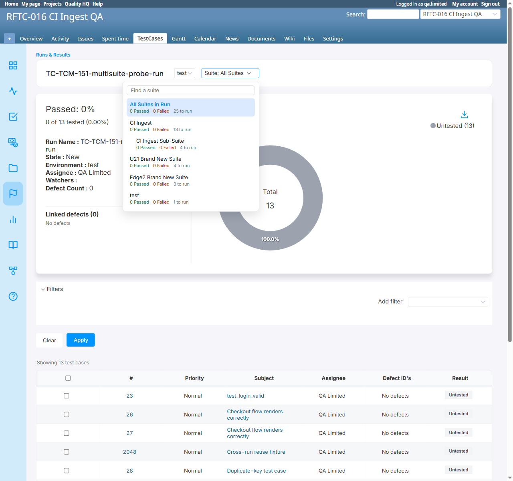

# BUG-TCM-097

- Bug ID: BUG-TCM-097
- Production Redmine Issue ID: #124423
- Title: A test case that belongs to two test suites is double-counted in a run that covers both suites — it gets
  two independent, separately-trackable result rows instead of one
- Redmine version: 7.0.0
- Plugin name: Redmineflux Testcase Management
- Plugin version: 7.2.0
- Environment: Docker `localhost:3000`, project `rftc-016-ci-qa`
- Browser: Chromium (Playwright)
- User role: `qa.limited` (Manager, full TCM permissions)
- Date: 2026-10-23 (found while executing TC-TCM-151, the "test case in multiple suites" regression case)

## Summary

The plugin's own `Testsuite`/`Issue` association (`has_many :issues, through: :issue_test_suites`) genuinely
supports a test case belonging to more than one suite — confirmed by creating two `IssueTestSuite` rows for the
same issue (#2125) against two different suites (CI Ingest, id 3; U21 Brand New Suite, id 5) in the same project,
and seeing the issue correctly listed on both suites' own pages.

The problem is downstream, when such a test case is pulled into a **Run**. `RunsController#create`'s
"Include all test run" path (`handle_test_suite_ids`, and the equivalent inline logic in `create` for
`include_testcase == 'true'`) builds one `RunIssue` row **per (issue, testsuite) pair**:

```ruby
# app/controllers/runs_controller.rb
issue_test_suites = IssueTestSuite.where(testsuite_id: testsuite_ids)
issue_test_suites.each do |issue_test_suite|
  @run.run_issues.build(issue_id: issue_test_suite.issue_id, testsuite_id: issue_test_suite.testsuite_id)
end
```

For an issue in two suites, this creates **two** `RunIssue` rows instead of one. `Run#create_issue_status_results`
then does `run_issues.map { |run_issue| ... }` to seed `IssueStatusResult` rows — again, one per `RunIssue`, so the
same test case ends up with **two separate, independently-trackable result rows** in the same run, each under its
own suite tab, each capable of being marked Passed/Failed/Untested **independently of the other**.

This directly contradicts the "a case must not be double-counted in report totals" requirement — the run's own
"All Suites in Run" aggregate literally sums these duplicate rows.

## Steps to reproduce

1. Create (or have) a test case that belongs to two test suites in the same project (currently only achievable at
   the data layer, since BUG-TCM-025's original "no multi-suite UI path" finding was fixed only for single-suite
   move/copy — see Notes below).
2. Create a Run with "Include all test run" (or any suite selection that covers both of that issue's suites).
3. Open the run and look at the suite-switcher dropdown, and the issue's row under each suite tab.

## Expected result

- The test case should be counted once in the run's aggregate totals, and marking a result for it should be a
  single, consistent status — not two independent result rows that can disagree with each other.

## Actual result

- The run's suite-switcher dropdown shows **"All Suites in Run ... 25 to run"** while the per-suite tabs sum to
  25 (13 + 4 + 4 + 3 + 1) — but only **20 distinct issues** actually exist in the run (confirmed via
  `IssueStatusResult.where(run_id: 77).distinct.count(:issue_id)` => 20). The 5-row discrepancy is exactly the 5
  test cases in this project that belong to two suites each (including the probe issue, #2125), each contributing
  one extra row.
- Issue #2125 (`TC-TCM-129-five-ordered-steps`) appears as a **separate, independently clickable "Untested" row**
  under both the "CI Ingest" suite tab (`testsuite_id=3`) and the "U21 Brand New Suite" tab (`testsuite_id=5`) of
  the same run — each with its own `issue_status_results/new` link, meaning a QA could mark it Passed under one
  suite tab and Failed under the other for the exact same test case in the exact same run.

## Evidence

### Screenshot



### Console / log

```ruby
# Confirmed the data model supports genuine multi-suite membership:
i = Issue.find(2125)
i.issue_test_suites.create!(testsuite_id: 3)
i.issue_test_suites.create!(testsuite_id: 5)
i.reload.issue_test_suites.pluck(:testsuite_id)  # => [3, 5]

# Created run 77 ("TC-TCM-151-multisuite-probe-run") via the real "Add Run" UI with
# "Include all test run" selected (environment "test", assignee QA Limited):
r = Run.find(77)
r.run_issues.where(issue_id: 2125).count            # => 2
r.run_issues.where(issue_id: 2125).pluck(:testsuite_id)  # => [3, 5]

IssueStatusResult.where(run_id: 77, issue_id: 2125).count  # => 2 (one per testsuite_id: 3 and 5)
IssueStatusResult.where(run_id: 77).count                  # => 25
IssueStatusResult.where(run_id: 77).distinct.count(:issue_id)  # => 20
```

## Re-verification (2026-10-22, same day) — clean, isolated reproduction, no historical data

Per the user's direct question ("ek testcase do different testsuite me kaise ho sakta he") and follow-up request
to re-verify cleanly: confirmed again with a **brand-new project state** (2 newly-created suites, a newly-created
test case, a newly-created run with 2 environments) to rule out any contamination from older session data.

**Confirmed: there is no UI path today to put one test case in two suites.** Move always removes the case from
every other suite; Copy always creates a separate, new issue. The only way to reach this state is a direct write
to the `issue_test_suites` join table (or a different real path: BUG-TCM-091's CSV-import cross-project suite
link, which proves the *general class* of "an issue linked to a suite via `IssueTestSuite` outside the normal
move/copy flow" is already a real, exploitable condition, not purely theoretical).

**Setup**: created suites `BUG97-Reverify-Suite-A` (id 33) and `BUG97-Reverify-Suite-B` (id 34), a fresh test case
`TC-BUG97-reverify-multisuite-case` (#2129, created in suite A via the real "New Test Case" form), then linked it
to suite B directly. Created Run #78 ("BUG97-Reverify-2env-run") via the real "Add Run" UI, explicitly selecting
both suites (`Only the following test runs` → both suites checked) and 2 real environments (`test` / `test1`).

```ruby
r = Run.find(78)
r.run_issues.where(issue_id: 2129).pluck(:testsuite_id)   # => [33, 34]  -- 2 rows for 1 issue
IssueStatusResult.where(run_id: 78, issue_id: 2129).count # => 4  -- 2 suites × 2 environments
```

**New, stronger finding from this clean reproduction — genuinely contradictory status, not just a count
mismatch.** Opened Suite A's tab, marked the one visible row **Passed**. Immediately reloaded Suite B's own tab:
the exact same test case (#2129) still shows **Untested** — same run, same environment, same issue, two
simultaneously-true-but-contradictory statuses. The "All Suites in Run" aggregate view then shows the issue once
as **Passed** (picking up only Suite A's row, silently hiding Suite B's still-Untested copy) — so a user looking
at the aggregate view would believe the case is fully verified while a Suite-B-scoped reviewer would see it as
never tested.

The suite-switcher dropdown's own badges (distinct from the page body — see BUG-TCM-098) also confirm the
double-count cleanly on this isolated data: "All Suites in Run: 1 Passed, 0 Failed, 1 to run" (1+1 = 2) while
Suite A alone correctly reads "1 Passed, 0 to run" and Suite B alone correctly reads "0 Passed, 1 to run" — each
individual suite is internally consistent, but their sum (which is what "All Suites in Run" naively computes)
double-counts the one real test case.


## Additional manifestation (2026-10-23) — same run's name repeats multiple times on the test case's own issue detail page

Per the user's direct report while viewing issue #23 ("test_login_valid"): "testcase detail page pe run name
multiple time dikh raha he" — clarified on follow-up to mean **one single run's name repeating several times**,
not several different runs being confused for one another (e.g. the screenshot showed "TC-TCM-042-env-rename-run"
printed 8 times in a row under the "Test Run:" field).

**Root cause — the exact same underlying defect as the main finding above, on a different page.** The issue
detail page's "Test Run:" field (`app/views/issues/_steps_list.html.erb`, line 13) is:

```erb
<div class="value">
  <%= @issue.runs.map(&:name).join(', ') %>
</div>
```

`Issue#runs` is declared (`lib/testcase_management/patches/issue_patch.rb:21`) as:

```ruby
has_many :runs, through: :run_issues
```

with no `-> { distinct }` scope. Since `RunIssue` is keyed per **(issue, run, testsuite)** triple rather than per
(issue, run) — the same root cause as the main finding — any issue that was pulled into one run via more than one
testsuite association produces that many duplicate `RunIssue` rows for that run, and `has_many :through` walks
every one of them, so `@issue.runs` contains the same `Run` object once per duplicate row.

**Confirmed directly on issue #23**:

```ruby
i = Issue.where(subject: 'test_login_valid').first   # => id 23
i.issue_test_suites.pluck(:testsuite_id)              # => [3]  -- only 1 CURRENT real suite link
RunIssue.where(issue_id: i.id, run_id: 76).pluck(:testsuite_id)
# => [3, 3, 5, 6, 7, 22]  -- SIX separate RunIssue rows for run 76 alone
```

`@issue.runs.map(&:name).join(', ')` therefore prints `"TC-TCM-042-env-rename-run"` six times for run 76 alone
(plus further repeats from the issue's other 30+ historical `RunIssue` rows across other runs) — exactly matching
the screenshot the user reported. This is not a separate bug; it is the same `RunIssue`-granularity flaw as the
main finding above, now shown to also corrupt the issue's own detail page rather than just the Run page.

A secondary, related discrepancy on the same page: the "Test Suite:" field (same partial, line 20, iterating
`@issue.issue_test_suites`) showed 3 distinct suite names in the user's screenshot ("CI Ingest", "Sub-Suite U21
Brand New Suite", "CI Ingest") even though the issue's *current* real `issue_test_suites` link is just `[3]`
("CI Ingest") — i.e. only 1 row. This field iterates the live association directly (not historical `RunIssue`
data) and does not itself duplicate rows, so the 3-name display does not fully reconcile against the 1-row current
state; left as an open question for follow-up rather than asserted as a confirmed separate defect, since it may
reflect suite membership the issue held at an earlier point that is no longer reflected in today's `pluck`.

**Fix implication**: the suggested fix below (dedupe `RunIssue` to one row per issue per run) resolves this
manifestation too, since `@issue.runs` would then naturally return each run only once.

**Reported to production** — added as a comment to the existing production issue **#124423** on 2026-10-23, per
explicit user instruction ("han kr do"), rather than opening a new issue, since it is the same defect as the main
finding above.

## Verdict

**Confirmed, High (upgraded from initial Medium after clean re-verification).** Originally scoped as a
double-counting/reporting defect; the clean, isolated reproduction (2 brand-new suites, a brand-new test case, a
brand-new run with 2 environments, zero historical data) proved something more serious — the same test case can
hold **genuinely contradictory statuses** (Passed under one suite tab, Untested under the other) in the exact same
run and environment at the same time, with the "All Suites in Run" aggregate view silently showing only one of the
two truths. This is a real data-integrity defect, not just a cosmetic total.

## Production report

Reported to production `ztflux` as **#124423** on 2026-10-23, per explicit user instruction ("dono bug production
pe create kr do"). Tracker Bug, Priority High, Category "Testcase Management Plugin", Target version "Testcase
Management plugin Release 7.2.0" (id 2067), assigned to Vaishnavi Bhawsar (id 192). Standalone issue, no Test
Run/Testcase link, matching the established convention for this cycle's other standalone bug reports.

## Duplicate check

- Duplicate found: No — related to, but distinct from, the original BUG-TCM-025 (which was about there being no UI
  path to *create* multi-suite membership at all; that half is now fixed for the single-suite move/copy flow).
  This is a different, newly-surfaced defect: once a test case *does* end up in two suites (by any means, UI or
  otherwise), the Run/report layer mishandles it by double-counting rather than deduplicating.
- Existing bug reference (if duplicate): n/a

## Suggested fix

In `RunsController` (both the `include_testcase == 'true'` branch and `handle_test_suite_ids`/
`handle_selected_testduite_and_testcase_ids`), build at most one `RunIssue` per **issue**, not per
(issue, testsuite) pair, when the same issue would otherwise be pulled in from more than one selected suite —
e.g. `.uniq(&:issue_id)` on the candidate list before `.build`, picking one canonical `testsuite_id` (or tracking
all contributing suites separately from the single result row) so `Run#create_issue_status_results` seeds exactly
one `IssueStatusResult` per test case per run.
