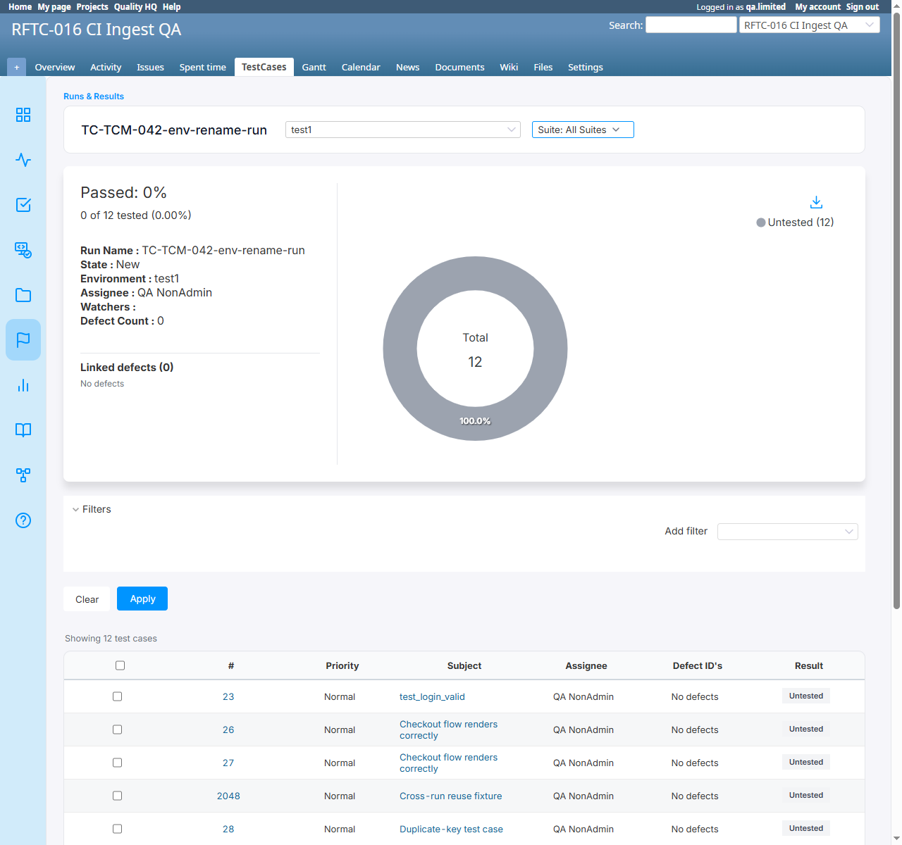
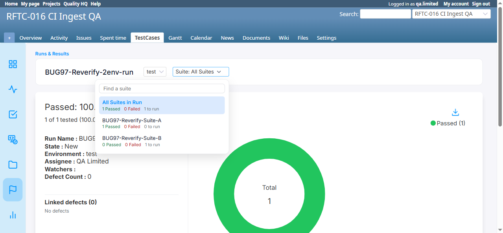
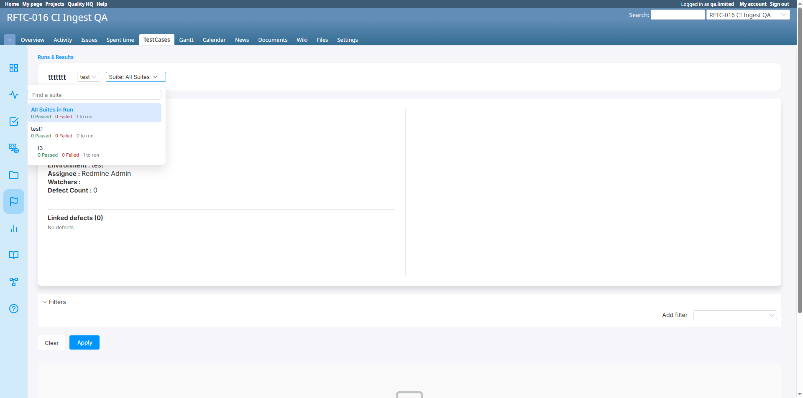

# BUG-TCM-098

- Bug ID: BUG-TCM-098
- Production Redmine Issue ID: #124424
- Title: "All Suites in Run" doesn't actually aggregate anything — it silently shows only `@run.testsuites.first`'s
  test cases (mislabeled as "All Suites"), while the suite-switcher dropdown's own badges are computed by a
  completely different, separately-wrong query (no environment filter, no issue de-duplication)
- Redmine version: 7.0.0
- Plugin name: Redmineflux Testcase Management
- Plugin version: 7.2.0
- Environment: Docker `localhost:3000`, project `rftc-016-ci-qa` — Run #80 (`ttttttt`, suites `test1` id 35
  [parent, 0 cases] + `t3` id 36 [child of `test1`, 1 case]) for the grid root-cause; Run #76
  (`TC-TCM-042-env-rename-run`, 2 environments) for the dropdown-badge finding
- Browser: Chromium (Playwright)
- User role: `qa.limited` (Manager, full TCM permissions)
- Date: 2026-10-23 — user directly spotted the original dropdown-vs-donut mismatch, then correctly doubted my
  first write-up after a different run's dropdown numbers added up fine, and pushed to re-check what "All Suites
  in Run" is actually supposed to show — that question led straight to the real root cause below.

## Summary — corrected after the user's follow-up (see "Revision history")

**This bug file originally mis-stated the root cause.** The user pointed out a run where the dropdown's own badge
math was internally consistent (parent suite `test1` + child suite `t3` summed correctly to "All Suites in Run"),
which correctly cast doubt on my first explanation. Re-investigating from the user's own framing — "All Suites in
Run should show every test case from every suite in the run" — found the real defect, in `runs_controller.rb#show`:

```ruby
# app/controllers/runs_controller.rb, inside #show
if params[:testsuite_id].present?
  issues_ids = RunIssue.where(testsuite_id: params[:testsuite_id], run_id: @run.id).pluck(:issue_id)
  @first_suite_test_cases = apply_filters(Issue.where(id: issues_ids), params[:testsuite_id], @selected_environment)
  ...
else
  @first_test_suite = @run.testsuites.first        # <-- "All Suites in Run" just picks ONE suite
  issues_ids = RunIssue.where(testsuite_id: @first_test_suite.id, run_id: @run.id).pluck(:issue_id)
  @first_suite_test_cases = apply_filters(Issue.where(id: issues_ids), @first_test_suite.id, @selected_environment)
  ...
end
```

When no `testsuite_id` param is present — i.e. exactly the state the "All Suites in Run" link/default page load is
in — the controller does **not** aggregate across every suite assigned to the run at all. It just takes
`@run.testsuites.first` (the first suite in whatever order `@run.testsuites` happens to return) and shows **only
that one suite's** test cases, under the "All Suites in Run" heading. There is no real "all suites" query anywhere
in this action.

This explains both halves of the puzzle:
- **Run #80** (suites `test1` [parent, 0 real cases] + `t3` [child, 1 real case], single environment): `.first`
  resolved to `test1`, so the main grid shows **"No data to display"** / **"0 of 0 tested"** / an empty donut —
  even though the run genuinely has one real, taggable test case (confirmed: selecting suite `t3` directly shows
  "Showing 1 test cases in t3"). The page's own "All Suites in Run" heading and donut are simply **wrong** here —
  not inflated like the earlier write-up guessed, but **silently empty**.
- **Run #78** (BUG-TCM-097's fixture, 2 top-level suites, the same issue genuinely linked to both): `.first`
  happened to resolve to one of the two suites containing that same issue, so the grid "coincidentally" showed the
  correct-looking total (1) — masking the fact that it still wasn't aggregating, it just got lucky because both
  suites held the identical single issue.

**Separately, the suite-switcher dropdown's own badges (the "Passed/Failed/to run" numbers next to each suite name
in the "Suite: All Suites" popup) are computed by different code entirely** — confirmed still broken independent
of the fix above: switching the page's Environment selector does not change the dropdown's numbers at all (they
stay identical across every environment), while the donut/grid directly below do correctly re-filter. On Run #76 /
suite "CI Ingest": dropdown badge **25 to run** under every environment, while the real environment-scoped total
(what the grid/donut agree on for `test1`) is **12**. This is still a real, independently-confirmed defect — it
just isn't the same bug as the grid's "All Suites" failure above, and isn't the full story either.

## Steps to reproduce

**Grid defect ("All Suites in Run" shows the wrong suite's data, or nothing):**
1. Create a Run with 2+ suites assigned, where the suite that is first in `@run.testsuites`'s natural order has
   zero (or different) test cases than another suite in the run.
2. Open the run's default page (or explicitly click "All Suites in Run" in the suite-switcher — same URL, no
   `testsuite_id` param).
3. Compare what's shown against the real combined set of test cases across every suite assigned to the run.

**Dropdown badge defect (environment-blind, non-deduplicated):**
1. Open a Run that has 2+ environments assigned.
2. Open the suite-switcher dropdown and note a suite's "to run" badge.
3. Change the Environment selector; re-open the dropdown and compare the same badge to the grid/donut for that
   environment.

## Expected result

- "All Suites in Run" should show the true union of every test case across every suite assigned to the run — not
  one arbitrarily-chosen suite's data.
- The suite dropdown's per-suite badges should reflect the same distinct-issue, environment-scoped total the grid
  and donut chart show for that same suite/environment.

## Actual result

- **Run #80**: "All Suites in Run" shows "0 of 0 tested", an empty donut, and "No data to display" — while the run
  genuinely has 1 real test case (visible only by explicitly selecting suite `t3`). Confirmed via `rails runner`:
  `@run.testsuites.first` resolves to `test1` (the empty parent), explaining the silent empty result.
- **Run #76**: dropdown badge for "CI Ingest" reads 25 under every environment regardless of selection; the real
  environment-scoped total (matching the grid/donut) is 12.

## Evidence

### Screenshot





### Console / log

```ruby
# Run #80 — "All Suites in Run" grid root cause
r = Run.find(80)
r.assign_testsuite_to_runs.pluck(:testsuite_id)   # => [35, 36]  (test1, t3 — both genuinely assigned to the run)
r.run_issues.pluck(:issue_id, :testsuite_id)       # => [[2130, 36]] (the one real case lives only under t3)
r.testsuites.first.id                              # => 35 (test1 — the EMPTY parent; picked by `.first`, not by relevance)
# UI: /runs/80?project_id=... (no testsuite_id) => "0 of 0 tested", "No data to display"
# UI: /runs/80?project_id=...&testsuite_id=36    => "Showing 1 test cases in t3"

# Run #76 — dropdown badge environment-blind
r = Run.find(76)
r.run_assignments.pluck(:environment)                        # => ["TC-TCM-293-manage-environment-positive-leg", "test1"]
r.run_issues.where(testsuite_id: 3).count                     # => 25  (dropdown's "CI Ingest" badge, every environment)
r.run_issues.where(testsuite_id: 3).distinct.count(:issue_id) # => 13
# UI, environment=test1, suite=CI Ingest: "Showing 12 test cases", donut Total: 12
```

## Additional observation — dropdown panel overlaps page content on a short run name

While reproducing on Run #80 (name `ttttttt`, short), the suite-switcher dropdown panel visually overlaps the
"Environment / Assignee / Watchers / Defect Count" summary block beneath it rather than pushing it down or
appearing in its own layer cleanly — see the attached screenshot. Not fully root-caused or confirmed as
name-length-dependent yet (could be a general z-index/positioning issue the short name just made easy to notice) —
flagging for a follow-up CSS check rather than claiming a precise trigger condition.

## Re-verification — not caused by Edit Run/Save

Per the user's direct question (whether opening Edit Run and saving is what produces the stale badge), tested
explicitly on the clean Run #78 from BUG-TCM-097's re-verification: captured the dropdown badge ("All Suites in
Run: 2 to run" for environment `test1`) **before** any edit, then opened **Edit Run** via the real UI action menu,
made **zero changes**, and clicked **Update**. Confirmed via `rails runner` that the underlying `run_issues`/
`IssueStatusResult` rows were completely unchanged by the save (still 2 / 4 respectively), and the dropdown badge
was identical before and after — still "All Suites in Run: 2 to run" for `test1`. **Edit Run → Save is not the
cause and does not refresh or fix the badge** — this is a persistent, standing miscalculation present on every
page load, not a stale-cache artifact tied to the edit/save workflow.

## Revision history

- **2026-10-23, original write-up**: described this purely as "the dropdown badge ignores environment and shows
  an inflated, non-deduplicated total vs. the grid/donut," using Run #76's `run_issues`-duplication-driven numbers
  as the only evidence.
- **2026-10-23, corrected after user follow-up**: the user noticed a different run (#80) where the dropdown's own
  arithmetic was internally consistent (parent + child summed correctly), which correctly cast doubt on the
  original framing. Re-investigating the user's own question — "shouldn't 'All Suites in Run' show every test case
  from every suite in the run?" — led to the real, more severe root cause: the main grid's "All Suites in Run"
  view never aggregates at all; it silently substitutes `@run.testsuites.first`. The original dropdown-badge
  finding on Run #76 was re-confirmed as still real and independent, but it is the secondary issue, not the
  primary one.

## Production report

Reported to production `ztflux` as **#124424** on 2026-10-23, per explicit user instruction ("dono bug production
pe create kr do"). Tracker Bug, Priority High, Category "Testcase Management Plugin", Target version "Testcase
Management plugin Release 7.2.0" (id 2067), assigned to Vaishnavi Bhawsar (id 192). Standalone issue, no Test
Run/Testcase link, matching the established convention for this cycle's other standalone bug reports.

## Duplicate check

- Duplicate found: No — related to BUG-TCM-097 (both involve the run/suite/issue data model and this project's
  nested-suite structure) but each is a distinct, separately-reproducible defect: BUG-TCM-097 is about one issue
  genuinely holding two different simultaneous statuses across suites; this bug is about the "All Suites" view
  never aggregating at all, plus a second, independent dropdown-badge miscalculation.
- Existing bug reference (if duplicate): n/a — found as a direct follow-up to BUG-TCM-097, corrected after further
  user-driven investigation the same day.

## Suggested fix

1. **Grid ("All Suites in Run")**: when `params[:testsuite_id]` is blank, query across **every** suite id in
   `@run.testsuites` (e.g. `RunIssue.where(testsuite_id: @run.testsuites.pluck(:id), run_id: @run.id)`), not just
   `@run.testsuites.first`. The "All Suites in Run" label should mean what it says.
2. **Dropdown badges**: compute each suite's badge (and the "All Suites in Run" aggregate badge) from the same
   distinct-issue, environment-scoped query the grid/donut already use for that suite + the selected environment,
   instead of a raw, environment-unfiltered `run_issues`/`IssueStatusResult` count. Fixing BUG-TCM-097's root cause
   (one `RunIssue` per issue, not per suite pair) will shrink part of this discrepancy, but the environment-filter
   gap is independent and needs its own fix in the dropdown's own badge query.
3. Separately verify and fix the dropdown panel's layout/positioning so it doesn't overlap the run summary content
   beneath it (see "Additional observation" above).

## Additional manifestation — 2026-10-23: the donut/pie chart and all 3 of its download formats inherit the same bug

Found while executing a new TC (TC-TCM-319, `TESTCASE_MANAGEMENT_TEST_RUNS.md`) created per direct user request to
check the run chart's Download SVG/PNG/CSV correctness. On run #84/environment `test`, with no `testsuite_id`
param (the default "All Suites in Run" view this bug already covers): the donut chart shows "Untested (18),
100.0%", and its **Download CSV** export reflects exactly that: `Untested (18),100`. The download itself is
accurate to what the chart displays — that part of the new TC passes cleanly. But the chart (and therefore every
one of its exports) is subject to the identical root cause as the grid: run #84 actually has **8** test suites
assigned (`CI Ingest`, `U21 Brand New Suite`, `Edge2 Brand New Suite`, `CI Ingest Sub-Suite`, `test`,
`BUG97-Reverify-Suite-A`, `BUG97-Reverify-Suite-B`, `t3`), with 18 / 3 / 3 / 4 / 1 / 1 / 1 / 2 distinct issues
respectively (33 total `RunIssue` rows) — confirmed via direct DB query. The chart's "18" is exactly the **first**
suite's count; the other 7 suites' 15 cases are silently excluded from the chart, and (confirmed separately) from
the grid rows rendered underneath it in this same view too. Same `@run.testsuites.first` substitution already
documented above — this just confirms the donut chart component (and PNG/SVG, which weren't separately
downloaded but share the same chart-data source as CSV) draws from the identical, already-buggy query. Not a new
bug — appended as evidence that this bug's reach extends beyond the grid rows originally reported.
