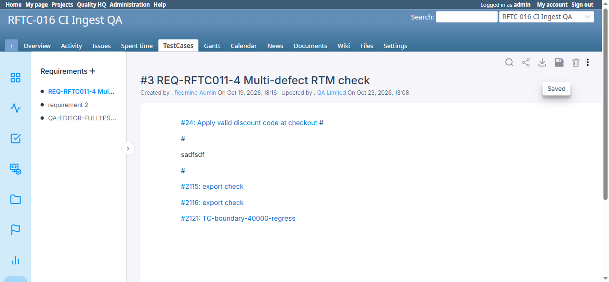

# BUG-TCM-100

- Bug ID: BUG-TCM-100
- Production Redmine Issue ID: #124715 (https://flux.zehntech.com/issues/124715)
- Title: Requirement page's Save and Close icon buttons both carry `alt="share-icon"` — identical to the real Share button's accessible name
- Redmine version: master (post-pull, pre-7.2.0)
- Plugin name: Redmineflux Testcase Management
- Plugin version: 7.2.0
- Environment: Docker `localhost:3000`, project `rftc-016-ci-qa`
- Browser: Chromium (Playwright)
- User role: admin
- Date: 2026-10-23 (found while thoroughly testing the Requirements page's toolbar icons per explicit user request to check Search/Share/Download/Export)

## Steps to reproduce

1. Open a requirement's detail page (`/requirements?project_id=<id>&page_id=<id>`).
2. Inspect the toolbar icon row (Search / Share / Export / Save / Delete / more-options) via the DOM — e.g. `document.querySelectorAll('img[alt*="icon"]')`.

## Expected result

- Each icon button's `alt` text (its accessible name) describes its own actual function — a Save button's icon should say "save", a Close button's icon should say "close", distinct from the real Share button.

## Actual result

- Confirmed via direct DOM inspection, 3 visually/functionally distinct buttons all expose `alt="share-icon"`:
  - `id="share-btn"`, `src=".../share-icon-e022af75.svg"` — the **real** Share button (tooltip "Share Page", correctly copies the page URL to the clipboard). This one's alt text is correct.
  - `id="save-draft"`, `src=".../save-icon-251a5781.svg"` — visually a **floppy-disk Save icon**, but its `alt` is also `"share-icon"` — wrong, should describe Save.
  - A **Close** button (`src=".../close_icon-8ce78407.svg"`) — also carries `alt="share-icon"` — wrong, should describe Close.
- The Export/Download button is a lesser version of the same pattern: its icon file is `download-icon-04afd1f5.svg` but its `alt` is `"export-icon"` (a naming mismatch, though "export" and "download" are near-synonyms here so this is far less confusing than the two above).
- Practical impact: a screen reader, or any automated test/tooling that identifies buttons by accessible name (`alt` text), cannot distinguish the Save button or the Close button from the real Share button — all three announce/match as "share-icon."

## Evidence

### Screenshot



### Console / log

```js
// document.querySelectorAll('img[alt*="icon"]') results (abridged to the relevant 3):
{ alt: "share-icon", src: ".../share-icon-e022af75.svg", id: "share-btn" }      // correct
{ alt: "share-icon", src: ".../save-icon-251a5781.svg",  id: "save-draft" }    // WRONG — should be "save-icon"
{ alt: "share-icon", src: ".../close_icon-8ce78407.svg" }                       // WRONG — should be "close-icon"
```

## Duplicate check

- Duplicate found: No
- Existing bug reference (if duplicate): n/a

## Suggested fix

Give each `` its own correct `alt` text matching the icon it actually renders — `alt="save-icon"` for `id="save-draft"`, `alt="close-icon"` for the close button, and (optionally) `alt="download-icon"` for the export/download button to match its actual asset file name.
