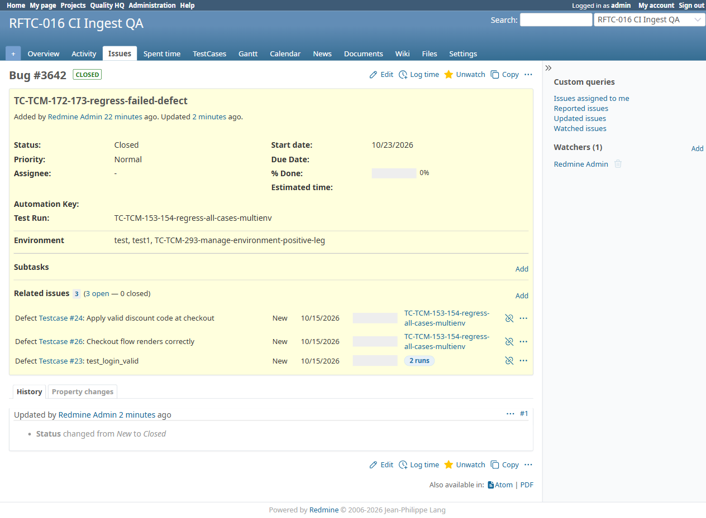

# BUG-TCM-102

- Bug ID: BUG-TCM-102
- Production Redmine Issue ID: #124717 (https://flux.zehntech.com/issues/124717)
- Title: A defect's own detail page shows only the single run it was *first* linked from in its "Test Run:" field — it never updates when the same defect is later linked to a second, different run, even though the sibling "Environment:" field on the same page *does* correctly aggregate every distinct value
- Redmine version: master (post-pull, pre-7.2.0)
- Plugin name: Redmineflux Testcase Management
- Plugin version: 7.2.0
- Environment: Docker `localhost:3000`, project `rftc-016-ci-qa`
- Browser: Chromium (Playwright)
- User role: admin
- Date: 2026-10-23 (found while verifying — at the user's explicit request — that a defect created/linked against an existing run+environment shows the correct run/environment on its own detail page)

## Steps to reproduce

1. Fail a test case in Run A / Environment A and report a new defect from it (e.g. via "Report Defect").
2. Open the new defect's own issue detail page — note its "Test Run:" and "Environment" fields (both correctly
   show Run A / Environment A at this point).
3. Go to a **different** Run B (any run, any environment), fail (or block) a different test case there, and in
   the Add Result form's **Defects\*** field, search for and link the **same, already-existing** defect from
   step 1.
4. Reopen the defect's own issue detail page.

## Expected result

- The "Test Run:" field should reflect **every** run the defect is genuinely linked to via a real execution (Run
  A **and** Run B), the same way the "Environment" field on the same page already does for environments.

## Actual result

- "Test Run:" still shows **only** `TC-TCM-153-154-regress-all-cases-multienv` (Run A — the run it happened to
  be reported from first) — Run B (`TC-TCM-042-env-rename-run`) is completely missing, even though the defect is
  genuinely linked to an execution there.
- "Environment" on the very same page correctly shows **all three** distinct environments the defect is actually
  linked to across every run: `test, test1, TC-TCM-293-manage-environment-positive-leg`.
- The page is self-contradictory: the **Related issues** section immediately below shows a **"2 runs"** badge
  next to the Testcase #23 relation (correctly indicating the defect is linked to that case across 2 different
  runs), directly under a "Test Run:" field at the top of the same page that still claims only 1.
- Confirmed via direct DB inspection (rails runner) that this is a real, reproducible data-display gap, not a
  caching artifact:
  ```
  issue.run_id (scalar): 83
  issue.run (scalar assoc): "TC-TCM-153-154-regress-all-cases-multienv"
  ExecutionDefect #60: issue_status_result #5963, run="TC-TCM-153-154-regress-all-cases-multienv", env="test", issue_id=24
  ExecutionDefect #61: issue_status_result #5964, run="TC-TCM-153-154-regress-all-cases-multienv", env="test", issue_id=26
  ExecutionDefect #62: issue_status_result #5996, run="TC-TCM-153-154-regress-all-cases-multienv", env="test1", issue_id=23
  ExecutionDefect #63: issue_status_result #6019, run="TC-TCM-042-env-rename-run", env="TC-TCM-293-manage-environment-positive-leg", issue_id=23
  ```
  `ExecutionDefect #63` proves the defect is genuinely linked to run `TC-TCM-042-env-rename-run` (run 76) — the
  "Test Run:" field simply never surfaces it.

## Root cause

`app/views/issues/_steps_list.html.erb`, the `defected_tracker_id` branch (around line 29-37):

```erb
<% if @issue.tracker_id == defected_tracker_id.to_i && @issue.run.present? %>
<div class="splitcontentleft">
  <div class="attribute">
    <div class="label"><%= l(:label_test_run) %>:</div>
    <div class="value">
      <%= @issue.run.name %>
    </div>
  </div>
</div>
<% end %>
```

`@issue.run` is the issue's **single scalar `run_id` association** — set once, to whichever run the defect
happened to be reported from first, and never updated afterward. This is the **exact same defect class already
fixed once on this same page, a few lines below, for the Environment field** — that code has an explicit
developer comment explaining the fix:

```erb
<%
  # A defect linked to more than one execution (ExecutionDefect) can genuinely
  # span more than one environment -- show every distinct one it's actually
  # linked to, comma-separated, instead of just the single environment column
  # recorded when the defect was first reported. Falls back to that single
  # value for a non-defect issue or a defect with no linked executions yet.
  ...
  _issue_environments = ExecutionDefect.where(defect_issue_id: @issue.id)
                   .includes(:issue_status_result)
                   .filter_map { |ed| ed.issue_status_result&.environment }
                   .uniq
%>
```

The Test Run field was simply never given the equivalent fix — it should read from
`ExecutionDefect.where(defect_issue_id: @issue.id).includes(issue_status_result: :run).filter_map { |ed| ed.issue_status_result&.run&.name }.uniq`
(or similar), exactly mirroring the Environment field's own approach immediately below it in the same file.

This is also the same **class** of bug as **BUG-TCM-050** (closed) and **BUG-TCM-058** (closed) — both of which
were about this exact "stale single `run`/`run_id` scalar instead of the real `ExecutionDefect` join" pattern,
in two *other* locations (`runs_helper.rb#defect_ids` / `testcase_reports_controller.rb`, and
`issues_helper_patch.rb`'s Relations-section Run column, respectively). This is a **third, not-yet-fixed**
instance of the same pattern — in the defect issue's own attribute panel, immediately next to the correctly-fixed
Environment field.

## Evidence

### Screenshot



### Console / log

- N/A — this is a data-display gap, not a JS console error.

## Separately confirmed working (not a bug)

While investigating this, also explicitly verified the user's other question: **a closed defect's ID correctly
shows with a strikethrough**, both in the Run page's "Linked defects" summary panel *and* in the run grid's own
"Defect ID's" column for every case the defect is linked to (confirmed via DOM inspection —
`style="text-decoration: line-through;"`, `computedTextDecoration: "line-through"` — on both grid cells for
case #24 and case #26 after closing defect #3642). This was initially missed in a quick visual pass at full-page
screenshot resolution (the line is thin) but is genuinely present and correctly applied in both locations.

## Duplicate check

- Duplicate found: No — related in root cause to closed BUG-TCM-050/058, but a different, not-yet-fixed location.
- Existing bug reference (if duplicate): n/a (see "Root cause" above for the related closed bugs)
