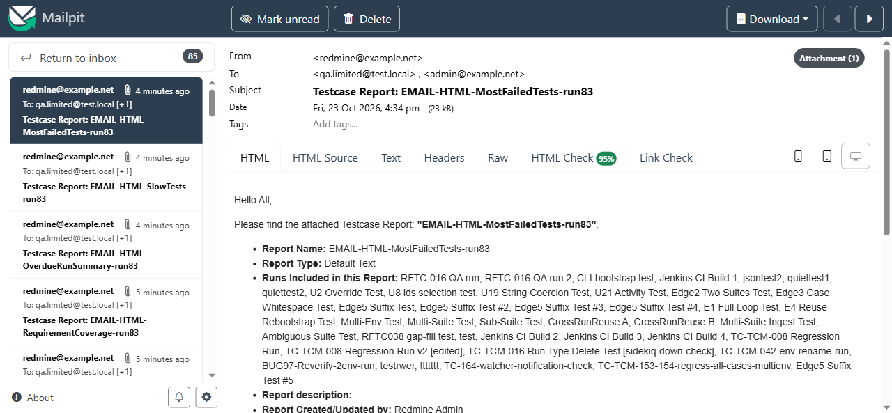

# BUG-TCM-109

- Bug ID: BUG-TCM-109
- Production Redmine Issue ID: #124776 (https://flux.zehntech.com/issues/124776) — assigned to Vaishnavi Bhawsar, priority Low, Defect Type Functional / Defect Severity Low-severity / Defect priority Low, target version Testcase Management plugin Release 7.2.0.
- Title: Emailed report's "Report Type:" line shows "Default Text" for Slow Tests and Most Failed Tests instead of their real type name
- Severity: Low
- Redmine version: 6.x (Docker)
- Plugin name: Redmineflux Testcase Management
- Plugin version: 7.2.0
- Environment: Docker `localhost:3000`, project `rftc-016-ci-qa`
- Browser: Chromium (Playwright)
- User role: Administrator
- Date: 2026-10-23

## Steps to reproduce

1. Create a **Slow Tests** or **Most Failed Tests** report with "Notify me by email" ticked (either HTML or PDF
   attachment format).
2. Open the delivered email and read its "Report Type:" line.

## Expected result

- The line should say "Slow Tests" or "Most Failed Tests" respectively, matching the report's actual type (as
  every other report type's emailed "Report Type:" line correctly does).

## Actual result

- Both show **"Default Text"** instead. Confirmed for report #151 (Slow Tests) and #152 (Most Failed Tests) —
  email body excerpt for #152: `* *Report Name:* EMAIL-HTML-MostFailedTests-run83 * *Report Type:* Default Text`.
  The other 6 report types emailed in the same batch (Testcase Summary, Defect Summary, Activity Summary,
  Tester Scorecard — see BUG-TCM-108 for why that one never actually delivered, Requirement Coverage, Overdue Run
  Summary) all show their correct type name.
- This affects only the email body's descriptive line — the attached report file itself (HTML/PDF/Excel) still
  carries correct data and its own correct title, per this session's download-format verification.

## Root cause (confirmed via code read, `app/models/run_mailer.rb`, ~line 273-289)

```ruby
report_type_texts = {
  "testcase" => "Testcase Summary",
  "summary" => "Defect Summary",
  "activity" => "Activity Summary",
  "tester_scorecard" => "Test Execution Scorecard by Tester",
  "requirement" => "Requirement Coverage",
  "overdue_run" => "Overdue Run Summary"
}
...
@report_type = report_type_texts[report.report_type] || "Default Text"
```

This hash was never updated when the **Slow Tests** (`slow_test`) and **Most Failed Tests** (`most_failed`)
report types were added to the plugin — both keys are simply absent from `report_type_texts`, so the lookup
returns `nil` and falls through to the `"Default Text"` fallback every time, for every email of either type.

## Evidence

### Email body, report #152 (Most Failed Tests), via Mailpit API

```
Report Name: EMAIL-HTML-MostFailedTests-run83
Report Type: Default Text
```

### Email body, report #150 (Overdue Run Summary) for contrast — correct

```
Report Name: EMAIL-HTML-OverdueRunSummary-run83
Report Type: Overdue Run Summary
```

### Screenshot



## Duplicate check

- Duplicate found: No
- Checked `bugs/_duplicates.md` and `bugs/_index.md` — related to, but distinct from, **BUG-TCM-106** (Excel
  export's report-type dispatch also doesn't recognize a newer report type's key, there for `requirement`) and
  **BUG-TCM-108** (Tester Scorecard's `show` action crash) — all three stem from the same pattern (newer report
  types added to the `Select type` dropdown without every downstream code path being updated to match), but each
  is a different file, different symptom, different report type. Not a duplicate of any existing bug.
