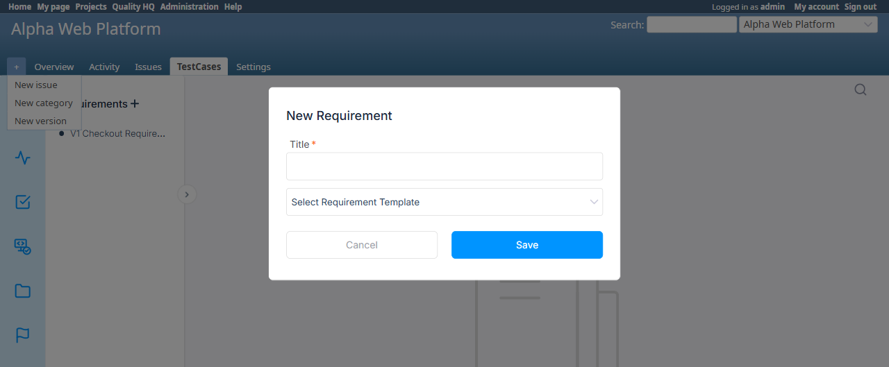

# BUG-TCM-120

- Bug ID: BUG-TCM-120
- Production Redmine Issue ID: <!-- fill after MCP report_defect/create_issue is approved and executed -->
- Title: Requirement Templates is a half-shipped feature — no UI/API exists anywhere to create one, so the "Select Requirement Template" dropdown is permanently empty on every real installation; a second, independent bug also makes a selected template never apply from the top-level "New Requirement" modal
- Severity: Medium
- Redmine version: 6.0.11.stable (Docker)
- Plugin name: Redmineflux Testcase Management
- Plugin version: 7.2.0
- Environment: Docker `localhost:3000`, project `alpha-web`
- Browser: Chromium (Playwright MCP) + direct DB verification
- User role: Administrator
- Date: 2026-10-26

## Steps to reproduce

1. On a fresh/real plugin installation (migrations only — no internal QA seed script run), open any project's
   Requirements page and click **+** to open "New Requirement".
2. Observe the "Select Requirement Template" dropdown.
3. Search the entire plugin codebase (`app/controllers/`, `config/routes.rb`, `app/views/settings/`) for any route,
   controller action, or admin page that can create/edit/delete a `RequirementTemplate` record.
4. Separately: insert a `RequirementTemplate` row directly (bypassing the product, since no in-product path
   exists), reload the Requirements page, open the top-level "New Requirement" modal (not the child/sub-requirement
   modal), select the newly-available template, and check which element's value the page's own JS actually reads
   when Save is clicked.

## Expected result

- A Requirement Template is a real, documented feature (model `RequirementTemplate`, migration
  `20250202120957_create_requirement_templates.rb`, and `requirements_controller.rb` fully supports applying one on
  create via `params[:requirement][:selectedTemplate]`) — so there should be some way, through the product's own UI
  or API, for an Administrator to create/manage Requirement Templates.
- Selecting a template from the top-level "New Requirement" modal (the normal, most common way to create a
  Requirement) should apply that template's content to the new Requirement.

## Actual result

**Finding 1 — no way to ever create a Requirement Template through the product itself.** Confirmed via a full
source search (`app/controllers/`, `config/routes.rb`, `app/views/settings/`, `init.rb`) that `RequirementTemplate`
is referenced in exactly 3 places in the entire plugin:
- `requirements_controller.rb` — reads `RequirementTemplate.all` for the dropdown, and applies one on create.
- `app/models/requirement_template.rb` — the bare ActiveRecord model (no validations, no scopes).
- `lib/tasks/testcase_setup.rake` — the **only** place a `RequirementTemplate` is ever created, and only as part
  of an internal QA/demo-data rake task (`testcase_plugin:setup`, described in its own `desc` string as "Setup
  initial data for Testcase Management Plugin (rich dataset for demo / reports)"), never referenced in `README.md`
  or any install documentation, and never run automatically during a real plugin install (`rails
  redmine:plugins:migrate` only runs migrations, which just create the empty table).

There is no controller action, route, or Administration/settings page anywhere in the plugin to create, edit, or
delete a `RequirementTemplate`. Confirmed live: on this Docker instance (migrations applied, QA seed rake task
never run), `SELECT * FROM requirement_templates` returns **0 rows**, and the "New Requirement" modal's dropdown
shows only the placeholder, with zero selectable templates — screenshot below.

**Finding 2 — even if a template exists, selecting it from the top-level "New Requirement" modal never applies.**
`app/views/requirements/index.html.erb` renders **two** separate `<select name="requirement_template_id">`
elements for two different modals:
- The top-level "New Requirement" modal's select (`#add-modal`) has **no `id` attribute at all**.
- The child/sub-requirement modal's select (`#add-child-modal`) has `id="requirement_template"`.

`assets/javascripts/script.js` (line 588) reads the chosen template via
`document.getElementById("requirement_template").value` — which, since only the child modal's select carries that
id, **always** returns the child modal's select value regardless of which modal is actually open. Verified live by
inserting a test `RequirementTemplate` row directly in the DB, reopening the top-level "New Requirement" modal
(now showing the real template as a selectable option), and running
`document.getElementById('requirement_template')` in the browser console — it resolves to the **child modal's**
select element, not the top-level modal's. A user selecting a template from the top-level modal (the normal way
most Requirements are created) has that selection silently ignored.

## Root cause (confirmed via code read + live DB check + browser console verification)

1. `RequirementTemplate` creation is never exposed through any controller/route/admin page — the model and its
   consuming logic in `requirements_controller.rb` were shipped, but the CRUD management UI for the template
   entity itself was not. The only seed path (`testcase_setup.rake`) is QA/demo tooling, not a product feature.
2. `app/views/requirements/index.html.erb`'s top-level-modal `<select name="requirement_template_id">` (no `id`)
   and child-modal `<select name="requirement_template_id" id="requirement_template">` share the same `name` but
   only one carries the `id` that `script.js`'s `document.getElementById("requirement_template")` depends on —
   a copy-paste/wiring gap between the two near-identical modals.

## Evidence

### Screenshot



### Database check

```sql
SELECT id, name FROM requirement_templates;
-- 0 rows (before test insert)
```

### Source search confirming no management UI exists

```
$ grep -rn "RequirementTemplate" app/ config/ lib/
app/controllers/requirements_controller.rb:48:    @requirement_templates = RequirementTemplate.all
app/controllers/requirements_controller.rb:67:      @template = RequirementTemplate.find(params[:requirement][:selectedTemplate])
app/models/requirement_template.rb:1:class RequirementTemplate < ActiveRecord::Base
lib/tasks/testcase_setup.rake:432:    unless RequirementTemplate.exists?(name: "Product Requirement Template")
lib/tasks/testcase_setup.rake:433:      RequirementTemplate.create!(...)
```

### Browser console verification (Finding 2)

```js
document.getElementById('requirement_template') === document.querySelector('#add-child-modal select[name="requirement_template_id"]')
// => true
document.getElementById('requirement_template') === document.querySelector('#add-modal select[name="requirement_template_id"]')
// => false (top-level modal's select has no id, so this selector would be the right one but getElementById never finds it)
```

### Console / log

- No server error; this is a feature-completeness gap (Finding 1) plus a silent JS wiring bug (Finding 2), not a
  crash.

## Duplicate check

- Duplicate found: No
- Checked `bugs/_duplicates.md` and `bugs/_index.md` — no existing bug covers Requirement Templates having no
  management UI, or the top-level/child-modal template-select `id` mismatch.
