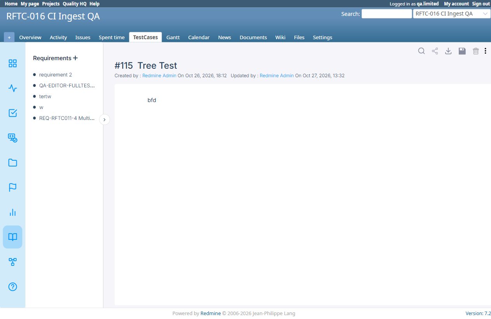

# BUG-TCM-123

- Bug ID: BUG-TCM-123
- Production Redmine Issue ID: <!-- not yet reported -->
- Title: `RequirementsController#content` has zero cross-project scoping — any user with `edit_requirement` on ANY project (or just logged-in, via the fallback branch) can read ANY other project's Requirement content by ID, completely bypassing project membership/visibility, even for private projects
- Redmine version: 6.x (Docker)
- Plugin name: Redmineflux Testcase Management
- Plugin version: 7.2.0
- Environment: Docker `localhost:3000`
- Browser: Chromium (Playwright MCP)
- User role: `qa.limited` (Manager on `rftc-016-ci-qa` only — confirmed NOT a member of `alpha-web`, which is a private project, via a real `403` on `/projects/alpha-web`)
- Date: 2026-10-27

## Summary

The Requirements page's client-side content loader fetches a requirement's content via
`GET /knowlegebase_pages_testcase/:id` (routed to `RequirementsController#content`), using only the `page_id`
from the URL — a value fully controlled by the viewer. The action's authorization check only verifies the
current user's permission on the project named by the request's own `project_id` param (the project the user is
legitimately browsing); it never checks that the requirement being fetched (`params[:id]`) actually belongs to
that project. The result: a user who can view Requirements for Project A can read the full content of ANY
Requirement in ANY OTHER project (including private ones they are not a member of) simply by changing the
`page_id` query parameter — a classic IDOR, not merely a cosmetic cross-project oddity.

This is a more severe sibling of the already-closed BUG-TCM-094 (`IssueStatusResultsController#new`'s
cross-project disclosure) and the still-open BUG-TCM-089 (Requirements has no dedicated `view_requirement`
permission) — this time on the actual content-serving endpoint itself, not just the surrounding UI controls.

## Steps to reproduce

1. As Admin, confirm `alpha-web` is a **private** project (Project → Settings → "Public" checkbox unchecked).
2. Confirm `qa.limited` is NOT a member of `alpha-web` (as admin, log in as `qa.limited` and navigate to
   `/projects/alpha-web` — real `403 Forbidden`).
3. As `qa.limited`, navigate to a project they ARE a legitimate member of instead, e.g.
   `http://localhost:3000/requirements?project_id=rftc-016-ci-qa&page_id=115` — note `page_id=115` is the numeric
   ID of a Requirement that belongs to `alpha-web` (`#115`, titled "Sidebar Tree Test"), not to `rftc-016-ci-qa`.
4. Observe the right-hand detail panel.

## Expected result

- The requirement content shown should always belong to the project named in the URL's `project_id` — a
  cross-project `page_id` should be rejected (404, matching the plugin's own established pattern elsewhere, e.g.
  `rftc_authorize_project_read!`'s "404 so this can't be used as a project-existence oracle").

## Actual result

- The full content of `alpha-web`'s private Requirement `#115` ("Sidebar Tree Test") is returned and rendered,
  even though `qa.limited` is logged in while browsing `rftc-016-ci-qa` and has zero membership/visibility into
  `alpha-web` at all (confirmed via the real `403` on that project's own Overview page in the same session).
  Confirmed via direct DOM inspection: `document.querySelector('#page-title').innerText === " Tree Test"` and
  `document.querySelector('#page-id').innerText === "#115"`, while the page's own project-context heading
  correctly still reads "RFTC-016 CI Ingest QA" — the sidebar/nav chrome is correctly scoped, only the actual
  requirement content fetch is not.

## Root cause (confirmed via source read)

`app/controllers/requirements_controller.rb`, the `content` action (routed from
`GET 'knowlegebase_pages_testcase/:id'`):

```ruby
def content
  if User.current.allowed_to?(:edit_requirement, Project.find(params[:project_id])) || User.current.admin?
    if params[:id].present?
      @parameter_id = params[:id].to_i
      @data = Requirement.where(:id => @parameter_id).map{|k| ... }   # <-- no project scoping at all
      ...
    end
  else
    if params[:id].present?
      @parameter_id = params[:id].to_i
      latest_version = RequirementVersion.where(requirement_id: @parameter_id).order(updated_at: :desc).first
      @data = Requirement.where(:id => @parameter_id).map{|k| ... }   # <-- same unscoped lookup
      ...
    end
  end
end
```

`Project.find(params[:project_id])` is used **only** to decide which branch's permission check to run (does the
current user have `edit_requirement` on the project they say they're browsing) — it is never used to constrain
the actual `Requirement.where(:id => @parameter_id)` lookup. Both branches fetch the requirement purely by its
own numeric `id`, with no `project_id: params[:project_id]` (or `project_id: @project.id`) clause anywhere. This
is a direct contrast to the plugin's own correctly-scoped pattern elsewhere in the same file (e.g. line ~193,
`Requirement.find_by(id: params[:page_id], project_id: @project.id)`, and the `show` action's
`rftc_authorize_requirement_read` → `rftc_require_project_visible!(@project)`, explicitly commented "Blocks
cross-project read IDOR" — but that protection lives on the REST `show` action, which the actual page-content
AJAX call does not use).

## Evidence

### Screenshot



### Console / log

```js
// As qa.limited, at http://localhost:3000/requirements?project_id=rftc-016-ci-qa&page_id=115
document.body.innerText.match(/Logged in as\s*\S+/)[0]   // => "Logged in as qa.limited"
document.querySelector('#page-title').innerText           // => " Tree Test"  (alpha-web's requirement)
document.querySelector('#page-id').innerText               // => "#115"
document.querySelector('h1').innerText                     // => "RFTC-016 CI Ingest QA" (the project qa.limited IS a member of)

// Confirmed alpha-web is private and qa.limited is not a member:
// GET /projects/alpha-web as qa.limited -> 403 Forbidden
// alpha-web Settings (as admin): "Public" checkbox unchecked
```

## Duplicate check

- Duplicate found: No
- Checked `bugs/_duplicates.md` and `bugs/_index.md` for "cross-project", "IDOR", "requirement", "knowlegebase" —
  closest relatives are BUG-TCM-094 (`IssueStatusResultsController#new`, a different controller, discloses only
  an environment name, already closed) and BUG-TCM-089 (Requirements has no `view_requirement` permission at
  all, a design gap, not this specific unscoped-lookup bug). Neither covers this endpoint or this exact
  vulnerability — a different controller action with its own distinct, more severe unscoped-ID-lookup root cause.

## Found via

Regression testing TC-TCM-121 ("Requirements are project-scoped") in `TESTCASE_MANAGEMENT_REQUIREMENTS_RTM.md`,
as part of the post-bug-fix regression pass triggered by this cycle's 39 retested bugs (2026-10-26/27). The
original TC-TCM-121 only checked that the sidebar/project-switch correctly scopes the requirements *list*; this
session extended it to directly test cross-project `page_id` access, which the original TC never covered.
