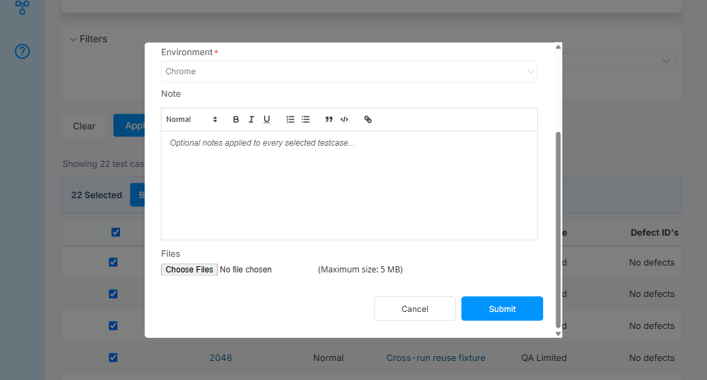
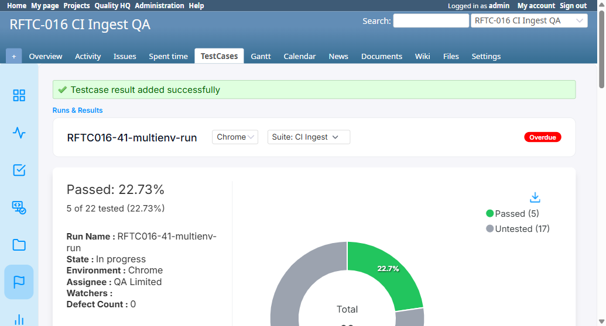

# BUG-TCM-124

- Bug ID: BUG-TCM-124
- Production Redmine Issue ID: #125531
- Title: Recording a result under the "All Suites" run view is broken two ways — Bulk Update Result fails outright with "Test Suite not found," and a single Add Result silently kicks the viewer out of "All Suites" into one specific suite
- Severity: Medium
- Redmine version: 6.x (Docker)
- Plugin name: Redmineflux Testcase Management
- Plugin version: 7.2.0
- Environment: Docker `localhost:3000`, project `rftc-016-ci-qa`, Run #163 (`RFTC016-41-multienv-run`, 22 test cases, suite "CI Ingest" id 3, multi-environment)
- Browser: Chromium (Playwright MCP)
- User role: Administrator (reproducible by any role that can record results)
- Date: 2026-10-27 — found live by the user while using the app, reproduced independently here

## Summary

A run's "All Suites" view (the default when no specific suite is selected from the "Suite:" switcher) is the
normal landing state for a run with more than one suite. Recording a result from this view is broken in two
distinct ways:

1. **Bulk Update Result always fails** with a hard "Test Suite not found" error and records nothing, because
   the frontend sends `testsuite_id: null` in the bulk payload — there is no single suite to attribute the
   selection to while viewing "All Suites" — but the backend's `bulk_create` action requires a valid
   `testsuite_id` and rejects the whole request outright (404) when it's `null`. This makes bulk-updating
   results completely unusable from "All Suites," the view's own default state.
2. **A single "Add Result" submission succeeds, but silently switches the view out of "All Suites"** into
   whichever one specific suite that test case happens to belong to. The user loses the "All Suites" context
   they were in without any indication this would happen, and has to manually switch back to "All Suites" to
   continue working across the whole run.

Both point to the same underlying gap already flagged by BUG-TCM-098 ("All Suites in Run" never properly
aggregates) — but this is a distinct manifestation on the **write path** (recording results), not the read/
display path BUG-TCM-098 covered.

## Steps to reproduce

**Finding 1 (Bulk Update Result):**
1. Open a run with more than one test suite, on its default "All Suites" view (no `testsuite_id` in the URL).
2. Select several/all test cases via the checkboxes.
3. Click **Bulk Update Result**, choose a Status (e.g. Passed) and Environment, click **Submit**.

**Finding 2 (single Add Result):**
1. On the same "All Suites" view, click a test case's own result link (e.g. "Untested") to open the **Add
   Result** modal.
2. Choose a Status and Environment, click **Submit**.

## Expected result

- Finding 1: Bulk Update Result should work from "All Suites" — either by writing each selected test case's
  result against its own actual suite (resolved per-issue, not one shared `testsuite_id` for the whole batch),
  or by explicitly disabling/hiding the Bulk Update Result action while "All Suites" is selected with a clear
  reason, rather than silently failing on submit.
- Finding 2: recording a single result should not change which suite the run view is scoped to — the user
  should stay on "All Suites" afterward, exactly as they were before submitting.

## Actual result

**Finding 1 — confirmed live.** Selected all 22 test cases on Run #163's "All Suites" view, opened Bulk Update
Result ("Apply to 22 testcase(s)"), chose Status=Passed, Environment=Chrome, clicked Submit. The modal
re-rendered with a red banner reading **"Test Suite not found"** and the Status field reset to
"-- Select status --" — nothing was recorded. Network trace confirms the root cause:

```
POST /issue_status_results/bulk_create
Request body: {"run_id":163,"testsuite_id":null,"issue_status_results":[{"issue_id":23,"case_status_id":2,...}, ...22 entries]}
Response: 404 Not Found
{"errors":"Test Suite not found"}
```

`testsuite_id` is sent as `null` — there is no way for the frontend to pick a single suite id while "All
Suites" is the active view, since the selected test cases can legitimately belong to different suites. The
backend has no fallback for this and just 404s the entire batch.

**Finding 2 — confirmed live.** On the same "All Suites" view (URL: `/runs/163?project_id=rftc-016-ci-qa`, no
`testsuite_id`), clicked the "Untested" link for test case #28, chose Status=Passed in the Add Result modal,
clicked Submit. The result was recorded successfully, **but the page redirected to**
`/runs/163?environment=Chrome&project_id=rftc-016-ci-qa&testsuite_id=3` — the "Suite:" switcher button now
reads **"Suite: CI Ingest (22)"** instead of "All Suites." The user was silently moved out of the view they
were working in, with no warning or explanation, and has to manually re-select "All Suites" to resume working
across every suite in the run.

## Root cause

- Finding 1: `issue_status_results_controller.rb#bulk_create` requires a single `testsuite_id` for the whole
  batch and look up/validate against it (raising "Test Suite not found" when it's `nil`), but the "All Suites"
  view has no single suite to supply — the UI's own bulk-selection mechanism doesn't track each selected
  issue's individual suite membership, only the issues themselves.
- Finding 2: `issue_status_results_controller.rb#create` (the single-result path) redirects back to the run
  using the specific `testsuite_id` the clicked row's link carried (visible in each row's own "Result" link,
  e.g. `/issue_status_results/new?...&testsuite_id=3`), rather than preserving whatever suite context
  (including "All Suites," i.e. no `testsuite_id`) the user was actually viewing when they clicked it.

## Evidence

### Screenshot — Finding 1 (Bulk Update Result error)



### Screenshot — Finding 2 (silently switched out of All Suites)



### Network trace (Finding 1)

```
POST /issue_status_results/bulk_create
{"run_id":163,"testsuite_id":null,"issue_status_results":[{"issue_id":23,"case_status_id":2,"environment":"Chrome","notes":""}, ... 21 more]}
=> 404 {"errors":"Test Suite not found"}
```

## Duplicate check

- Duplicate found: No — related but distinct.
- Closely related to **BUG-TCM-098** ("All Suites in Run" never actually aggregates on the read/display path —
  `@run.testsuites.first` substitution) but that bug is about what the grid *shows*; this bug is about what
  happens when you try to *write* a result while on that same view. Fixing BUG-TCM-098's read-path bug would
  not fix either finding here, since both are write-path (`bulk_create`/`create` + redirect) issues.
- Checked `bugs/_duplicates.md` and `bugs/_index.md` for "bulk update," "Test Suite not found," "All Suites" —
  no existing entry covers the write path specifically.

## Test data impact

Reproducing Finding 1 and Finding 2 against real fixture run #163 (`RFTC016-41-multienv-run`) recorded genuine
"Passed" results for test cases #23, #26, #27, #24, and #28 (Chrome environment) as part of confirming the
behavior. The Status dropdown has no "Untested"/unset option to manually revert these, so this run's pass rate
(now 18.18%, up from its original 13.64%) was left as-is rather than attempting an unsupported rollback. Noted
here for the record — not a data-integrity concern (the extra Passed statuses are real, intentional results
from this session), just a heads-up for anyone later using this run's counts as a baseline.

## Production report

Reported to production `ztflux` as **#125531** on 2026-10-27, per explicit user instruction ("sirf 124 report kro").
Tracker Bug, Priority Medium, Category "Testcase Management Plugin", Target version "Testcase Management plugin
Release 7.2.0 [21-10-2026]" (id=2067), assigned to Vaishnavi Bhawsar (id=192). Custom fields: Defect
Type=Functional, Defect Severity=Medium-severity, Defect priority=Medium. Standalone issue, no Test Run/Testcase
link.
