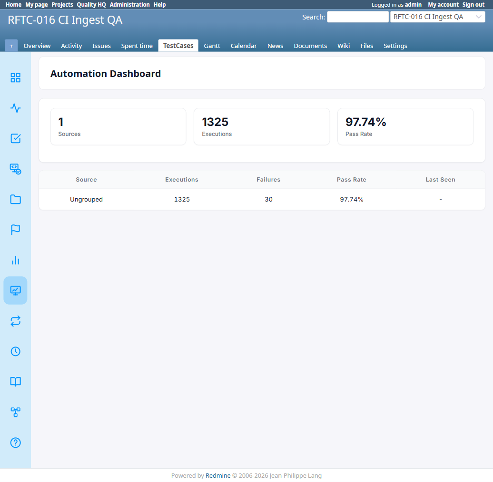

# BUG-TCM-125

- Bug ID: BUG-TCM-125
- Production Redmine Issue ID: #127357 (linked to testcase #127276, Run #659 "Testcase Release 7.3.0 Sign-off", RFTC-018 suite #519)
- Title: AutomationSource resolution silently drops a result into "ungrouped" when the same source name is re-ingested with different casing
- Redmine version: 6.x (Docker)
- Plugin name: Redmineflux Testcase Management
- Plugin version: branch `release/7.3.0`, commit `329311d` (rftc-018 — Automation Sources, not yet on master)
- Environment: Docker `localhost:3000`, project `rftc-016-ci-qa`
- Browser: N/A — reproduced directly via `bin/rails runner` (this is a backend resolution bug, not a UI-visible one on its own; it's visible indirectly via the Automation Dashboard showing fewer/wrong sources than expected)
- User role: N/A (server-side service logic)
- Date: 2026-11-02

## Steps to reproduce

1. CI-ingest a result with an explicit `source` of `"Nightly"` for a project with no existing `AutomationSource` of that key. `AutomationSourceResolver.resolve!` creates `AutomationSource(key: "Nightly")` successfully.
2. CI-ingest a second result for the **same project**, this time with `source: "nightly"` (same name, different case only).
3. Observe `AutomationSourceResolver.resolve!`'s return value / the resulting `issue_status_results.source_id` for the second result.

## Expected result

- The second ingest should either (a) resolve to the **same** `AutomationSource` row as the first (treating the key as the same source regardless of case, consistent with `AutomationSource`'s own uniqueness validation being case-insensitive), or (b) if case-sensitive keys are actually intended, raise/log a clear "name conflict" rather than silently failing. Either way, the result should end up grouped under some real source, not silently ungrouped.

## Actual result

- `resolve!` returns `nil` for the second call. Root cause (confirmed by reading both files):
  - `AutomationSource` validates `key` uniqueness as `uniqueness: { scope: :project_id, case_sensitive: false }` (`app/models/automation_source.rb:14`).
  - `AutomationSourceResolver#resolve!` looks the key up with a **case-sensitive** literal match: `AutomationSource.find_by(project_id: project.id, key: key)` (`app/services/automation_source_resolver.rb:57`).
  - When the second call's `create_source` tries to `AutomationSource.create!(key: "nightly", ...)`, the case-insensitive validation correctly rejects it as a duplicate of `"Nightly"`, raising `ActiveRecord::RecordInvalid`.
  - The rescue clause then retries `AutomationSource.find_by(project_id:, key: "nightly")` — still a case-sensitive literal match, which finds nothing (the real row's key is `"Nightly"`), so it returns `nil`.
  - Back in `resolve!`, `source ||= create_source(...)` is `nil`, so `return nil if source.nil?` fires — `resolve!` returns `nil` for the entire second ingest call.
  - Net effect: the second CI result's `source_id` stays `nil` ("Ungrouped" on the Automation Dashboard) instead of being correctly grouped under the existing `"Nightly"` source — a result that should clearly belong with the first batch silently falls out of that source's rollup.
- Live-confirmed via `bin/rails runner` against `localhost:3000` (project `rftc-016-ci-qa`, id=2):
  ```
  First resolve (CaseTestXYZ): id=1 key=CaseTestXYZ
  Second resolve (casetestxyz, different case): NIL -- BUG CONFIRMED, result would be ungrouped
  ```

## Evidence

### Screenshot

The bug itself has no direct UI reproduction screenshot (it's a backend resolution path); the attached screenshot shows the Automation Dashboard's current state on this project, where all 1325 historical (pre-rftc-018) executions land in a single "Ungrouped" bucket — this is expected for pre-existing data, but the same "Ungrouped" bucket is where any future case-mismatched re-ingest of an existing source would also silently land, indistinguishable from legitimately ungrouped data.



### Console / log

```
irb(main)> AutomationSourceResolver.resolve!(project: project, key: 'CaseTestXYZ', kind: 'explicit')
=> #<AutomationSource id: 1, key: "CaseTestXYZ", ...>
irb(main)> AutomationSourceResolver.resolve!(project: project, key: 'casetestxyz', kind: 'explicit')
=> nil
```

## Duplicate check

- Duplicate found: No
- Existing bug reference (if duplicate): —
