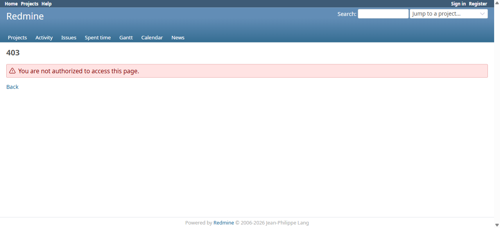

# BUG-TCM-127

- Bug ID: BUG-TCM-127
- Production Redmine Issue ID: #127360 — "BUG-TCM-127: Anonymous access to any rftc_require_login!-gated TCM page returns a bare 403 instead of redirecting to login (plugin-wide)", assigned Vaishnavi Bhawsar (linked to testcases #127284/RFTC-022 suite #521, #127289/RFTC-029 suite #522, and #127292/RFTC-035 suite #523, all in Run #659 "Testcase Release 7.3.0 Sign-off" — one defect issue linked across all three, reflecting the plugin-wide scope)
- Title: Anonymous (logged-out) access to any `rftc_require_login!`-gated TCM page returns a bare 403 Forbidden instead of redirecting to the login page
- Redmine version: 6.x (Docker)
- Plugin name: Redmineflux Testcase Management
- Plugin version: branch `release/7.3.0`, commit `329311d` — but this is a **pre-existing** gap in the shared `RftcAccessControl` concern, not something rftc-022 introduced; it affects every controller that uses `rftc_require_login!`/`rftc_require_permission!`/`rftc_authorize_project_read!` plugin-wide (confirmed on Run Comparisons, the Automation Dashboard, AND Exploratory Sessions — see RFTC022-15/RFTC029-18), not just Run Comparisons
- Environment: Docker `localhost:3000`, project `rftc-016-ci-qa`
- Browser: Chromium (Playwright MCP)
- User role: Anonymous (logged out)
- Date: 2026-11-02

## Steps to reproduce

1. Without logging in (or after explicitly signing out via the real "Sign out" button, not just a direct GET to `/logout`), navigate directly to `/projects/rftc-016-ci-qa/run_comparisons`.
2. Observe the HTTP response.
3. Repeat against `/projects/rftc-016-ci-qa/automation_dashboard` (a different rftc-0NN feature using the same shared access-control concern) to confirm this is not isolated to one controller.

## Expected result

- Per the developer's own written functional test for this exact feature (`test/functional/run_comparisons_controller_test.rb`, `test "anonymous user is redirected to login"` → `assert_response :redirect`) and standard Redmine UX elsewhere in the product, an anonymous user hitting a login-required page should be **redirected to `/login` (302)**, landing on a usable login form, not stopped with a dead-end error page.

## Actual result

- The page returns a bare **403 Forbidden** (not a redirect) and renders Redmine's generic 403 error page with no link or affordance to sign in. Confirmed via raw HTTP status (`HTTP status: 403 Forbidden`), not just the rendered title.
- Root cause (confirmed by reading the code): `app/controllers/concerns/rftc_access_control.rb`'s `rftc_require_login!` is:
  ```ruby
  def rftc_require_login!
    return true unless rftc_anonymous?

    rftc_render_error(:forbidden, l(:error_unauthorized_action))
  end
  ```
  It renders a **403** directly for any anonymous user, rather than calling Redmine's own `require_login`/redirecting to `/login` with a `back_url`. Every other gate in this concern (`rftc_require_permission!`, `rftc_require_any_permission!`, `rftc_authorize_project_read!`) calls `rftc_require_login!` first, so this 403-not-redirect behavior is inherited plugin-wide, confirmed independently on `RunComparisonsController` (rftc-022), `AutomationDashboardController` (rftc-035), and `TestcaseSessionsController` (rftc-029) — in the last case confirmed to hit EVERY action (`index`, `show`, `new`, `close`, `add_note`), since `authorize_session_project_access` (which wraps `rftc_authorize_project_read!`) runs as a `before_action` ahead of every action-specific permission check, so the 403 fires before `deny_access`-based gates are ever reached.
- This directly contradicts the developer's own functional test's explicit assertion (`assert_response :redirect`) for this exact scenario — meaning that test, if it had actually been run (per this plugin's own "Minitest suite was written and syntax-checked but never run by the actual test runner" note, recorded earlier this QA cycle), would have failed. This is the same "developer's own Quality Gates is not independent QA" pattern already noted in plugin memory.

## Evidence

### Screenshot



### Console / log

- Playwright MCP `browser_navigate` result for the anonymous request: `Page Title: 403 - Redmine`, `HTTP status: 403 Forbidden`.
- Confirmed logged-out state first (not a stale session) by clicking the real "Sign out" button and verifying the top nav no longer shows "Logged in as," then navigating directly to the URL in the same tab.
- Same 403 (not a redirect) independently reproduced on `/projects/rftc-016-ci-qa/automation_dashboard` and on every `testcase_sessions` route (`index`, `show`, `new`) as an anonymous user — confirmed via RFTC029-18's live execution (2026-11-02). Also confirmed that a logged-in NON-member of this private project correctly gets a 404 (not a leak, not a 403) — that part of the plugin's cross-project/visibility handling is correct; only the anonymous-user path is wrong.

## Duplicate check

- Duplicate found: No
- Existing bug reference (if duplicate): —
