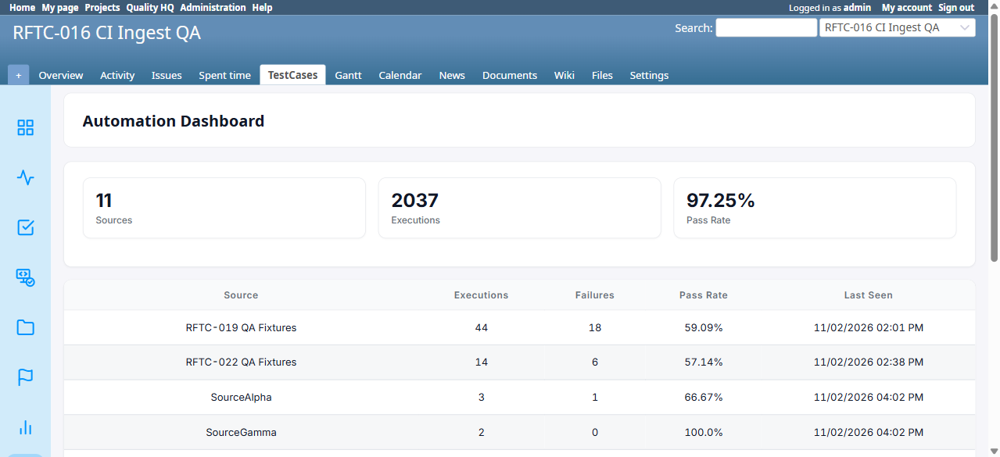

# BUG-TCM-128

- Bug ID: BUG-TCM-128
- Production Redmine Issue ID: #127359 — "BUG-TCM-128: Automation Dashboard's Pass Rate counts Untested/Blocked/Retest/Skipped results as 'Passed'...", assigned Vaishnavi Bhawsar (linked to testcase #127293, Run #659 "Testcase Release 7.3.0 Sign-off", RFTC-035 suite #523)
- Title: Automation Dashboard's Pass Rate counts Untested/Blocked/Retest/Skipped results as "Passed," inflating the pass rate for sources with zero genuine passes
- Redmine version: 6.x (Docker)
- Plugin name: Redmineflux Testcase Management
- Plugin version: branch `release/7.3.0`, commit `c9c8593` ("Add four roadmap features: automation sources, flaky-test detection, run comparisons, and exploratory sessions")
- Environment: Docker `localhost:3000`, project `rftc-016-ci-qa`
- Browser: Chromium (Playwright MCP)
- User role: Administrator
- Date: 2026-11-02

## Steps to reproduce

1. Ingest a single CI result with status `skipped` (or `blocked`, or leave a row `Untested`) for a test case under a brand-new, otherwise-empty `AutomationSource` (e.g. via `CiResultIngestService` with an explicit `source` value and no other result under that source).
2. Open `/projects/<id>/automation_dashboard`.
3. Find that source's row.

## Expected result

- A source whose only result is Skipped/Blocked/Untested — i.e. has **zero** genuine `Passed` results and zero genuine `Failed` results — should show a Pass Rate that reflects this (e.g. 0% genuine passes, or the row should be excluded from a binary pass/fail percentage entirely), not a rate implying everything passed.

## Actual result

- The source shows **100.0% Pass Rate** with 1 Execution and 0 Failures, as if its one result were a genuine Pass — even though the result was actually `Skipped` (or `Blocked`). Confirmed live on the real Automation Dashboard page: a source named `SourceDelta` with a single `Skipped` result reads `1 | 0 | 100.0%`, and a source named `SourceGamma` with one `Passed` + one `Blocked` result reads `2 | 0 | 100.0%` (should arguably be 50% if Blocked is treated as a non-pass, per this plugin's own sibling metrics' convention).
- Root cause (confirmed by reading the code): `RollupMath.automation_sources_overview` in `lib/redmineflux_testcase_management/reporting/rollup_math.rb`:
  ```ruby
  rec[:pass_count] += cnt if failure_by_status[row['case_status_id']] == false && row['case_status_id'].present?
  rec[:fail_count] += cnt if failure_by_status[row['case_status_id']]
  ```
  `pass_count` increments whenever the `CaseStatus`'s `is_failure` column is `false` — but `is_failure` is `false` for **every** status except `Failed` (confirmed via `CaseStatus.all`: `Untested`, `Passed`, `Retest`, `Blocked`, `Skipped` all have `is_failure: false`; only `Failed` has `is_failure: true`). The code should instead check `is_success` (which is `true` only for `Passed`) to increment `pass_count`, the same way `fail_count` correctly checks `is_failure`. As written, **any non-Failed status counts toward the Pass Rate's numerator as if it were a genuine pass** — Untested, Blocked, Retest, and Skipped are all silently counted as "passed."
- This is a correctness/misleading-metrics bug, not a crash — but it can make a source's Pass Rate look artificially high (up to 100%) even when it has produced zero genuine passing results, which directly undermines the dashboard's purpose of showing real automation health per source.
- Cross-checked against the plugin's own sibling metrics for contrast: `most_failed_tally`/`flaky_tally` (rftc-019/020) both explicitly exclude `Untested`/`Skipped` from their "executed" denominator before computing any rate — this is the more defensible pattern already established elsewhere in the plugin, and this new feature does not follow it.

## Evidence

### Screenshot



Shows the live Automation Dashboard table: `SourceGamma` (1 Passed + 1 Blocked) reading `2 | 0 | 100.0%`, and `SourceDelta` (1 Skipped only) reading `1 | 0 | 100.0%` — both showing 100% Pass Rate despite having zero or only partial genuine Passed results.

### Console / log

- Confirmed via direct `RollupMath.automation_sources_overview(project)` calls against `bin/rails runner` fixtures: a source with exactly one `Skipped` result returns `{total_cells: 1, pass_count: 1, fail_count: 0, pass_rate: 100.0}` — `pass_count` incorrectly includes the Skipped row.
- Live UI table (read via `document.querySelectorAll`) matches this backend data exactly, confirming the bug is visible to a real user, not just in the underlying service call.

## Duplicate check

- Duplicate found: No
- Existing bug reference (if duplicate): —
