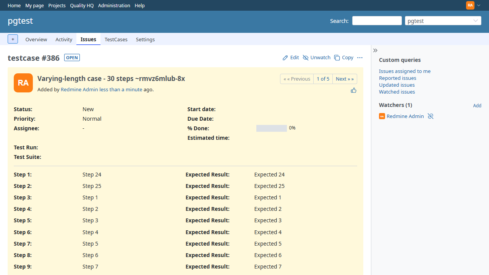

# BUG-TCM-129

- Bug ID: BUG-TCM-129
- Production Redmine Issue ID:
- Title: A test case's steps are shown in scrambled order on PostgreSQL — `Issue has_many :steps` has no ORDER BY and the `steps` table has no position column, so the page follows the database's physical row layout, not the order the steps were saved
- Severity: High
- Redmine version: 7.0 (Docker `redmine:7.0-bookworm`)
- Plugin name: Redmineflux Testcase Management
- Plugin version: branch `release/7.3.0`, commit `acda260` (also `release/7.2.0`, commit `b1a6c79`) ("Fix CSV test case import crashing on PostgreSQL when steps have long text")
- Environment: Docker `localhost:3003` (fresh install, PostgreSQL 16, project `pgtest`)
- Browser: Chromium (Playwright automation suite)
- User role: Administrator
- Date: 2026-11-02
- Found via: automated suite — `automation/tests/TESTCASE_MANAGEMENT_CSV_IMPORT.spec.ts`, **TC-TCM-026** (varying step counts in one file), run by `npx playwright test`

## Steps to reproduce

1. On a PostgreSQL-backed instance, import `automation/testdata/csv-test-data/06_varying_step_counts_same_file.csv`
   (Project → TestCases → Import Testcases → accept the auto-mapping → Import). Row 5, "Varying-length case - 30 steps",
   has Step 1 … Step 30 in order.
2. Open the created test case (here issue #386).
3. Read the order of the Step / Expected Result rows.
4. Compare with what is stored: `SELECT step FROM steps WHERE issue_id = 386 ORDER BY id;`

## Expected result

- The page shows Step 1, Step 2, Step 3 … Step 30 — the order in which the steps were saved.

## Actual result

- The page shows **"Step 24, Step 25, Step 1, Step 2, … Step 23, Step 26 … Step 30"**: the case's own "Step 1" label is attached
  to the text "Step 24", and its Expected Result is "Expected 24".
- The saved data is correct. `ORDER BY id` returns Step 1 … Step 30. Only the read order is wrong.
- It is intermittent, because it depends on where PostgreSQL happens to place each row on disk. Across five full runs of the
  import suite on this instance, TC-TCM-026 failed on 2 (runs 2 and 3, with the same "Step 24" symptom) and passed on 3
  (runs 1, 4 and 5; it also passed when run alone). A case whose rows are already stored out of order stays that way:
  issue #386 still returns Step 24, Step 25, Step 1, Step 2 … on every read.
- **Not limited to long cases.** Found again on 2026-11-02 with Playwright MCP, importing `05_mixed_partial_per_row.csv` on the same
  instance: case #888 ("Mixed - missing step mid-sequence") has only 2 steps. Saved order (`ORDER BY id`) is Step 1, Step 3, but the
  page shows "Step 3 action" first. Cases whose rows come back out of saved order on this instance: **3 of 871** with steps
  (#297 and #386, both 30-step, and #888); on the restored `localhost:3000` PostgreSQL database: **1 of 2020** (#2748, 3 steps).
  Found by comparing physical row order (`ctid`) with `id` order; read-only SQL.
- **Also present in `release/7.2.0`** (`b1a6c79`, fresh PostgreSQL 16, `localhost:3004`): found with Playwright MCP importing
  `05_mixed_partial_per_row.csv`, case #350 ("Mixed - fully paired, 3 steps") shows its steps out of saved order — 1 of 424 cases with
  steps on that instance. Both releases carry the same unordered `has_many :steps` in `issue_patch.rb`.

## Root cause (confirmed)

- `lib/testcase_management/patches/issue_patch.rb:9` and `:27`: `has_many :steps, dependent: :destroy` — no scope, so no `ORDER BY`.
- The `steps` table has no `position`/`number` column (columns: id, step, expected, created_at, updated_at, created_by,
  updated_by, issue_id), so the display order can only come from `id`.
- Rails run on the instance: `Issue.find(386).steps.map(&:step).first(4)` → `["Step 24", "Step 25", "Step 1", "Step 2"]`;
  `.steps.reorder(:id)` → `["Step 1", "Step 2", "Step 3", "Step 4"]`. The generated SQL is
  `SELECT … FROM "steps" WHERE "steps"."issue_id" = 386` with nothing after it.
- A SQL standard fact, not a quirk: without `ORDER BY` the order is undefined. PostgreSQL reuses freed space in the table
  file, so rows can come back out of insertion order. MySQL/InnoDB usually returns primary-key order for this query, which is why
  this is likely to stay invisible on a MySQL-backed instance; that was not tested here.

## Impact

- Any test case on PostgreSQL can show its steps in the wrong order, not only imported ones — anything that reads
  `issue.steps` (the test case page, and likely the run/execution views that list steps) goes through the same unordered
  association. A tester following the steps as displayed executes them in the wrong sequence, with the expected results
  still paired to the wrong step labels.
- It is intermittent: the same case can look right today and wrong after the table has been vacuumed or rewritten.

## Suggested fix (not verified against the full app)

- `has_many :steps, -> { order(:id) }, dependent: :destroy` in both places in `issue_patch.rb`. This also needs a check of
  any place that builds the steps list from a plain `Step.where(...)` instead of the association.

## Evidence

### Screenshot

### Retest screenshot (fill after fix is verified)

### Console / log

- Playwright failure: `row 5 step 1` — `Expected: "Step 1"`, `Received: "Step 24"`
  (`TESTCASE_MANAGEMENT_CSV_IMPORT.spec.ts`, TC-TCM-026).
- Reproduced on two of five full runs, plus a permanent reproduction on issue #386 (its stored rows are out of insertion order).
- The spec asserts the correct behaviour and is left failing until the app is fixed.

## Duplicate check

- Duplicate found: No
- Checked `bugs/_index.md`, `bugs/_duplicates.md` and a keyword search of `bugs/open` and `bugs/closed` for step order/sequence.
  Closed BUG-TCM-021 (steps lost on form re-render) and BUG-TCM-025 (no way to link a case to a suite) are different defects.
