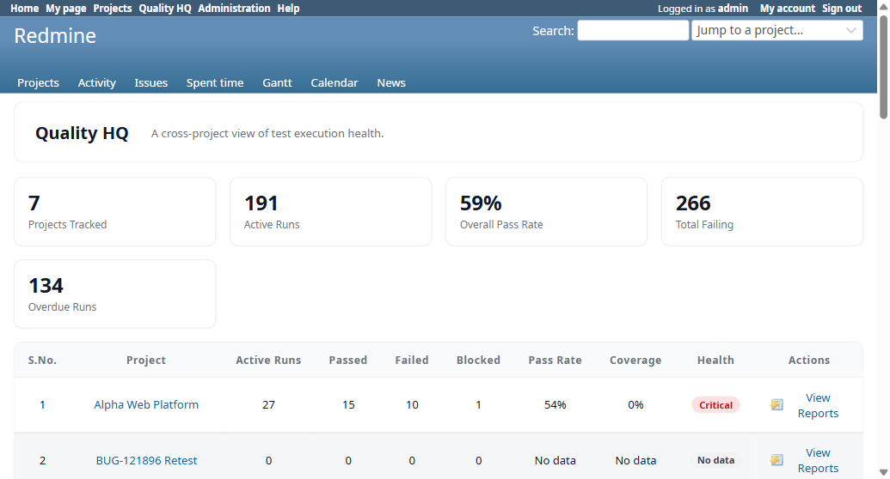

# BUG-TCM-130

- Bug ID: BUG-TCM-130
- Production Redmine Issue ID: <!-- not yet reported — found this session, confirm scope before reporting -->
- Title: Quality HQ (`/quality_hq`) takes 5–21 seconds and issues 1,600–6,500 SQL queries per page load — the "Most Failed"/"Slow Tests"/"Flaky Tests" panels are recomputed live, uncached, on every request
- Redmine version: 6.x (Docker)
- Plugin name: Redmineflux Testcase Management
- Plugin version: master (post-7.2.0) — this is the live `QualityHqController` (rftc-044), not a Release 7.3.0 feature; the slowness was newly exposed by this QA cycle's own data volume (several thousand `IssueStatusResult` rows added to project `rftc-016-ci-qa` while testing Release 7.3.0), but the underlying inefficiency is a real, pre-existing code defect, not something caused by the test data itself
- Environment: Docker `localhost:3000`
- Browser: Chromium (Playwright MCP)
- User role: Administrator
- Date: 2026-11-02

## Steps to reproduce

1. Have at least one project with a large volume of `Run`/`IssueStatusResult` rows (this instance's `rftc-016-ci-qa` currently has ~140 runs and 2,000+ results, accumulated over this QA cycle's own testing).
2. Log in and open `/quality_hq`.
3. Observe the load time and the Rails server log's `Completed` line for the request.
4. Reload the page 2–3 times in a row (to rule out a one-off cold-cache fluke).

## Expected result

- Quality HQ should load in well under 1 second on a repeat visit, the same way any other dashboard page in this plugin does once its per-project summary rollup is cached.

## Actual result

- Three consecutive real loads measured via the actual Rails server log, not an estimate:
  - Load 1 (cold cache): **21,149 ms**, **6,490 SQL queries** (2,992 cached), ActiveRecord time 6,759 ms, GC 1,847 ms, Views only 37.5 ms.
  - Load 2: **8,917 ms**, **1,623 queries** (280 cached), ActiveRecord 3,568 ms.
  - Load 3: **5,246 ms**, **1,624 queries** (280 cached), ActiveRecord 2,156 ms.
- The per-project summary rollup (`QualityHqRollupCache`) clearly helps between load 1 and load 2 (query count drops from 6,490 to ~1,624 and stays there), but the page **never** gets fast, because a large chunk of work is explicitly never cached at all.
- Root cause (confirmed by reading the code): `QualityHqController#index` computes the "Most Failed Tests," "Slow Tests," and "Flaky Tests" panels **live, on every single request**, by its own explicit comment:
  ```ruby
  # Most Failed / Slow Tests / Flaky: computed live, per request, NOT through
  # QualityHqRollupCache -- see RollupMath's own comment ... for why (viewer-sensitive
  # issue subjects, unlike the cached rollup's pure aggregate numbers).
  ```
  Each of `most_failed_rows`/`slow_tests_rows`/`flaky_rows` independently loops over up to 10 projects (`QHQ_INLINE_FALLBACK_CAP`) and, for each project, calls `RollupMath.most_failed_tally`/`slow_test_tally`/`flaky_tally` — each of which **re-scans every `Run` in that project from scratch** via `each_latest_result_cell`, which itself issues **2 separate queries per run** (`run.issues.visible(...).where(...).distinct.to_a`, then `IssueStatusResult.where(run_id: run.id, ...)`). With `most_failed_rows` and `flaky_rows` both independently calling this same scan for the same project in the same request (no shared/memoized timeline between the two), and `slow_tests_rows` doing its own separate per-run loop with 2 more queries per run, a single project with ~140 runs alone accounts for well over a thousand queries — multiplied across however many of the capped 10 projects actually have data.
- This is a genuine, reproducible performance defect, not a one-off: even on a fully warm `QualityHqRollupCache`, every real page load still costs 1,600+ queries and several seconds, because the three ranked-list panels have **no caching layer at all** by design.

## Evidence

### Screenshot



### Console / log

Three consecutive real Rails server log lines for `/quality_hq`, same session, no code/data changes between them:
```
Completed 200 OK in 21149ms (Views: 37.5ms | ActiveRecord: 6759.1ms (6490 queries, 2992 cached) | GC: 1847.0ms)
Completed 200 OK in 8917ms (Views: 55.5ms | ActiveRecord: 3568.3ms (1623 queries, 280 cached) | GC: 141.9ms)
Completed 200 OK in 5246ms (Views: 25.0ms | ActiveRecord: 2155.7ms (1624 queries, 280 cached) | GC: 108.7ms)
```
Also independently confirmed client-side via the Navigation Timing API on an earlier load: `TTFB ≈ 8,964 ms` — the browser received zero bytes from the server for that long, ruling out client-side rendering as the cause.

## Duplicate check

- Duplicate found: No
- Existing bug reference (if duplicate): —
