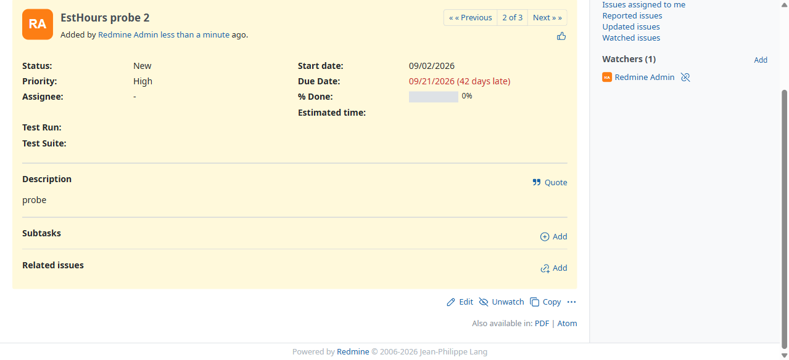

# BUG-TCM-132

- Bug ID: BUG-TCM-132
- Production Redmine Issue ID:
- Title: CSV import silently drops the "Estimated time" and "% Done" columns — the preview says OK, but every imported test case is saved with no estimated time and 0% done
- Severity: Medium
- Redmine version: 7.0 (Docker `redmine:7.0-bookworm`)
- Plugin name: Redmineflux Testcase Management
- Plugin version: `master` @ `983556e`; the same code is on `release/7.2.0` @ `b1a6c79` and `release/7.3.0` @ `acda260`
- Environment: Docker `localhost:3005` (fresh install, PostgreSQL 16, project `pgtest`)
- Browser: Chromium (Playwright MCP)
- User role: Administrator
- Date: 2026-11-02
- Found via: asked to verify every imported column against the CSV; compared the saved values for `18_all_columns_export_118789.csv`, then reproduced with the small fixture `25_estimated_time_and_done_ratio.csv`

## Steps to reproduce

1. Import `automation/testdata/csv-test-data/25_estimated_time_and_done_ratio.csv` (columns: Title, Description, Priority, Start date,
   Due date, **Estimated time**, **% Done**; three rows: 2.5 h / 40%, 9 h / 75%, 1:30 / 10%). Project → TestCases → Import Testcases →
   Next on step 2 (the auto-mapping maps both columns) → Next on step 3 → Import.
2. Step 4 shows "3 testcases will be created correctly, 0 with warnings, 0 with errors".
3. Open the created test cases.

## Expected result

- Estimated time 2.5 h, 9 h and 1.5 h; % Done 40, 75 and 10 — as in the CSV.

## Actual result

- Every case has an **empty Estimated time** and **0% Done**. Start date, Due date and Priority are saved correctly.
- No warning or error anywhere in the wizard; the user cannot tell the two values were thrown away.
- Database: `estimated_hours = NULL` and `done_ratio = 0` for all three. The same happened for the 500-row export `18_all_columns_export_118789.csv`:
  none of the 500 imported cases has an estimated time, although some rows carry values such as "9.00" and "56.00".

## Root cause (confirmed by reading the code and by the three-row reproduction)

`app/controllers/testcase_import_controller.rb`, `step4`: the value of each mapped column comes from one big `mapped_value = if … elsif … end`.
The `estimated_hours` branch and the `done_ratio` branch assign the parsed value to `mapped_value` and then end with an
`if invalid … end` that has no `else`:

```ruby
elsif issue_field == 'estimated_hours'
  mapped_value = parse_estimated_time(csv_value)
  if mapped_value.nil?
    row_summary[:errors] << "Invalid time format …"
    …
  end            # <- last expression: an `if` with no else, which is nil when the value is valid
```

A valid value makes that last `if` evaluate to `nil`, and the outer `mapped_value = if … end` then stores `nil` over the correct value that
was just assigned. Invalid values are still reported as errors, which is why only the valid case is lost. `done_ratio` has the same shape.
The other branches (dates, status, priority, version, category) end with their value and are unaffected.

## Impact

- Any CSV that carries an estimated time or a % done loses it on import, silently. Migrating planned effort or progress (for example from
  Jira/Zephyr, the use case behind the 40000-character limit work) is not possible, and the preview gives no hint.

## Suggested fix (not verified)

- Make each of those two branches end with the value — for example put `mapped_value` on its own last line after the `if … end` — so the
  `if` chain evaluates to the parsed value. Add a regression test with a valid time and a valid % done.

## Evidence

### Screenshot



Test case #1477 ("EstHours probe 2"): the CSV said 9 hours and 75%; the page shows % Done 0% and an empty Estimated time, while Start date,
Due Date and Priority High are saved.

### Retest screenshot (fill after fix is verified)


### Console / log

- Playwright MCP run, helper compare against the CSV: `estimated_hours` mismatch on the rows with a value (CSV "9.00" vs saved empty).
- SQL: `select id, estimated_hours, done_ratio from issues where id between 1476 and 1478` → NULL/0, NULL/0, NULL/0.
- The automated test for this is TC-TCM-335 in the native spec; it asserts the correct behaviour and stays failing until the app is fixed.

## Duplicate check

- Duplicate found: No
- Checked `bugs/_index.md` titles for estimated / % done / done ratio / csv / import. BUG-TCM-001 and 002 (silently dropped step column and duplicate header, both closed) and BUG-TCM-079 (length limit) are different defects.
