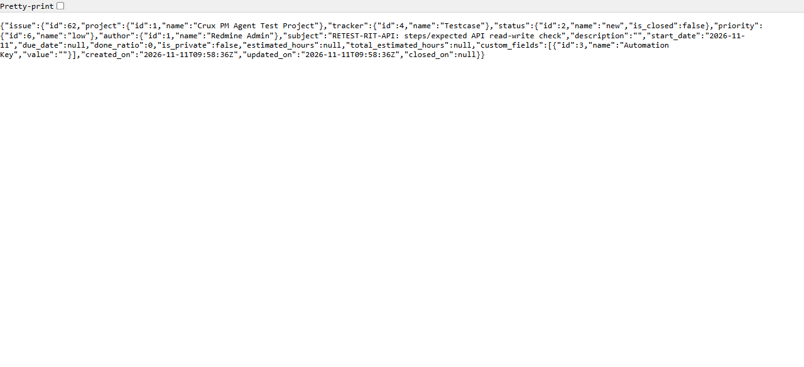

# Bug Report Template

- Bug ID: BUG-TCM-138
- Production Redmine Issue ID: #128057
- Title: An existing testcase's Steps and Expected Result can't be read or updated through the MCP or REST API
- Redmine version: 6.0-bookworm (local Docker instance, localhost:3015)
- Plugin name: Redmineflux Testcase Management / Redmineflux MCP Server (BETA), Testcase Management tools
- Plugin version: 0.0.0-dev
- Environment: Local — `http://localhost:3015`
- Browser: Chromium (Playwright MCP) + direct REST calls
- User role: admin
- Date: 2026-11-11

## Steps to reproduce

1. Create a testcase with a structured Step and Expected Result via the native UI ("New Test Case" →
   "New Step" → fill Step + Expected) — fixture used: issue #62, "RETEST-RIT-API: steps/expected API
   read-write check", Step "Open the login page" / Expected "Login page loads ORIGINAL", in "Crux PM Agent
   Test Project".
2. Check the `redmineflux_testcases_management_update_testcase` MCP tool's own parameter schema for a way to
   change the Step/Expected rows.
3. Read the testcase back via `GET /issues/62.json` (native Redmine REST API).
4. Try plugin-style REST URLs: `GET /projects/<project>/testcases/62.json` and `GET /testcases/62.json`.
5. Confirm Administration → Settings → REST API has "Enable REST web service" checked (ruling out "API
   disabled" as the explanation for any 404/empty result).

## Expected result

- `update_testcase` should accept a `steps` parameter that replaces or edits the Step and Expected rows, the
  same way `create_testcase` accepts one on creation.
- `get_testcase` and the native REST API should return the Step and Expected rows, so external tools can read
  and sync them.
- A dedicated plugin REST route for testcases (or an equivalent documented path) should exist and return
  2xx/JSON, not 404.

## Actual result

- `update_testcase`'s own parameter schema only exposes `testcase_id`, `subject`, `description`, `priority_id`,
  `status_id`, and `uploads` — there is no `steps` parameter anywhere in the schema. Confirmed via direct tool
  schema inspection.
- `GET /issues/62.json` returns only `id`, `project`, `tracker`, `status`, `priority`, `author`, `subject`,
  `description` (empty, since the testcase's content lives in its Step/Expected rows, not the description),
  `custom_fields` (just "Automation Key"), and standard date fields — no Step or Expected data anywhere in the
  payload, even though the native UI (`/issues/62`) genuinely shows "Open the login page" → "Login page loads
  ORIGINAL" as a structured row.
- `GET /projects/crux-pm-agent-test-project/testcases/62.json` → **HTTP 404 Not Found**.
- `GET /testcases/62.json` → **HTTP 404 Not Found**.
- REST API is confirmed enabled instance-wide (Administration → Settings → API → "Enable REST web service" is
  checked), so the 404s are a genuinely missing route, not a disabled service.
- The only way to read or change the Step/Expected rows is the web UI's own testcase edit form — there is no
  API path in or out for this specific data, for either read or write.

## Evidence

### Screenshot

### Retest screenshot (fill after fix is verified)

### Console / log

- `update_testcase` schema (verbatim, relevant fields): `testcase_id`, `subject` (default ""), `description`
  (optional), `priority_id` (default 0), `status_id` (default 0), `uploads` (optional list) — no `steps` field.
- `GET /issues/62.json` (verbatim): `{"issue":{"id":62,"project":{"id":1,"name":"Crux PM Agent Test
  Project"},"tracker":{"id":4,"name":"Testcase"},"status":{"id":2,"name":"new","is_closed":false},
  "priority":{"id":6,"name":"low"},"author":{"id":1,"name":"Redmine Admin"},
  "subject":"RETEST-RIT-API: steps/expected API read-write check","description":"","start_date":"2026-11-11",
  "due_date":null,"done_ratio":0,"is_private":false,"estimated_hours":null,"total_estimated_hours":null,
  "custom_fields":[{"id":3,"name":"Automation Key","value":""}], ...}` — no `steps` key anywhere.
- `GET /projects/crux-pm-agent-test-project/testcases/62.json` → 404 Not Found.
- `GET /testcases/62.json` → 404 Not Found.
- Independent corroboration via Crux's own Testcase Agent (backed by this same local `redmineflux-mcp` server,
  not just a direct tool-schema read): asked "What are the Steps and Expected Result for testcase #62...?" —
  the agent's verbatim reply: *"Unfortunately, the available testcase tools in Redmineflux don't expose a
  dedicated endpoint that returns the steps and expected results in a structured format. The `get_testcase`
  call returns the testcase metadata (title, status, priority, dates) but the detailed step-by-step content
  and expected results are stored within the description field of the underlying Redmine issue."* The agent's
  own remediation guess (steps live "within the description field") is itself incorrect in our fixture — issue
  #62's Description is genuinely empty, confirming the agent has no real visibility into the Step/Expected data
  either, not even enough to know where it actually lives.

## Secondary check — Step/Expected character length (no limit enforced)

The original production report's "Suggested fix" section assumed a 255-character limit on Step/Expected
("same format and 255-character limit as create_testcase"). Tested the real limit natively on a fresh fixture
(issue #63, "RETEST-RIT-LEN"): set Step to exactly 4000 characters and Expected to 4001 characters via direct
field assignment, then submitted the native "New Test Case" form.

**Both saved successfully with no validation error and no truncation** — native-verified on the resulting
issue page: the saved Step content contains all 4000 characters, and the saved Expected content contains all
4001 characters, byte-for-byte. No server-side length rejection was triggered at either boundary. This means
there is currently no enforced character limit on these fields at all (at least up to 4001 characters) — a
separate, lower-severity observation from the main API-read/write gap, but worth recording since it
contradicts the 255-character assumption in the original report and shows the real fields allow substantially
longer content than that.

## Duplicate check

- Duplicate found: No
- Existing bug reference (if duplicate): N/A — checked `bugs/_duplicates.md` and `bugs/_index.md`, no prior
  finding on `update_testcase`'s missing `steps` parameter or the plugin's missing REST testcase route exists
  in this suite.

## Notes

- This finding was first reported independently against production (`flux.zehntech.com`, project `ztzpp`
  id 699, suite #516, run #656; first seen 2026-08-19, still present as of 2026-11-04) — this QA repo had no
  local bug file for it yet. Re-verified here against a fresh local fixture (issue #62) on the local Docker
  instance (localhost:3015) to confirm it reproduces independently of the specific production project/suite,
  and to pin down the exact `GET /issues/<id>.json` payload and the two 404'd plugin REST URLs with concrete
  evidence rather than relying on the original report's prose alone.
- Real-world impact (from the original production report): 7 testcases in suite #516 needed new Expected
  Results after a requirement change; since there is no API to update them, the team had to add the new text
  to the Description field instead, leaving the real Expected Result field stale and the testcase catalog out
  of sync with the real requirements.
