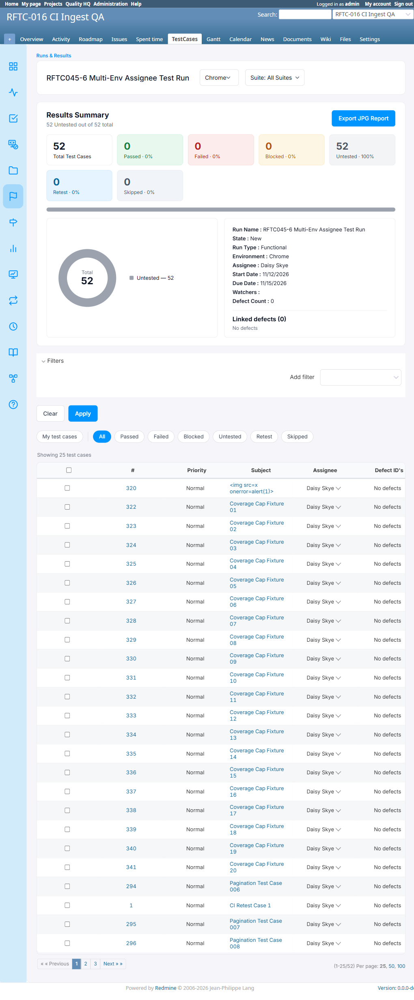
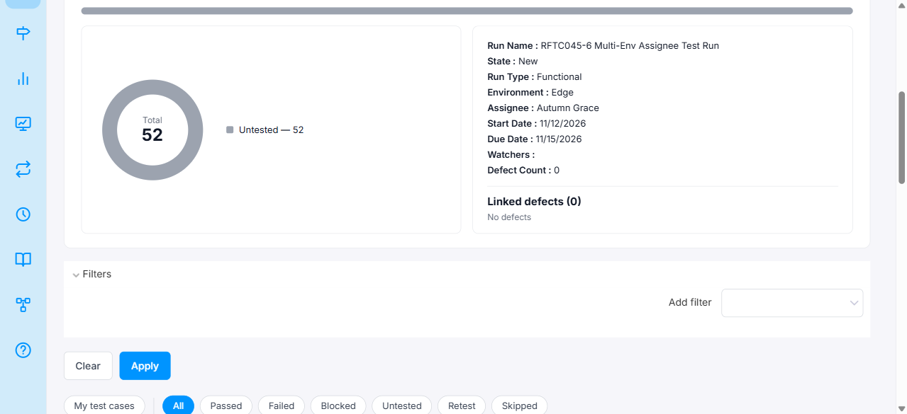
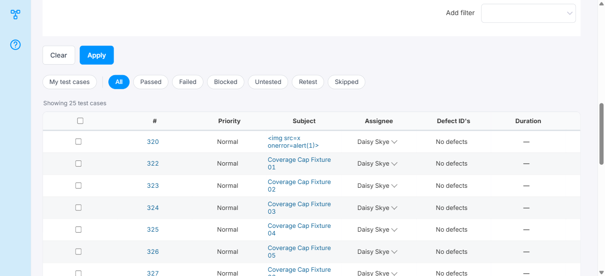

# Bug Report

- Bug ID: BUG-TCM-140
- Production Redmine Issue ID:
- Title: Add Run form allows per-environment assignee selection but per-TC assignee column ignores it — same assignee shown on all environment tabs
- Redmine version: 6.0.11 (Docker)
- Plugin name: redmineflux_testcase_management
- Plugin version: master (Release 7.4.0)
- Environment: localhost:3000
- Browser: Chrome (admin)
- User role: Admin
- Date: 2026-11-12

## Steps to reproduce

1. Navigate to TestCases → Runs & Results → New Run for a project.
2. Add two environments (e.g. Chrome and Edge) using the "Add Assignment" button.
3. Set a **different** env-level assignee for each environment — e.g. Chrome → Daisy Skye, Edge → Autumn Grace.
4. Set the global `assignee_id` field (Release 7.4.0 per-TC default) to any user (e.g. Daisy Skye).
5. Create the run.
6. Open the run. Observe the TC table under the Chrome tab — note the "Assignee" column value.
7. Switch to the Edge tab using the environment dropdown.

## Expected result

- Under the Chrome tab, all TCs should show the Chrome env-level assignee (Daisy Skye) in the per-TC Assignee column.
- Under the Edge tab, all TCs should show the Edge env-level assignee (Autumn Grace) in the per-TC Assignee column.
- The Add Run form's per-environment assignee fields imply that each environment's TCs will carry that environment's assignee, which is what the client specifically requested ("har environment har testcase alag assignee").

## Actual result

- Under both Chrome and Edge tabs, all TCs show **Daisy Skye** in the per-TC Assignee column — the value from the global `assignee_id` field set at run creation.
- The Edge env-level assignee (Autumn Grace) appears correctly in the **run summary** ("Assignee: Autumn Grace") when the Edge tab is active, but does **not** flow through to the individual TC rows.
- The env-level assignee setting in the Add Run form has no effect on the per-TC Assignee column — the column always reflects the single global `assignee_id` value, shared across all environments.

## Impact

- The Add Run form's UI is **misleading**: setting different assignees per environment looks like it will differentiate per-TC assignment by environment, but it has no such effect.
- The client's requirement (per-test-case, per-environment assignee) is not met.
- Found during RFTC045-6 (multi-env design check), Run #44, project `rftc-016-ci-qa`.

## Evidence

### Chrome tab — per-TC assignee = Daisy Skye

### Edge tab — run summary shows Autumn Grace (env-level correct) but TC column still shows Daisy Skye

### Retest screenshot (fill after fix is verified)

### Console / log

- No console errors — this is a data/logic issue, not a JS crash.

## Duplicate check

- Duplicate found: No
- Checked `bugs/_duplicates.md` — no existing bug for per-env assignee not flowing to TC column.
