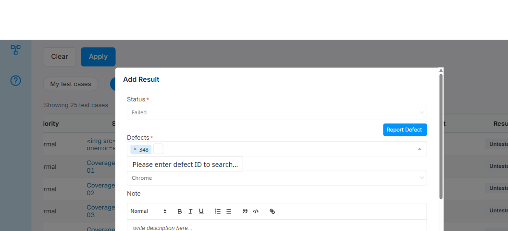
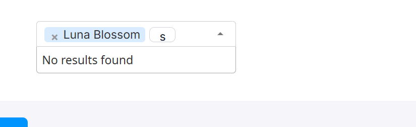
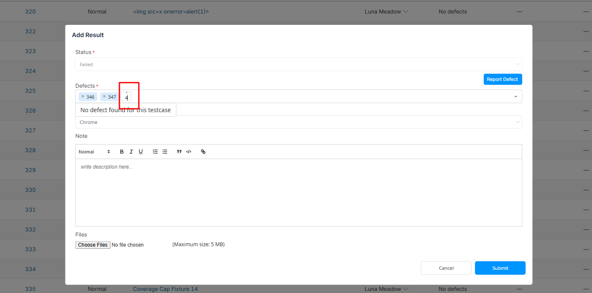

# Bug Report

- Bug ID: BUG-TCM-143
- Production Redmine Issue ID: #128385
- Title: Typed text in every Select2 multi-select search box (Defects field, Assignee filter, etc.) stacks vertically instead of typing horizontally
- Redmine version: 6.0.11 (Docker, localhost:3000)
- Plugin name: redmineflux_testcase_management
- Plugin version: master (commit `4e0170a`)
- Environment: localhost:3000
- Browser: Chrome (admin)
- User role: Admin

## Steps to reproduce

1. Open any Run's Test Case table; click "Untested" (or any result link) on a TC to open the "Add Result" modal.
2. Set Status to "Failed" (or "Blocked") — the "Defects" multi-select field appears.
3. Click inside the Defects field and type any text, e.g. `bug` (one character at a time).
4. Separately: on the Run's TC table, open the "Add filter" → "Assignee" multi-select filter field and type a search term there too.

## Expected result

- The search input box inside the multi-select (Select2) widget should grow horizontally as the user types, same as any normal search box — each typed character appears side-by-side, reading left to right.

## Actual result

- The search input box never grows. It stays pinned at its initial tiny width (computed `10.5px`, inline `style="width: 0.75em"`).
- Because the box is narrower than a single character, the browser wraps each typed character onto its own line inside the box — typed text renders **vertically stacked** (e.g. typing "bug" visibly shows "b", "u", "g" stacked on top of each other) instead of horizontally.
- This is not isolated to the Defects field — the same narrow, non-resizing search box occurs in the Assignee filter's multi-select too (and likely every other Select2 multi-select search field sharing this CSS class across the plugin), confirmed from a live screenshot showing "s" typed into the Assignee filter box under the same tiny-box symptom.
- The dropdown's results list itself still updates correctly as characters are typed (search logic works) — this is purely a visual/CSS defect in the search input's width, not a functional search failure.

## Root cause (source-verified)

`assets/stylesheets/testcase_style.css` (minified) sets, for every Select2 search field across the plugin:

```css
.select2-search__field{height:28px!important;padding-top:5px!important;font-size:15px!important}
```

This rule forces `height`/`padding-top`/`font-size` but never sets or allows a `width` to be controlled — it relies entirely on Select2's own built-in JS auto-resize (which normally measures the typed text with a hidden mirror element and writes an inline `width: <N>em` style on the `<textarea class="select2-search__field">` as the user types). Live inspection of the rendered element after typing confirms the auto-resize is **not** running/updating:

```html
<textarea class="select2-search__field" ... style="width: 0.75em; ...">
```

Computed `width: 10.5px` regardless of how many characters are typed — the auto-resize calculation appears to be stuck at its initial (near-zero) value and never recalculates on keystroke. `assets/stylesheets/rf_testcase_management_controls.css` deliberately excludes `.select2-search__field` from its own general input styling (`:not(.select2-search__field)` throughout), so the plugin's own CSS isn't fighting Select2's width — this points to a JS-side issue (the auto-resize trigger/recalculation not firing on `input`/`keyup`), not a CSS override battle.

## Impact

- Any multi-select search box in the plugin (Defects field on Add Result, Assignee filter on the Run TC table, and any other field built on the same Select2 multi-select pattern) is effectively unusable for typing a search term — the vertical character stacking makes it very hard to read what was typed, and on longer search terms the box visually breaks the surrounding layout.
- This affects a core, frequently-used workflow: filing/linking a defect to a failed/blocked test result, and filtering a Run's TC table by assignee.
- Severity: Medium — functionality (the actual search/filter) still works underneath; this is a significant usability/visual defect, not a data-correctness issue.

## Evidence

### Screenshot






### Retest screenshot (fill after fix is verified)


### Console / log

- One unrelated console error observed during this session (`SyntaxError: Failed to execute 'appendChild' on 'Node': Identifier 'parser' has already been declared`) — not investigated as part of this bug; flagged separately if it recurs.
- No console error tied specifically to the Select2 resize failure itself (it fails silently).

## Duplicate check

- Duplicate found: No
- Checked `bugs/_duplicates.md` — no existing bug for Select2 search-field width/vertical-typing.
