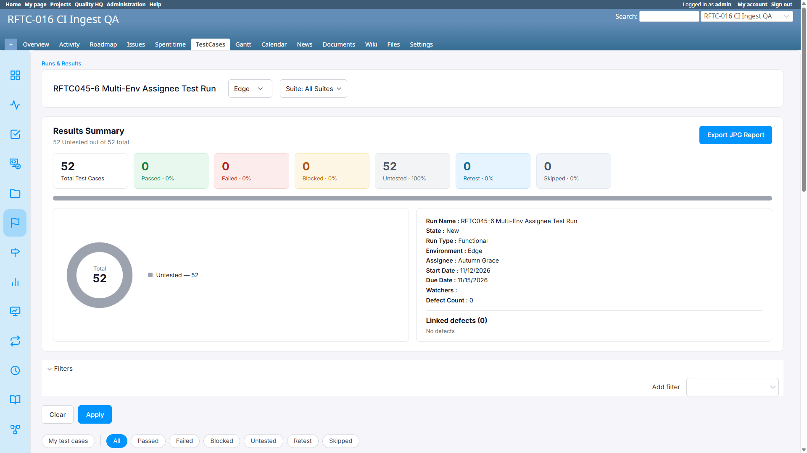

# Bug Report

- Bug ID: BUG-TCM-145
- Production Redmine Issue ID:
- Title: Edit Run's per-environment assignee carry-over (#128320) leaks across ALL environments instead of staying scoped to the edited one, on any Run whose test cases don't yet have explicit per-environment rows
- Redmine version: 6.0.11 (Docker, localhost:3000)
- Plugin name: redmineflux_testcase_management
- Plugin version: master (commit `4e0170a`)
- Environment: localhost:3000
- Browser: Chrome (admin)
- User role: Admin

## Steps to reproduce

1. Use a Run whose test cases do **not** yet have explicit per-environment assignee rows — the simplest repro is a Run created **before** #128320 shipped (e.g. Run #44, "RFTC045-6 Multi-Env Assignee Test Run", created with Chrome → Daisy Skye, Edge → Autumn Grace, before the per-environment feature existed). A multi-environment Run where no one has ever inline/bulk-reassigned a given test case also qualifies.
2. Confirm the starting state: on the Chrome tab, untouched test cases show "Daisy Skye"; on the Edge tab, the *same* untouched test cases also show "Daisy Skye" (expected — no per-env row yet, both fall through to the shared Test-Case-level default; this part is correct, documented, pre-existing behavior).
3. Open Edit Run. Change **only** the Chrome environment's assignee (e.g. Daisy Skye → Luna Blossom). Leave Edge's assignee field untouched (still Autumn Grace). Save.
4. Check the Chrome tab: untouched test cases should now show "Luna Blossom" — correct.
5. Check the Edge tab for the **same** untouched test cases.

## Expected result

- Edge's untouched test cases should still show "Daisy Skye" (their current environment, Edge, was never edited) — same test case, same Run, but Edge's own environment-level assignee (Autumn Grace) was never touched, and per #128320's design, Edge's per-TC values should likewise be unaffected by an edit scoped to Chrome.

## Actual result

- Edge's untouched test cases also changed to **"Luna Blossom"** — the same new value that was only supposed to apply to Chrome. The edit leaked into an environment that was never touched in the Edit Run form.

## Root cause (source-verified, `runs_controller.rb` `update` action)

Two separate cascade blocks run, in this order, and they conflict:

**1. The old, pre-#128320 cascade (still present, not environment-scoped):**
```ruby
new_default_case_assignee = RunAssignment.where(run_id: @run.id).order(:id).pluck(:assignee_id).compact.first
if new_default_case_assignee.present? && new_default_case_assignee != previous_default_case_assignee
  RunIssue.where(run_id: @run.id, assignee_id: previous_default_case_assignee)
          .update_all(assignee_id: new_default_case_assignee)
end
```
This updates `RunIssue.assignee_id` — the single, shared Test-Case-level fallback column — **globally**, for every test case still at the old fallback value, using only the **first** `RunAssignment`'s new assignee (Chrome, in this repro). It has no awareness of which specific environment was actually edited.

**2. The new, #128320 per-environment cascade (correct in isolation, but runs second):**
```ruby
assignee_changes.each do |env_name, change|
  ...
  RunIssueAssignment.where(run_id: @run.id, environment: env_name, assignee_id: old_a)
                    .update_all(assignee_id: new_a)
  with_rows = RunIssueAssignment.where(run_id: @run.id, environment: env_name).pluck(:issue_id)
  RunIssue.where(run_id: @run.id, assignee_id: old_a).where.not(issue_id: with_rows)
          .pluck(:issue_id).each do |iid|
    RunIssueAssignment.create!(run_id: @run.id, issue_id: iid, environment: env_name, assignee_id: new_a)
  end
end
```
For `env_name = "Chrome"` only (the one environment actually present in `assignee_changes`), this is supposed to backfill a Chrome-specific `RunIssueAssignment` row for every test case that was still following the old shared default (`old_a`) and has no row yet — so Chrome's view updates while Edge's is left alone.

**The conflict:** block 1 runs **first** and already rewrites `RunIssue.assignee_id` from `old_a` to `new_a` for every matching test case, project-wide. By the time block 2's own lookup (`RunIssue.where(assignee_id: old_a)`) runs, those rows **no longer match** `old_a` — they're already `new_a`. So block 2's backfill creates **zero** Chrome-specific override rows for these test cases. They are left with no per-environment row at all, continuing to fall through to the Test-Case-level fallback — which block 1 already changed to the new value, **globally**. The display resolution (environment-specific → Test-Case-level → unassigned) then shows the new value on **every** environment tab, not just the one that was edited, because nothing environment-specific was ever actually created to distinguish them.

Block 1 is dead/superseded logic from before #128320 existed (its own comment cites BUG-TCM-142, which predates the per-environment feature) and was never removed or environment-scoped when block 2 was added.

## Impact

- Any Run whose test cases still rely on the shared Test-Case-level fallback (true of every Run created before #128320, and any multi-environment Run where a given test case has never been individually reassigned) will have Edit Run's assignee changes leak across **every** environment instead of staying scoped to the one actually edited.
- This directly undermines the per-environment assignee feature's core promise ("each environment's test cases follow that environment's assignee," independently) for exactly the population of Runs most likely to be tested against immediately after the feature ships — pre-existing Runs.
- Severity: High — a silent data-correctness regression (wrong assignee shown/recorded for an environment nobody intended to touch), not just a display glitch; the underlying `RunIssue.assignee_id` value is also incorrectly overwritten project-wide for these test cases.

## Evidence

### Screenshot



### Retest screenshot (fill after fix is verified)


### Console / log

- No console error — this is a server-side logic/ordering defect, not a client-side crash.
- Source-verified directly in the running container: `app/controllers/runs_controller.rb`, the two cascade blocks described above, confirmed present in that exact order in commit `4e0170a`.
- Live-reproduced on Run #44 ("RFTC045-6 Multi-Env Assignee Test Run"): Chrome edited Daisy Skye → Luna Blossom via Edit Run; both Chrome AND Edge tabs showed "Luna Blossom" for untouched test cases afterward. Confirmed this does **not** happen on a Run created fresh after #128320 with every test case already holding explicit per-environment rows for both environments (Run #48, RFTC045-44 passed cleanly) — isolating the bug specifically to test cases still on the shared fallback.

## Duplicate check

- Duplicate found: No
- Checked `bugs/_duplicates.md` — no existing bug for this specific cascade-ordering conflict.
- Related to BUG-TCM-140/BUG-TCM-142 (same feature area, same Edit Run cascade code path) but a distinct, newly-introduced regression from #128320's own implementation, not a re-occurrence of either closed bug.
