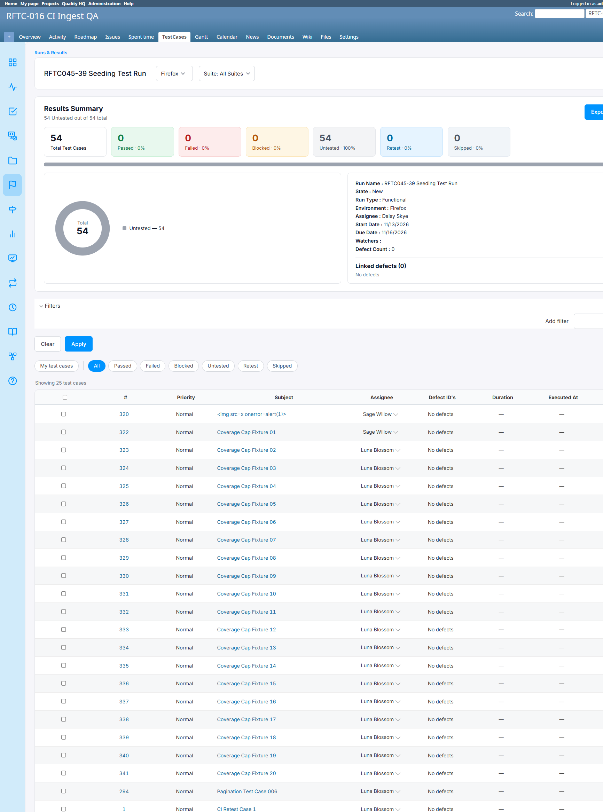

# Bug Report

- Bug ID: BUG-TCM-146
- Production Redmine Issue ID: #128395
- Title: Adding a new environment to an existing Run does not seed its test cases with that environment's own assignee (#128320)
- Redmine version: 6.0.11 (Docker, localhost:3000)
- Plugin name: redmineflux_testcase_management
- Plugin version: master (commit `4e0170a`)
- Environment: localhost:3000
- Browser: Chrome (admin)
- User role: Admin

## Steps to reproduce

1. On a Run that already has test cases, open Edit Run.
2. Click "Add" under the environment assignments section to add a brand-new environment (e.g. "Firefox") not previously on this Run, and set its assignee (e.g. Daisy Skye).
3. Save ("Update").
4. Switch the Run's environment tab selector to the newly added environment.

## Expected result

- Per #128320's own design ("Creating a run seeds each environment's rows from that environment's Add Run assignee... test cases added later get their own per-environment rows too"), the newly added environment should behave the same way: every test case in the Run should be seeded with the NEW environment's own assignee (Daisy Skye in this repro) on that environment's tab.

## Actual result

- The Run summary/header correctly shows the new environment's own assignee ("Assignee: Daisy Skye") when that tab is selected.
- But the per-test-case Assignee column shows whatever the shared Test-Case-level fallback currently happens to be (in this repro, "Luna Blossom" — a value left over from an earlier Edit Run change on a different environment), **not** the new environment's own assignee (Daisy Skye).
- No `RunIssueAssignment` rows exist for the new environment at all — it falls through entirely to the Test-Case-level fallback, same as if it had never been configured with its own assignee.

## Root cause (source-verified, `runs_controller.rb#update`)

```ruby
new_environments = run_assignments_hash.values.map { |assignment| assignment[:environment] } - previous_environments
...
if new_environments.present?
  @run.run_issues.each do |run_issue|
    new_environments.each do |new_env|
      IssueStatusResult.find_or_create_by(run_id: @run.id, issue_id: run_issue.issue_id, testsuite_id: run_issue.testsuite_id, environment: new_env) do |result|
        result.case_status_id = 1
      end
    end
  end
end
```

The `new_environments` branch only creates `IssueStatusResult` rows (execution-result tracking placeholders) for the newly added environment. There is no corresponding call to seed `RunIssueAssignment` rows (the per-environment assignee table) for the new environment's test cases — unlike `new_issue_ids` (new test cases), which correctly does call `RunIssueAssignment.seed_for!(@run, new_issue_ids, new_default_case_assignee)` a few lines later. The "new environment" case has simply been left out of the seeding logic.

## Impact

- The exact scenario the ticket itself describes as supported ("test cases added later get their own per-environment rows too" — implicitly also meaning environments added later should seed their own rows) does not work for newly added environments.
- A user adding a second/third environment to an existing Run and setting a distinct assignee for it will see that assignee correctly in the Run summary header, but every test case will silently continue showing an unrelated, stale value — a confusing, easy-to-miss correctness gap in a feature whose entire purpose is per-environment accuracy.
- Severity: Medium — the environment-level assignee (summary header) is correct, so this is not a security/permission issue, but it is a genuine functional gap in the per-environment assignee feature for a common workflow (growing a Run's environment coverage over time rather than defining everything at creation).

## Evidence

### Screenshot



### Retest screenshot (fill after fix is verified)


### Console / log

- No console error — server-side logic gap, not a crash.
- Source-verified in `runs_controller.rb`'s `update` action, the `new_environments` handling block (no `RunIssueAssignment` seeding call present).
- Live-reproduced: Run #48, added environment "Firefox" (assignee Daisy Skye) via Edit Run; Firefox tab's test cases showed "Luna Blossom" (the then-current Test-Case-level fallback) instead.

## Duplicate check

- Duplicate found: No
- Checked `bugs/_duplicates.md` — no existing bug for new-environment seeding.
- Related to BUG-TCM-145 (same feature area, Edit Run cascade logic) but a distinct gap — that bug is about an *existing* environment's assignee change leaking to others; this one is about a *newly added* environment never being seeded at all.
