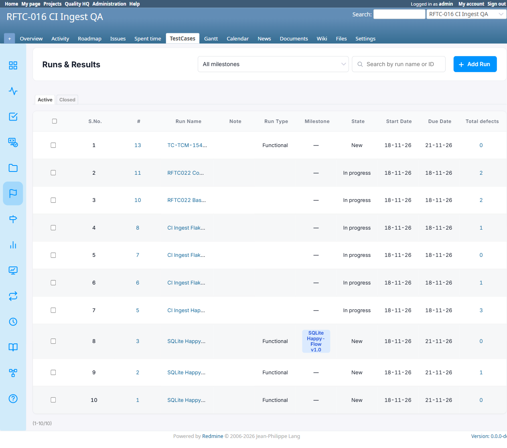

# Bug Report Template

- Bug ID: BUG-TCM-153
- Production Redmine Issue ID: <!-- not yet reported -->
- Title: "Active" Runs & Results tab does not exclude closed runs — a run with `is_closed: true` still appears under Active
- Redmine version: 6.0 (official `redmine:6.0-bookworm` Docker image)
- Plugin name: redmineflux_testcase_management
- Plugin version: master, commit `92e446f`
- Environment: Docker `redmine6-happyflow-sqlite`, `localhost:3021`, SQLite3, project `rftc-016-ci-qa`
- Browser: Chromium (Playwright)
- User role: Admin
- Date: 2026-11-18

## Steps to reproduce

1. Create a run (e.g. via **Runs & Results → Add Run**) — run #12 "TC-TCM-153/157 happy-flow all-cases run
   EDITED (SQLite)" used here.
2. Open its row's **Actions** menu → **Close Run** → **Confirm** on the "Close Run?" warning modal.
3. Confirm the close actually took effect server-side: `GET /runs.json?project_id=rftc-016-ci-qa` shows the run
   with `"is_closed":true` and `"state":3` (Done).
4. Navigate to **Runs & Results** (`/runs/new?project_id=rftc-016-ci-qa`, which defaults to the "Active" tab),
   or explicitly click the **Active** tab link, or navigate to `?tab=Active` directly.
5. Look for the closed run (#12) in the list.

## Expected result

- A run with `is_closed: true` should appear **only** under the **Closed** tab, not under **Active** — this is
  exactly what TC-TCM-165 ("Active and Closed tabs partition runs correctly") requires, and what an earlier
  session's regression pass against a different (PostgreSQL) instance confirmed was working correctly at that
  time.

## Actual result

- Run #12 appears in **both** tabs simultaneously: confirmed present in the **Closed** tab listing (correct),
  but **also still present** in the **Active** tab listing (incorrect) — reproduced 3 separate ways: loading
  the bare `/runs/new?project_id=...` URL (defaults to Active), loading `?tab=Active` directly, and genuinely
  clicking the "Active" tab link in the UI. All three show the same result. The row itself correctly reflects
  the closed state everywhere it's shown — State column says "Done", and its Action menu only offers "Delete
  Run" (no Edit/Close), confirming the UI *knows* the run is closed — but the Active-tab filter query itself
  doesn't exclude it.
- Not an isolated one-off: the "Active" tab also still lists other already-closed runs from this instance's
  earlier fixture data (not just run #12), so this is a real, repeatable filter gap, not a timing/caching
  artifact from the specific Close action just performed.

## Evidence

### Screenshot



### Console / log

```
GET /runs.json?project_id=rftc-016-ci-qa → run id 12:
{"id":12,"name":"TC-TCM-153/157 happy-flow all-cases run EDITED (SQLite)","state":3,
 "include_testcase":true,"project_id":1,"is_closed":true, ...}
```

## Duplicate check

- Duplicate found: No (checked `bugs/_duplicates.md` and `bugs/_index.md` — TC-TCM-165 was previously confirmed
  PASS on a different/PostgreSQL instance per `_index.md`'s 2026-10-23 entry; no existing open bug covers this
  Active/Closed partition gap)
- Existing bug reference (if duplicate): —
