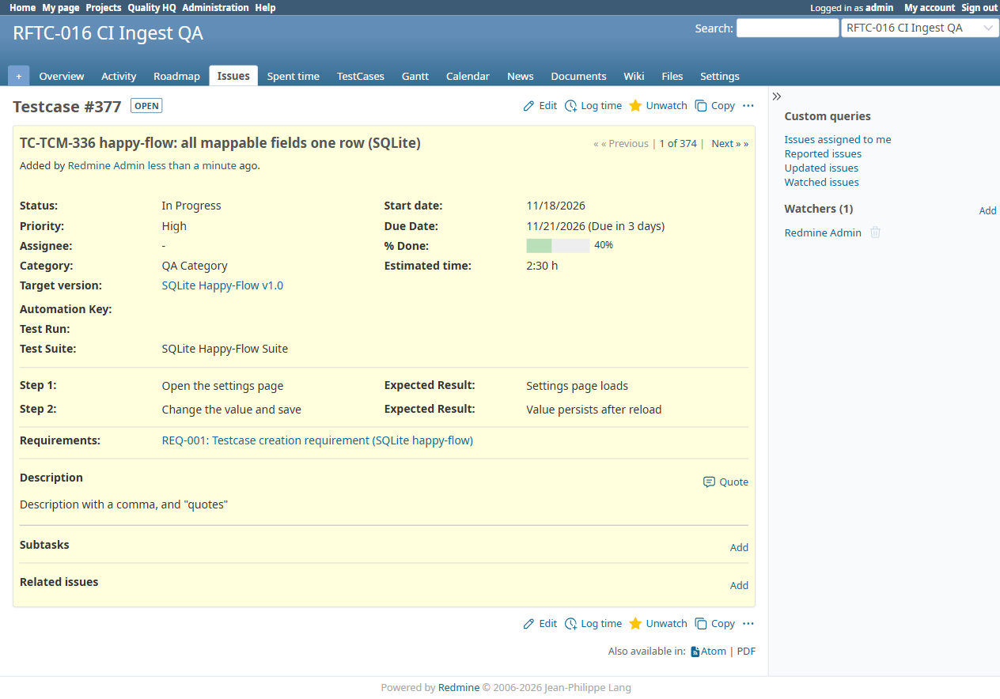

# Bug Report Template

- Bug ID: BUG-TCM-154
- Production Redmine Issue ID: <!-- not yet reported -->
- Title: CSV import's "Private" column only recognizes the literal value "yes" — any other truthy value (e.g. "true", "1", "Y") is silently saved as not-private, with no warning shown
- Redmine version: 6.0 (official `redmine:6.0-bookworm` Docker image)
- Plugin name: redmineflux_testcase_management
- Plugin version: master, commit `92e446f`
- Environment: Docker `redmine6-happyflow-sqlite`, `localhost:3021`, SQLite3, project `rftc-016-ci-qa`
- Browser: Chromium (Playwright)
- User role: Admin
- Date: 2026-11-18

## Steps to reproduce

1. Build a CSV with a `Private` column (part of the plugin's own documented mappable-columns set, confirmed
   via the column-mapping wizard step) and set that cell's value to `true` for one row (fixture:
   `automation/uploads/26_all_mappable_fields_sqlite.csv`).
2. Run the CSV Import wizard (Testcase Management → Import → CSV): upload → select a target suite → confirm
   auto-mapping (`Private` correctly auto-maps to the `Private` field) → confirm value mapping (Priority/Status
   value tables shown; no separate value-mapping table is offered for `Private`) → Import.
3. Check the preview screen's warnings for the row before confirming.
4. Open the created test case (or `GET /issues/<id>.json`) and check its `is_private` value.

## Expected result

- A CSV value like `true`, `1`, `Y`, or `TRUE` for a boolean-style column should be recognized as true (or, at
  minimum, the import should warn that the value wasn't recognized so the row doesn't silently diverge from the
  CSV).

## Actual result

- The created test case (#377, `TC-TCM-336 happy-flow: all mappable fields one row (SQLite)`) has
  `is_private: false`, even though the CSV cell was `true`. Confirmed via `GET /issues/377.json` and the issue
  page itself (no "Private" indicator rendered at all). Root-caused by reading
  `app/controllers/testcase_import_controller.rb` inside the running container:
  ```ruby
  if data['is_private'].present?
    data['is_private'] = data['is_private'].downcase == 'yes'
  end
  ```
  Only the literal string `"yes"` (case-insensitive) is treated as true — any other non-blank value, including
  the extremely plausible `"true"`, `"1"`, or `"Y"`, is silently coerced to `false`. The preview screen's own
  warning for this row only flagged an unrelated issue (the Status-workflow wording quirk already documented
  under `TESTCASE_MANAGEMENT_CSV_IMPORT.md` TC-TCM-336) — nothing flagged the Private value as unrecognized.
  Every other mapped field on the same row (Status, Priority, Category, Target version, Start/Due date,
  Estimated time, % Done, Requirements link, both Step/Expected pairs, Description with comma+quotes) saved
  correctly, isolating this to the Private column specifically.

## Evidence

### Screenshot



### Console / log

```
GET /issues/377.json →
{"id":377, ... "is_private":false, ... }
```
CSV row (automation/uploads/26_all_mappable_fields_sqlite.csv): `...,2.5,40,true,REQ-001: Testcase creation requirement (SQLite happy-flow),...`

Source (`app/controllers/testcase_import_controller.rb:687-688`):
```ruby
if data['is_private'].present?
  data['is_private'] = data['is_private'].downcase == 'yes'
end
```

## Duplicate check

- Duplicate found: No (checked `bugs/_duplicates.md` and `bugs/_index.md` — no existing bug covers CSV import's
  Private-column value parsing)
- Existing bug reference (if duplicate): —
