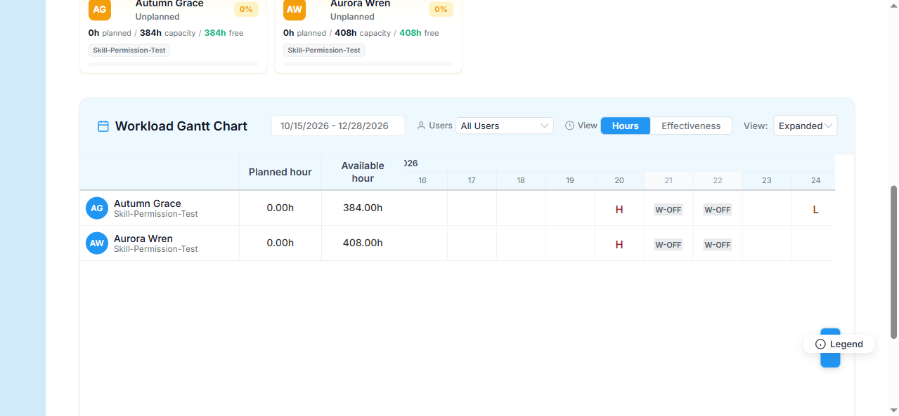
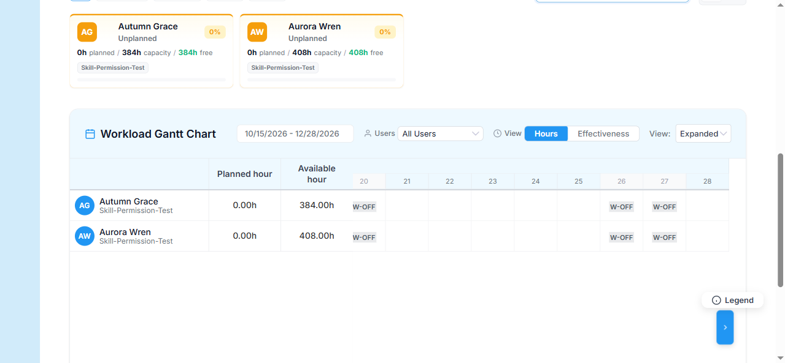

# Bug Report Template

- Bug ID: BUG-WKL-002
- Production Redmine Issue ID: #123757
- Title: Workload Gantt chart's own data service re-implements holiday detection without recurrence support — a recurring holiday never highlights or reduces capacity past its creation year on the Gantt specifically
- Redmine version: 6
- Plugin name: redmineflux_workload
- Plugin version: current (2026-10-15)
- Environment: Local Docker (localhost:3013, `redmine6platform-redmine-1`)
- Browser: Chromium (Playwright MCP)
- User role: Admin
- Date: 2026-10-15

## Steps to reproduce

1. Create (or use) an active Platform Holiday Scheme with a Holiday dated in a **past** year and **Recurring =
   Yes** (here: "TC-Recurring-Holiday-XMas", `12/25/2025`, National).
2. Create/extend a Workload whose date range spans both a non-recurring holiday already in the active scheme
   (e.g. "Holiday-Testing" on `11/20/2026`) and the recurring holiday's current-year occurrence
   (`12/25/2026`) — here, `WHPD-Test-New-Workload` extended to `10/15/2026 – 12/28/2026`.
3. Open the Workload's detail page (`/rf_teams/19/rf_workloads/4`) and inspect its Gantt chart.
4. Compare the cell at `11/20/2026` (the non-recurring holiday) against the cell at `12/25/2026` (the recurring
   holiday's current-year date) and `12/26/2026` (the following Saturday, for a working weekend contrast).

## Expected result

- Since the Holiday is marked Recurring, `12/25/2026` should be treated identically to `11/20/2026` on the Gantt
  — the "H" label/holiday highlighting and the corresponding capacity reduction should both apply, the same way
  Platform's own `WorkingCalendar` (and this same Workload plugin's own `capacity_aggregator.rb`, used by its
  Dashboard figures) already correctly projects a recurring holiday into any year.

## Actual result

- `11/20/2026` correctly shows `gantt-timeline-bg-cell holiday` with the "H" label.
- `12/26/2026` (Saturday) correctly shows the `weekend` class.
- `12/25/2026` — the recurring holiday's current-year date — shows **neither**: plain
  `gantt-timeline-cell gantt-day-cell` with no holiday class or label at all, confirmed precisely via the cell's
  own `left` pixel offset (`4970px`, the column immediately before the `5040px`/`weekend` column for the 26th).

**Root cause (confirmed from source):** unlike `app/services/workload/dashboard/capacity_aggregator.rb` and
`app/services/rf_workload_timeline_service.rb` — both of which correctly delegate to Platform's own
`RedminefluxPlatform::WorkingCalendar` (which properly handles `is_recurring` via month/day projection) — the
Gantt-specific `app/services/rf_workload_gantt_data_service.rb` has its own independent, naive implementation:
```ruby
def fetch_holidays
  active_scheme = RedminefluxPlatform::HolidayScheme.find_by(is_active: true)
  ...
  RedminefluxPlatform::Holiday.where(rf_holiday_scheme_id: active_scheme.id)
    ...
    .map { |holiday| { date: holiday.date, end_date: holiday.end_date || holiday.date, name: holiday.name, holiday_type: holiday.holiday_type } }
end
# ...
def holiday?(date)
  @holidays.any? { |holiday| date >= holiday[:date] && date <= holiday[:end_date] }
end
```
This serializes each holiday's literal `date`/`end_date` with zero awareness of `is_recurring`, and the same
naive date-range check is duplicated client-side in `gantt_optimized.js`'s `isHoliday(date)` (used for both the
visual "H" label and this file's own working-day/capacity math at lines ~213-214, ~227-229). So the Gantt's own
hour totals likely also fail to deduct the recurring holiday's hours for `12/25/2026`, not just its visual
marker — a third independent re-implementation of holiday detection in this codebase that ignores `recurring`,
alongside `BUG-SFM-002` (Shift Management) and `BUG-HLP-071` (Helpdesk) filed the same day.

## Evidence

### Screenshot





### Retest screenshot (fill after fix is verified)


### Console / log

- N/A — confirmed via DOM inspection (cell `className`/`left` offsets, cross-checked against the adjacent
  Saturday's correct `weekend` class) and source code (`rf_workload_gantt_data_service.rb`,
  `gantt_optimized.js`'s `isHoliday`), contrasted against the correct implementations in
  `capacity_aggregator.rb` / `rf_workload_timeline_service.rb` / `RedminefluxPlatform::WorkingCalendar`.

## Duplicate check

- Duplicate found: No
- Existing bug reference (if duplicate): — (same root-cause *class* as `BUG-SFM-002`/`BUG-HLP-071`, filed
  separately since all three are independent code paths in three different plugins)
