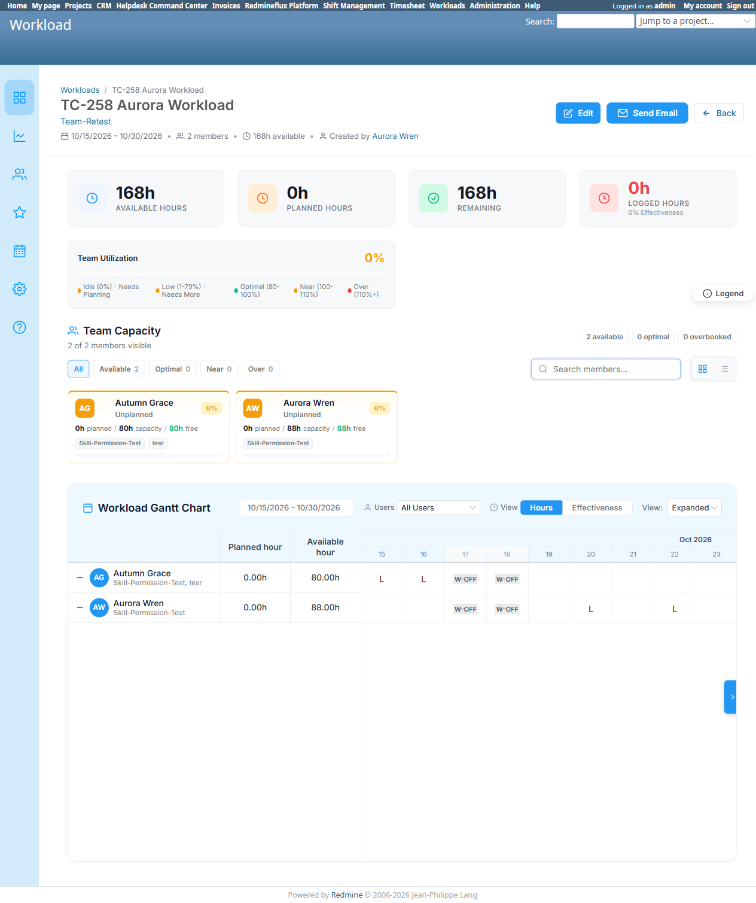
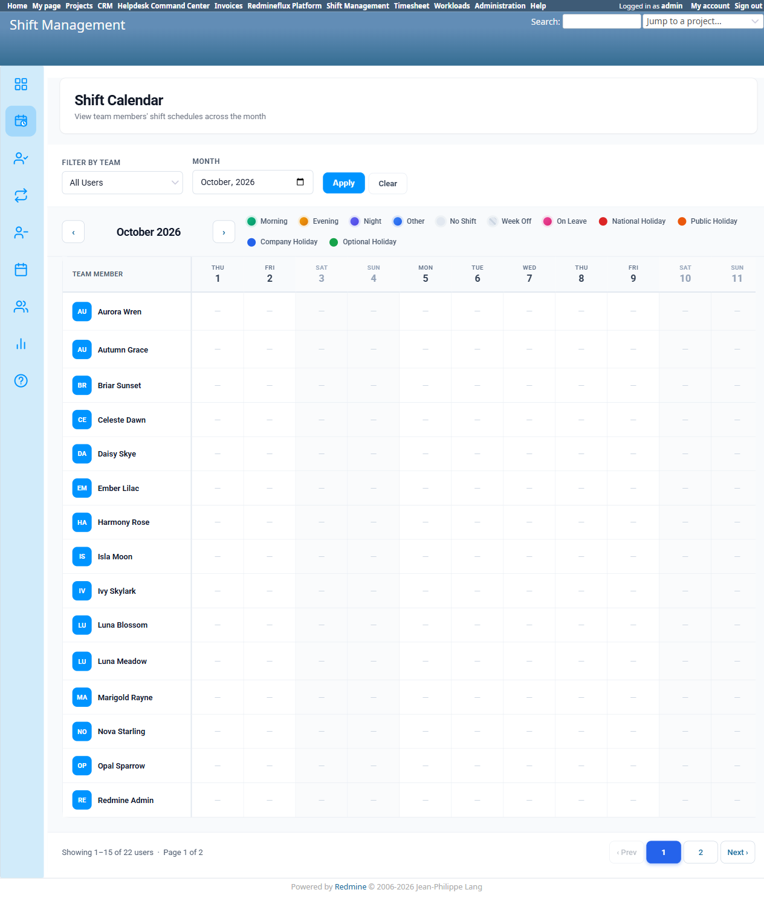

# Bug Report Template

- Bug ID: BUG-WKL-003
- Production Redmine Issue ID: #123791
- Title: Workload's own Gantt/capacity service treats a still-Pending (unapproved) Leave identically to an Approved one — reduces a member's available capacity and blocks scheduling before any approval decision
- Redmine version: 6
- Plugin name: redmineflux_workload
- Plugin version: current (2026-10-16)
- Environment: Local Docker (localhost:3013, `redmine6platform-redmine-1`), via Platform integration testing
- Browser: Chromium (Playwright MCP) + direct `rails runner` service-level verification
- User role: Admin (setup/verification)
- Date: 2026-10-16

## Steps to reproduce

1. Create a Leave request for a user who is a member of an active Workload (e.g. `aurora.wren`, member of
   Workload #3 "TC-258 Aurora Workload", Oct 15–30, 2026). Leave it in **Pending** status — do not approve or
   reject it.
2. Open that Workload's own page (`/rf_teams/19/rf_workloads/3`) and look at the Workload Gantt Chart and the
   member's Team Capacity card.
3. Observe the Pending leave's date is marked `L` on the Gantt, identically to how an Approved leave on a
   different date is marked, with no visual distinction between the two statuses.
4. Confirm via source/service-level check (`rails runner`, calling `RfWorkloadGanttDataService#fetch_user_leaves`
   and `#count_working_days` directly) that the Pending leave is already excluded from the user's available
   working days for this workload window, exactly as if it had been approved.

## Expected result

- Per the Leave detail page's own tooltip text ("Approving it is what takes those days out of their capacity")
  and per the **separate**, correctly-implemented `Workload::Dashboard::CapacityAggregator` service (which
  explicitly scopes to `status: 'approved'` only, confirmed in source), a Pending leave should NOT yet reduce a
  member's available capacity or block scheduling on that date. It should only do so once approved — matching
  Shift Management's own Shift Calendar, which correctly shows "On Leave" only for the Approved leave in this
  same test and shows nothing for the still-Pending one on the same calendar.

## Actual result

- `RfWorkloadGanttDataService#fetch_user_leaves` (the service backing this specific Workload's own Gantt
  chart and per-member capacity figures) queries
  `RedminefluxPlatform::Leave.where(user_id: user_id, status: ['pending', 'approved'])` — explicitly including
  `'pending'` alongside `'approved'`. This same leave list feeds `working_day?`/`count_working_days`, which
  governs both the Gantt's visual marking and the actual available-working-day count used for this workload's
  capacity math.
- **Confirmed via direct service call, not just visual inspection:** for the same user/workload, counting
  working days with the Pending leave included yields **10 working days**; counting with only the Approved
  leave (the correct scope) yields **11 working days** — a full day's capacity (8h) is already being deducted
  for a leave request nobody has approved yet.
- Cross-plugin inconsistency: the exact same test data, viewed on Shift Management's own Shift Calendar
  (`/shift_management/calendar`), correctly shows the Approved leave as "On Leave" and shows **nothing** for the
  Pending one on the same date — proving the correct, intended behavior is achievable and is already implemented
  correctly elsewhere in this same codebase; Workload's own Gantt service is the outlier.

## Evidence

### Screenshot





### Console / log

- Direct `rails runner` evidence (source: `redmineflux_workload/app/services/rf_workload_gantt_data_service.rb`
  line 88, `fetch_user_leaves`):
  ```
  Leaves fetched (pending+approved): [Leave #9 Pending 2026-10-20, Leave #10 Approved 2026-10-22]
  Working days WITH pending counted as leave: 10
  Working days counting ONLY approved as leave: 11
  ```
- Contrasting correct scoping, confirmed in source (`redmineflux_workload/app/services/workload/dashboard/capacity_aggregator.rb` line 105): `RedminefluxPlatform::Leave.where(user_id: user_ids, status: 'approved')` — approved-only, as expected.

## Duplicate check

- Duplicate found: No
- Existing bug reference (if duplicate): Related in root-cause *class* to `BUG-WKL-002` (this same
  `rf_workload_gantt_data_service.rb` file independently re-implementing logic that a separate, correct service
  already gets right — there, holiday recurrence vs. `WorkingCalendar`; here, leave-status scoping vs.
  `CapacityAggregator`) but a distinct defect, not a duplicate — `BUG-WKL-002` is closed/fixed and was about
  holidays, not leave approval status.

## Production report

Reported to production as **#123791** on `flux.zehntech.com`, project `ztflux`, assigned to Prashant Chaurasia.
Not linked to any Test Run/Test Case — same as `BUG-WKL-001` and `BUG-WKL-002`, no production Run/Suite exists
yet for the Workload plugin's own test case set. Category: Workload Plugin. Priority: Medium | Defect Severity:
Medium-severity | Defect priority: Medium | Defect Type: Functional.
